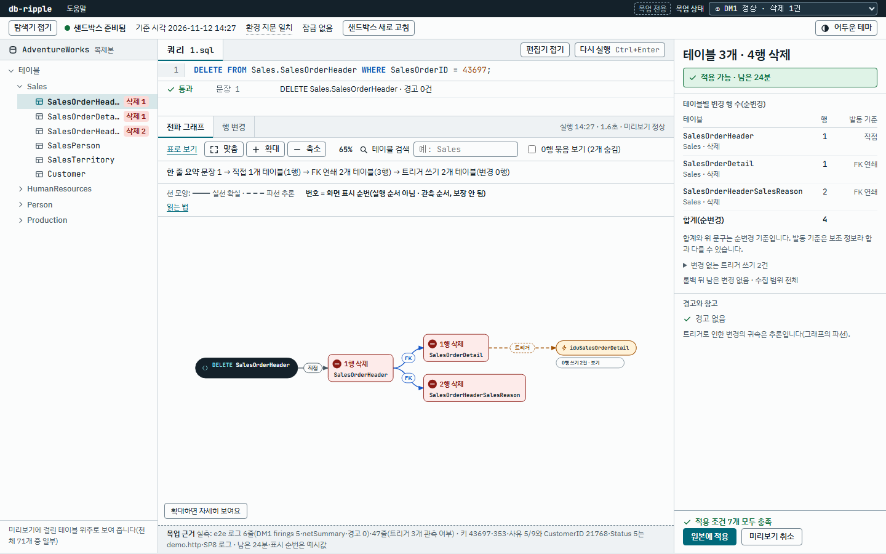
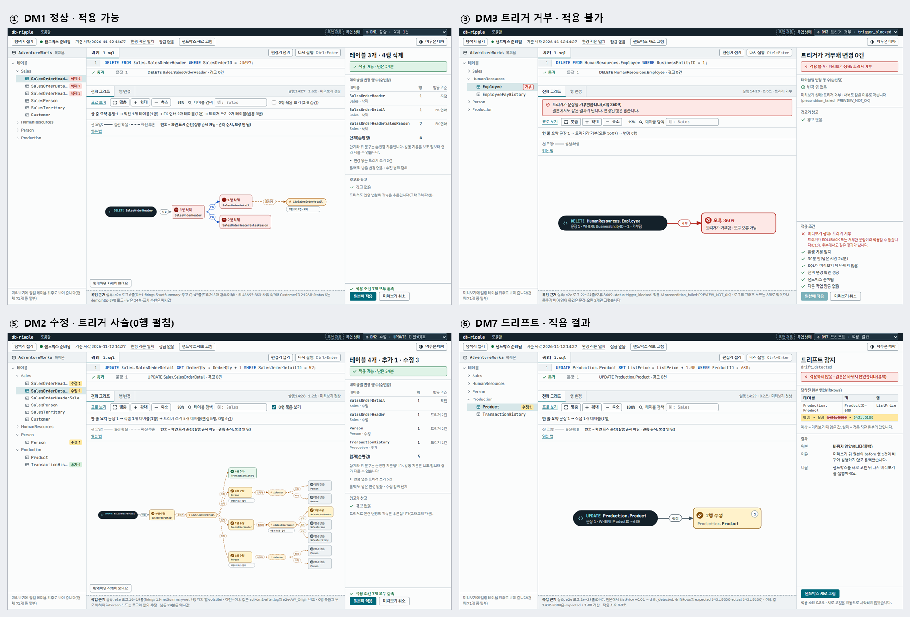
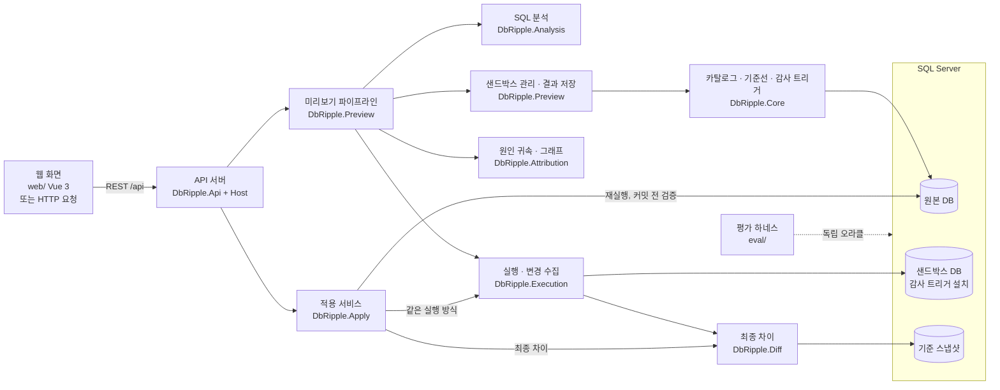

# db-ripple

**SQL Server에서 INSERT·UPDATE·DELETE를 실행하기 전에, 그 문장이 FK 연쇄와 트리거를 타고 어디까지 번지는지 실제 실행으로 보여 주는 도구다.**

복제 DB에서 문장을 먼저 실행해 보고 결과를 세 가지로 보여 준다. 어느 테이블의 어떤 행이 바뀌는지(before/after), 그 변경이 어떤 FK·트리거 때문에 어떤 순서로 퍼졌는지(전파 그래프), 그리고 테이블별 건수와 경고다. 사용자는 그것을 보고 원본에 [적용]하거나 [취소]한다. 결과는 LLM 추론이 아니라 실제 실행에서 나온다.

## 왜 필요한가

`DELETE` 한 줄이 생각보다 많은 것을 바꾼다.

- **FK 연쇄:** 부모 행을 지우면 `ON DELETE CASCADE`로 자식 테이블 행이 같이 지워지고, `SET NULL`·`SET DEFAULT`로 다른 행의 값이 바뀐다.
- **트리거:** 바뀐 테이블의 트리거가 또 다른 테이블을 고치고, 그 테이블의 트리거가 다시 발동한다.
- **보이지 않음:** SSMS에서는 실행해 보기 전에는 이 범위를 알기 어렵다. 트랜잭션을 열고 실행한 뒤 롤백해 봐도, "어느 행이 왜 바뀌었는지"는 테이블마다 직접 조회해서 맞춰 봐야 한다.

예를 들어 AdventureWorks에서 주문 1건을 지우는 문장은 FK 연쇄로 주문 상세 12행을 함께 지우고, 주문 상세의 트리거를 발동시킨다. db-ripple은 이것을 실행 전에 한 화면에 보여 준다.

## 무엇을 보여 주나

- **전파 그래프:** 문장에서 시작해 바뀐 테이블 묶음으로 이어지는 그래프다. 간선마다 원인(FK 연쇄, 트리거, INSTEAD OF, 프로시저 본문의 직접 쓰기)과 확신도(`certain`, `inferred`, `ambiguous`)를 선 모양으로 구분하고, 순서가 보장된 것과 관측된 것뿐인 것을 나눠 표시한다.
- **before/after 표:** 행 단위 변경을 "발동 보기"(묶음마다 일어난 그대로)와 "최종 차이 보기"(실행이 끝난 뒤 순 변경)로 전환해 본다. 바뀐 셀을 강조하고, 실행할 때마다 달라지는 값(IDENTITY, GETDATE 등)은 "예상값", 계산 열은 "파생"으로 표시한다.
- **요약:** 문장별 결과, 테이블별 건수, 거부·경고, 트리거가 트랜잭션 밖에 남긴 변경을 보여 준다.
- **[적용]·[취소]:** [적용]은 원본에서 같은 SQL을 다시 실행하고, 결과가 미리보기와 같을 때만 커밋한다(아래 "[적용]은 어떻게 안전한가").

## 화면

화면은 확정 목업 v6(IDE형 워크벤치)를 따른다. 왼쪽 탐색기, 가운데 SQL 편집기와 결과 탭(전파 그래프 | 행 변경), 오른쪽 요약·[적용] 레일로 이뤄진다. `web/`은 이 목업대로 구현돼 있다.



상태별 화면(정상, 트리거 거부, 트리거 사슬, 드리프트):



- **직접 열어 보기:** [docs/mockups/a-workbench-v6.html](docs/mockups/a-workbench-v6.html)을 내려받아 브라우저로 연다. 오른쪽 위 "목업 상태"로 8개 상태를 바꿔 볼 수 있다. 정적 목업이고, 숫자는 e2e 실측 로그 기준이며 로그에 없는 값은 화면에 "예시값"으로 표시했다.
- **처음 비교한 방향 4종**(워크벤치, 영향 리포트, 그래프 캔버스, 단계 안내): [docs/mockups/index.html](docs/mockups/index.html), [비교 그림](docs/mockups/png/all-4-compare.png)
- **다듬은 과정:** [v1→v2](docs/mockups/png/a-v1-vs-v2.png) · [v2→v3 AI 티 제거](docs/mockups/png/a-v2-vs-v3.png) · [v3→v4 시스템 통일](docs/mockups/png/a-v3-vs-v4.png) · [v4→v5 독립 검토 반영](docs/mockups/png/a-v4-vs-v5.png) · [v5→v6 그래프](docs/mockups/png/a-v5-vs-v6-graph.png)

## 다른 방법과 무엇이 다른가

"트랜잭션 안에서 실행하고 롤백해 결과를 보여 주는" dry-run 기능은 다른 도구에도 있다. db-ripple은 거기서 한 걸음 더 나가, 바뀐 행마다 **왜 바뀌었는지(어떤 FK·트리거 때문인지)와 어떤 순서로 퍼졌는지**를 귀속한다. 확신할 수 없는 귀속은 확신도를 낮추고 후보를 함께 보여 준다.

## 어떻게 작동하나

미리보기 한 번은 다음 순서로 돈다.

1. **분석:** Microsoft ScriptDom으로 SQL을 파싱하고 허용 목록(사용자 테이블 대상 단독 INSERT·UPDATE·DELETE, 그리고 저장 프로시저를 `EXEC 스키마.이름 @매개변수 = 값`으로 부르는 한 문장)만 통과시킨다. DDL, TRUNCATE, MERGE, 트랜잭션 제어, 동적 SQL(`EXEC('…')`, sp_executesql)·변수·제어 흐름, 다른 DB 참조는 실행하지 않고 거부한다(규칙 ID와 위치 포함). 외부 부작용이 있는 트리거가 붙은 테이블은 물론, FK 연쇄나 트리거를 타고 닿는 테이블에 그런 트리거가 있어도 거부한다. 프로시저는 본문을 깊이 4까지 펼쳐 같은 방식으로 본다.
2. **샌드박스(미리 한 번 만들어 둠):** 원본 DB를 복제해 샌드박스 DB를 만들고(기본 설정은 같은 서버, Split을 켜면 내 PC의 Docker 컨테이너), 테이블마다 감사 트리거를 설치한 뒤 데이터베이스 스냅샷(기준선)을 찍는다.
3. **실행:** 전용 연결에서 트랜잭션을 열고, 문장마다 DML 권한만 가진 전용 사용자로 실행한다. FK 연쇄나 사용자 트리거로 바뀐 행은 각 테이블의 감사 트리거(그 테이블에서 마지막에 도는 AFTER 트리거)가 before/after와 순번으로 기록한다.
4. **수집:** 감사 기록에서 "어느 테이블에 어떤 연산이 몇 행, 어떤 깊이로" 일어났는지와 행별 before/after를 재구성한다.
5. **최종 차이:** 같은 트랜잭션 안에서 샌드박스와 기준 스냅샷을 비교한다. 감사가 놓친 변경이 있으면 잔차로 드러난다.
6. **롤백:** 트랜잭션을 롤백해 샌드박스를 원래대로 돌린다. 트리거가 몰래 커밋한 흔적이 보이면 샌드박스를 "오염"으로 표시하고 다음 미리보기 전에 다시 만든다.
7. **원인 귀속:** FK 연쇄는 FK 정의와 키 값 일치로 판정한다(`certain` 또는 `inferred`). 트리거 효과는 트리거 본문(트리거가 부르는 저장 프로시저 포함)이 쓰는 테이블을 정적으로 분석해 추론한다(최고 `inferred`, 후보가 여럿이면 `ambiguous`). EXEC 문장에서 프로시저 본문이 직접 쓴 변경은 `PROC_DIRECT`(`certain`)다.
8. **저장·조회:** 결과를 30분 동안 보관하고 요약·그래프·행 페이지·내보내기를 API로 준다.

이 방식을 고른 까닭과 대안 비교(CDC, 감사 테이블, 트리거 계측 등)는 [설계 문서](docs/architecture.md) §8에 있다.

## [적용]은 어떻게 안전한가

[적용]은 미리보기에서 모은 변경으로 DML을 만들어 내지 않는다. **원본에서 같은 SQL을 같은 방식으로 다시 실행하고, 결과가 미리보기와 같을 때만 커밋한다.**

1. **선행 조건:** 미리보기가 정상이고(잘린 결과가 아님), EXEC 문장이 없고(프로시저 호출의 [적용]은 아직 막혀 있다), SQL이 그대로이고, 30분이 지나지 않았고, 그 사이 기준선과 서버 환경이 바뀌지 않았어야 한다. 아니면 원본에 아무것도 하지 않는다.
2. **원본 스냅샷:** 원본의 데이터베이스 스냅샷을 만든다. 스냅샷을 만들 수 없는 DB(권한 없음, FILESTREAM 등)에서는 약한 검증(`KEYSET_HASH`)으로 낮춘다. 사용자가 동의해야 하고, 테이블 건수·미리보기 키 행 값·미리보기 밖 테이블의 건수와 해시만 비교하므로 놓칠 수 있는 변경을 결과에 적는다. 원본이 TRUSTWORTHY ON이거나 복제·CDC·Service Broker를 쓰면 그 사실도 결과에 경고로 적는다(막지는 않는다).
3. **드리프트 검사:** 미리보기 이후 원본의 해당 행이 바뀌었으면 실행하지 않는다(`drift_detected`).
4. **재실행:** 트랜잭션 안에서 다시 실행한다. 실패하면 롤백하고, 트리거가 트랜잭션 밖에 남긴 변경이 있으면 보여 준다.
5. **커밋 전 검증:** 원본의 최종 차이를 미리보기와 비교한다. 문장별 행 수, 테이블별 건수, 행 값, 새 IDENTITY 행 짝, 미리보기에 없던 테이블, 비결정 열의 형식을 본다. 모두 같으면 커밋하고(`committed`), 하나라도 다르면 롤백한다(`rolled_back_mismatch`).
6. **뒤처리:** 커밋한 미리보기는 다시 적용할 수 없게 지우고 샌드박스 기준선을 새로 고친다. 커밋 도중 연결이 끊겨 결과를 알 수 없으면 그렇게 알리고 재적용을 막는다.

[적용]은 공개 샘플 DB의 "원본 역할 사본"에만 쓴다. 실제 운영 DB는 범위 밖이다.

## 구조



| 프로젝트 | 하는 일 |
|---|---|
| `src/DbRipple.Contracts` | 컴포넌트 사이 공용 타입(DTO, 인터페이스) |
| `src/DbRipple.Core` | 카탈로그 읽기, 기준선(샌드박스·스냅샷) 구축, 감사 트리거 생성·설치 |
| `src/DbRipple.Analysis` | SQL 분석(허용 목록, 거부·경고), 트리거·저장 프로시저 본문 정적 분석 |
| `src/DbRipple.Execution` | 샌드박스 실행, 감사 기록에서 변경 재구성 |
| `src/DbRipple.Diff` | 샌드박스 대 스냅샷 최종 차이 |
| `src/DbRipple.Attribution` | 원인·확신도 판정, 그래프 데이터 |
| `src/DbRipple.Preview` | 미리보기 순서 조립, 샌드박스 상태·잠금, 결과 저장 |
| `src/DbRipple.Apply` | [적용]: 선행 조건, 원본 스냅샷, 드리프트 검사, 재실행, 커밋 전 검증 |
| `src/DbRipple.Api`, `src/DbRipple.Host` | REST API와 실행 파일(웹 서버) |
| `src/DbRipple.Cli` | 기준선 구축·복원 등 명령줄 도구 |
| `web/` | 웹 화면(Vue 3, CodeMirror 6, Vue Flow + dagre, AG Grid Community) |
| `eval/` | 평가 하네스(제품 코드와 독립된 오라클·비교기, 지표 CSV, 대조군, 보고서) |
| `cascadelab/` | 평가용 합성 정답 DB(사례별 SQL과 손으로 쓴 정답) |
| `tests/` | 단위·통합 테스트, 테스트 DB 지원 |

## 실행해 보기

**필요한 것:** Windows, Docker Desktop(WSL2 백엔드), .NET 10 SDK, Node.js, PowerShell. 처음 설치 과정과 주의점은 [docs/dev-setup.md](docs/dev-setup.md)에 있다.

1. **비밀값 파일:** `Copy-Item .env.example .env` 후 `MSSQL_SA_PASSWORD`를 강한 값으로 바꾼다. `.env`는 커밋하지 않는다.
2. **SQL Server 컨테이너:** `.\scripts\db-up.ps1`. SQL Server 2025가 `127.0.0.1:14333`에만 열린다.
3. **AdventureWorks 원본:** `.\scripts\fetch-adventureworks.ps1`로 공식 백업을 받고, `.\scripts\restore-aw-origin.ps1`로 원본 역할 DB `AW_Origin`에 복원한다. 이 스크립트는 [적용]이 쓰는 실행 사용자(로그인 없음, DML 권한만)도 만든다.
4. **API 서버:**

   ```powershell
   . .\scripts\env.ps1
   dotnet run --project src\DbRipple.Host
   ```

   `env.ps1`은 `.env`를 읽어 연결 문자열을 이 프로세스 안에서만 만든다(화면에 출력하지 않는다). 서버는 `http://127.0.0.1:5080`에서 돈다.
5. **웹 화면:** API 서버를 켜 둔 채 다른 PowerShell 창에서 실행한다.

   ```powershell
   cd web
   npm install
   npm run dev
   ```

   브라우저로 `http://localhost:5273`을 연다. 처음 한 번은 위쪽 띠의 [샌드박스 새로 고침]으로 기준선을 만든다. 그다음 편집기에 SQL을 쓰고 Ctrl+Enter를 누르면 전파 그래프, before/after 표, 요약이 나온다. 화면 구성은 [web/README.md](web/README.md)에 있다.

**실행 파일로 쓰기(2026-11-13):** Node·.NET 설치 없이 쓰는 배포본은 `.\scripts\publish.ps1`로 만든다(web 의존성은 미리 설치돼 있어야 한다). 결과는 `artifacts\db-ripple\`(실행 파일 폴더)와 `artifacts\db-ripple-win-x64.zip`이다. 받는 사람은 Docker Desktop만 설치하고, 폴더 안 `README-실행.txt`대로 `docker compose up -d`로 샌드박스를 띄운 뒤 `DbRipple.Host.exe`를 실행한다. 기본 브라우저가 일회용 실행 주소로 열리고(그 창에서만 API를 쓸 수 있다), 처음에는 화면의 설정에서 원본·샌드박스 연결을 저장한다(`%LOCALAPPDATA%\db-ripple\profile.json`, 비밀번호는 이 Windows 계정에서만 풀리게 따로 암호화). 브라우저를 열지 않으려면 `DbRipple.Host.exe --no-browser`로 실행하고 콘솔에 찍힌 주소를 연다. 위 4번의 `dotnet run`은 개발 모드로 돈다. 개발 모드는 환경 변수(`ASPNETCORE_ENVIRONMENT`)가 아니라 실행 인자로 정한다. Debug 빌드이고, `--dev` 인자가 있고, 실행 폴더에 `wwwroot/index.html`이 없을 때만 개발 모드다(`Properties/launchSettings.json`이 `--dev`를 넘긴다). 그 밖에는 환경 변수와 상관없이 실행 파일 모드(환경 이름 Production 고정)다. 개발 모드는 Vite 프록시용이라 실행 토큰을 요구하지 않고 `/openapi`가 열린다. launchSettings를 쓰지 않고 띄우면(`dotnet run --project src\DbRipple.Host --no-launch-profile -- --dev`) `--dev`를 직접 붙여야 한다.

**HTTP로 써 보기(개발 모드):** `/api` 아래의 POST에는 헤더 `X-DbRipple-Request: 1`이 필요하다(아래 "보안"). 실행 파일 모드는 세션마다 다른 요청 키와 쿠키가 있어야 해서 이 방식으로는 부를 수 없다.

```powershell
$h = @{ 'X-DbRipple-Request' = '1' }
$body = @{ sql = 'DELETE FROM Sales.SalesOrderHeader WHERE SalesOrderID = 43659;' } | ConvertTo-Json
$r = Invoke-RestMethod -Method Post -Uri http://127.0.0.1:5080/api/previews -Headers $h -ContentType 'application/json' -Body $body
# 원본에 적용(상태가 committed면 AW_Origin에 실제로 커밋된다. 되돌리려면 restore-aw-origin.ps1로 다시 복원한다)
Invoke-RestMethod -Method Post -Uri "http://127.0.0.1:5080/api/previews/$($r.previewId)/apply" -Headers $h -ContentType 'application/json' -Body (@{ sqlHash = $r.sqlHash } | ConvertTo-Json)
```

요청 예시는 [src/DbRipple.Host/DbRipple.Host.http](src/DbRipple.Host/DbRipple.Host.http)와 데모 대본 [scripts/demo/demo.http](scripts/demo/demo.http)에 더 있다(VS Code REST Client, Rider, Visual Studio에서 바로 보낼 수 있다).

**테스트:**

```powershell
. .\scripts\env.ps1
dotnet test DbRipple.slnx
```

테스트는 `dbrt_` 접두의 임시 DB를 만들고 지운다. 연결 문자열이 없으면(`env.ps1`을 부르지 않으면) DB 테스트는 건너뛰고 단위 테스트만 돈다. 웹 화면은 `cd web; npm run typecheck; npm run build`로 검사한다.

## API

| 메서드·경로 | 하는 일 |
|---|---|
| `GET /api/sandbox` | 샌드박스 상태(building, ready, dirty, error), 기준 시각, 환경 지문 |
| `POST /api/sandbox/refresh` | 기준선 다시 만들기(202) |
| `POST /api/analyze` | SQL 분석만(거부·경고·위치) |
| `POST /api/previews` | 미리보기 실행. 거부면 422와 `rejects[]` |
| `GET /api/previews/{id}` | 결과 요약·발동 묶음·그래프 |
| `GET /api/previews/{id}/rows?view=event\|net` | 행 페이지(발동 보기, 최종 차이 보기, 최대 1000행). `view=net`에는 `&table=스키마.테이블`을 더해 서버에서 그 테이블만 거를 수 있다(`total`도 거른 수) |
| `GET /api/previews/{id}/export` | 결과 JSON 내보내기 |
| `POST /api/previews/{id}/cancel` | 취소(204) |
| `POST /api/previews/{id}/apply` | [적용]. 결과 상태는 `committed`, `rolled_back_mismatch`, `drift_detected`, `precondition_failed`, `error` |
| `GET /api/catalog/schema` | 편집기 자동완성용 스키마(테이블, 열 형식, 키, 수집 범위) |

오류는 ProblemDetails 형식으로 돌려준다: 400 입력 오류, 403 보안 규칙 위반, 409 지금 처리할 수 없음(`reason`: 다른 작업 실행 중, 기준선 구축 중 등), 422 거부된 문장, 500 서버 오류, 503 SQL Server 연결 불가. 계약 타입은 `src/DbRipple.Contracts`에 있다.

**보안:** API는 사용자 인증이 없는 로컬 서버라, 사용자가 연 다른 웹사이트가 이 API를 부르지 못하게 막는다. 개발 모드(`--dev`)에서는 상태를 바꾸는 요청에 전용 헤더(`X-DbRipple-Request: 1`)가 있어야 하고, `Origin`은 허용 목록에 있어야 하며, `Sec-Fetch-Site: cross-site` 요청은 거부한다. 실행 파일 모드는 더 엄격하다. 실행할 때마다 새로 만드는 일회용 실행 주소를 한 번 열어야 세션 쿠키(`dbr_session_<포트>`)가 생기고, 세션마다 다른 요청 키(서버가 `index.html`에 넣어 주고 화면이 헤더 `X-DbRipple-Request`로 보낸다)가 쿠키와 함께 맞아야 한다. 쿠키만으로는 401이다. 보안 헤더(CSP 등)는 모든 응답에 붙고, Host 헤더는 `127.0.0.1`·`localhost`·`[::1]`로 제한한다(DNS 재바인딩 방어). 막지 못하는 것: 같은 Windows 계정으로 도는 다른 프로세스와 브라우저 확장, 그리고 명령줄·브라우저 기록에 남을 수 있는 실행 주소(한 번 쓰면 무효)다.

## 어떻게 평가하나

"미리보기가 실제 실행과 같은가", "연쇄·트리거 변경까지 찾는가", "원인과 순서를 맞게 귀속하는가", "쓸 만한 시간 안에 끝나는가"를 따로 잰다.

- **정답:** 연쇄·트리거 패턴을 하나씩 담은 합성 DB [CascadeLab](cascadelab/README.md)의 손으로 쓴 정답과, 감사 장치가 없는 사본에서 같은 SQL을 실행한 결과(오라클)를 쓴다. 오라클 비교기는 제품 코드와 공유하지 않는 독립 구현이다.
- **지표:** 셀 단위 일치율(M1), 원인별 변경 탐지율(M2), 원인 간선 정확도와 확신도별 과신 오류(M3), 반복 실행 순서 안정성(M4), 행 수별 응답 시간(M5).
- **대조군:** 직접 대상 테이블만 보는 방법(B0)과, 실행 뒤 차이만 보여 주는 방법(B2)을 같은 지표로 잰다.
- **측정한 결과(2026-11-12):** CascadeLab 30개 사례(CL01~CL20)를 20회 반복해 셀 일치 precision·recall 1.0000(1회분 176셀), 변경 탐지 115/115, 원인 간선 recall 1.0000(102/102)·certain 과신 0, 순서 안정 30/30이었다(20회 결과가 모두 같았다). 같은 사례에서 직접 대상만 보는 방법(B0)은 변경 탐지 0.3652, 실행 뒤 차이만 보는 방법(B2)은 원인 간선 recall 0이다. 응답 시간 p50은 1만 행 DELETE 6.1초·UPDATE 0.9초이고, 5만 행부터는 행 이미지 상한을 넘어 키만 보이며 DELETE 43.4초(10만 행 105초)다. 합성 사례 기준이고 정의상 한계는 [docs/evaluation.md](docs/evaluation.md) §8에 있다. EXEC 사례 CL21~CL25(정답 형식 v0.3)는 작성만 했고 평가는 아직 돌리지 않았다.

지표 정의, 측정 방법, 아직 측정하지 않은 항목은 [docs/evaluation.md](docs/evaluation.md)에 있다.

## 한계

- 지원 문장은 단독 INSERT·UPDATE·DELETE와, 저장 프로시저를 `EXEC 스키마.이름 @매개변수 = 값`으로 부르는 한 문장이다. **EXEC는 미리보기만 된다.** EXEC가 든 미리보기의 [적용]은 막힌다(2차 작업). MERGE, 변수·제어 흐름, 동적 SQL은 거부한다. 프로시저는 외부 부작용·동적 SQL·트랜잭션 제어(짝 안 맞는 COMMIT, 저장점)·`@@TRANCOUNT` 분기 등이 있으면 거부하거나 경고하고, 사용자 정의 함수는 CLR·EXECUTE AS·외부 부작용이 없는 T-SQL 함수만 허용하고, 시노님·뷰를 거치는 쓰기는 다루지 못한다.
- 트리거의 원인은 정적 분석으로 추론하므로 최고 확신도가 `inferred`다. 트리거가 부르는 저장 프로시저는 깊이 4까지 펼쳐 보고, 펼치지 못한 것(동적 SQL, 암호화, 다른 DB 등)은 쓰기 대상을 모르는 것으로 본다.
- [적용]은 미리보기가 잘렸으면(행 이미지 상한 초과) 막힌다. 원본 스냅샷을 만들 수 없는 DB에서는 건수 비교로 낮추는데, 이때 행 수가 그대로인 UPDATE는 놓칠 수 있다. 값이 같은 새 IDENTITY 행 여러 개는 IDENTITY 순서로 짝짓는다(같은 문장이 같은 순서로 값을 매긴다는 가정이고, 결과에 적는다).
- 기본 설정(`SingleServer`)에서 샌드박스는 원본과 같은 SQL Server 인스턴스에 있다. 원본이 다른 서버일 때를 위한 Split(원본 서버의 백업을 내 PC의 Docker 샌드박스로 가져옴)은 설정으로 켜며, 실제 서버 두 대로는 아직 확인하지 않았다. 미리보기는 한 번에 하나만 돈다. API에 사용자 인증은 없다(로컬 전용, 실행 파일 모드는 세션 쿠키와 요청 키만).
- 데이터는 공개 샘플 DB(AdventureWorks, CascadeLab)만 쓴다.
- 미리보기와 [적용]은 AdventureWorks 전용 사본에서 실제 서버로 끝까지 확인했다(커밋, 트리거 거부, 드리프트 감지). 큰 DELETE는 행 수보다 시간이 빨리 늘어난다(10만 행 약 105초, 주로 재조회와 원인 귀속). 브라우저 렌더 시간(SP9)은 아직 정식 측정 전이다. 자세한 것은 [docs/evaluation.md](docs/evaluation.md)에 있다.
- 2026-11-13에 더한 것(도달 폐포 거부, EXEC 미리보기, [적용] 검증 보강, Split, 실행 파일·보안)은 정적 검사와 단위 테스트까지만 했다(빌드 경고 0, 단위 테스트 910개 통과, DB 테스트는 건너뜀). 실제 SQL Server로 확인하는 일은 집에서 한다([docs/home-test-plan.md](docs/home-test-plan.md), 아직 실행하지 않음).

## 문서

- [docs/architecture.md](docs/architecture.md): 설계(결정 기록, 데이터 계약, 원인 귀속 규칙, 평가 방법, 위험)
- [docs/evaluation.md](docs/evaluation.md): 평가 보고서(주장, 데이터셋, 지표 정의, 대조군, 결과, 타당성 위협)
- [docs/spikes/](docs/spikes/README.md): 설계 전제를 실제 DB로 확인한 실험 기록(SP11~SP21은 준비만 했고 아직 실행하지 않음)
- [docs/home-test-plan.md](docs/home-test-plan.md): 집에서 DB로 확인할 항목과 순서(미실행)
- [web/README.md](web/README.md): 웹 화면 구성과 실행
- [cascadelab/](cascadelab/README.md): 합성 정답 DB, 손 정답 형식, 정정 기록
- [docs/dev-setup.md](docs/dev-setup.md): 개발 환경 준비
