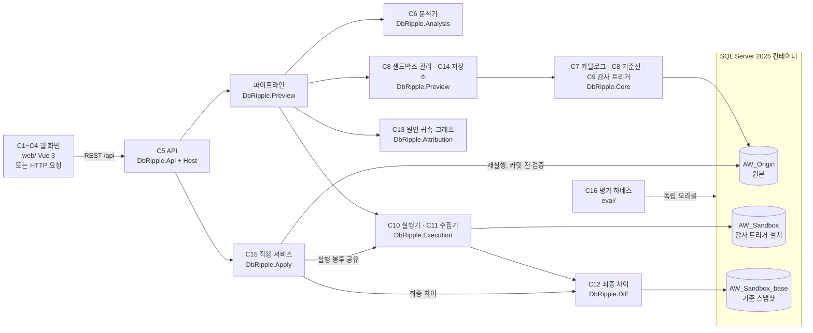

# db-ripple

INSERT·UPDATE·DELETE를 실제 DB에 반영하기 전에 복제 DB에서 먼저 실행해 보고, FK 연쇄와 트리거까지 포함해 어느 테이블의 어떤 행이 바뀌는지 보여 주는 SQL Server용 도구다. 변경이 어떤 FK·트리거 때문에 어떤 순서로 퍼졌는지는 그래프로, 행 값은 before/after로 보여 주고, 사용자가 [적용] 또는 [취소]를 고른다. 결과는 LLM 추론이 아니라 실제 실행에서 나온다.

## 지금 상태 (2026-11-11, 3·4주차 코드 완료, DB 테스트 전)

- **동작 방식:** ASP.NET Core 웹 API 서버(`src/DbRipple.Host`, 기본 주소 `http://127.0.0.1:5080`)와 Vue 3 웹 화면(`web/`)으로 돈다. HTTP 요청(`.http` 파일, `curl`, `Invoke-RestMethod`)으로도 쓸 수 있다.
- **된 것(코드):** SQL 분석, 샌드박스 실행과 변경 수집, 최종 차이, 원인 귀속과 그래프 데이터, 미리보기 저장·조회 API, 웹 화면(편집기·전파 그래프·diff 그리드·요약·적용 패널), [적용](원본 재실행과 커밋 전 검증), 평가 하네스(M1~M5, 대조군 B0·B2, 보고서 생성)
- **확인한 것:** 솔루션 빌드 경고·오류 0, DB 없이 도는 단위 테스트 572개 통과(DB 테스트 55개는 건너뜀), 웹 화면 빌드(타입 검사 포함) 통과
- **아직 안 한 것:** DB 테스트(Apply·CascadeLab CL09~CL20 회귀 등), 실제 Host와 브라우저로 끝까지 해 보기(DM1~DM3, DM7), 평가 실행(M3~M5, B0·B2), SP8·SP9 측정. 그래서 [적용]과 3·4주차 기능은 **실DB에서 동작을 확인하지 않았다.**
- **측정된 평가(2주차, CascadeLab CL01~CL08b 11사례):**
  - M1 셀 일치 precision·recall 1.0000(54/54), 관찰자 효과 E_obs 0
  - M2 변경 탐지 전체 45/45((테이블, 키)당 한 번). 원인별 DIRECT 14/14, FK_CASCADE 20/20, FK_SET_NULL 2/2, FK_SET_DEFAULT 2/2, TRIGGER 9/9
  - 원인 간선 40/40, certain 과신 0은 2주차 회귀 테스트 픽스처 기준이다. 평가 하네스의 M3는 아직 재지 않았다.
  - 결과 파일: `logs/week2/eval/eval-20261110-135700/`. 정리는 [docs/evaluation.md](docs/evaluation.md)
- **데이터:** 공개 샘플 DB만 쓴다. AdventureWorks(공식 백업)와 직접 만든 합성 정답 DB CascadeLab이다.

## 어떻게 작동하나

미리보기 한 번은 다음 순서로 돈다.

1. **분석(C6):** Microsoft ScriptDom으로 SQL을 파싱한다. 허용 목록(기반 사용자 테이블 대상 INSERT·UPDATE·DELETE)만 통과시킨다. DDL, TRUNCATE, MERGE, 트랜잭션 제어, EXEC, 다른 DB 이름, 외부 부작용이 있는 트리거가 붙은 테이블 등은 실행하지 않고 422로 거부한다(규칙 ID와 위치 포함).
2. **샌드박스(C8, 미리 한 번 만들어 둠):**
   - 원본 DB를 COPY_ONLY로 백업해 같은 인스턴스의 샌드박스 DB로 복원한다.
   - 미리보기 실행 사용자(`dbr_preview_user`, DML 권한만)를 만든다.
   - 테이블마다 감사 트리거를 설치한다(C9).
   - 데이터베이스 스냅샷(기준선)을 찍는다.
3. **실행(C10):**
   - 전용 연결에서 트랜잭션을 연다.
   - 문장마다 `EXECUTE AS USER`로 실행하고 `REVERT`한다.
   - FK 연쇄나 사용자 트리거로 바뀐 행은 각 테이블의 감사 AFTER 트리거(마지막 순서로 지정)가 before/after 이미지와 순번으로 기록한다.
4. **수집(C11):** 감사 기록에서 "어느 테이블에 어떤 연산이 몇 행, 어떤 깊이로" 일어났는지(발동 묶음)와 행별 before/after를 재구성한다.
5. **최종 차이(C12):** 같은 트랜잭션 안에서 샌드박스와 기준 스냅샷을 테이블별로 비교한다. 감사가 놓친 변경이 있으면 잔차로 드러난다.
6. **롤백:** 트랜잭션을 ROLLBACK해 샌드박스를 원래대로 돌린다. 트리거가 몰래 COMMIT한 흔적이 보이면 샌드박스를 "오염"으로 표시하고 다음 미리보기 전에 다시 만든다.
7. **원인 귀속(C13):**
   - FK 연쇄는 FK 메타데이터와 키 값 일치로 판정한다(`certain` 또는 `inferred`).
   - 트리거 효과는 트리거 본문의 정적 쓰기 대상으로 추론한다(최고 `inferred`, 후보가 여럿이면 `ambiguous`).
   - 결과로 전파 그래프(문장 → 묶음 → 테이블)와 확신도를 만든다.
8. **저장·조회(C14·C5):** 결과를 30분 동안 보관하고, API로 요약·그래프·행 페이지·내보내기를 준다.

### [적용]

미리보기에서 본 변경을 원본에 반영하는 단계다(C15, `src/DbRipple.Apply`). 수집한 diff로 DML을 만들지 않고, **원본에서 같은 SQL을 같은 실행 봉투로 다시 실행한 뒤 결과가 미리보기와 같을 때만 커밋한다.**

1. **선행 조건:** 미리보기 상태가 ok(잘린 결과 아님), SQL 해시가 같음, 만든 지 30분 안이고 그 뒤 기준선이 바뀌지 않음, 환경 지문이 같음, 원본에 실행 사용자 `dbr_preview_user`가 있음. 하나라도 어기면 원본에 아무것도 하지 않고 `precondition_failed`다.
2. **원본 스냅샷:** 원본의 데이터베이스 스냅샷(`AW_Origin_pre`)을 만든다. 스냅샷을 만들 수 없는 DB일 때만 건수 비교(`KEYSET`)로 낮추고 한계를 결과에 적는다. 이름 충돌·권한 오류는 실행하지 않고 `error`다.
3. **드리프트 검사:** 미리보기의 before 행을 원본에서 잠그며 읽어 비교한다. 다르면 실행하지 않고 `drift_detected`다.
4. **재실행:** 트랜잭션 안에서 문장마다 `EXECUTE AS USER`로 실행한다. 실패하면 롤백하고, 트리거가 트랜잭션 밖에 남긴 변경이 있는지 스냅샷과 비교해 보인다(`error`).
5. **커밋 전 검증:** 원본 대 원본 스냅샷의 최종 차이를 미리보기와 비교한다(문장별 행 수, 테이블별 건수, 행 값, 새 IDENTITY 행 짝, 미리보기에 없는 테이블, 비결정 열의 형식). 모두 같으면 `committed`, 하나라도 다르면 롤백하고 `rolled_back_mismatch`다.
6. **뒤처리:** 커밋한 미리보기는 다시 적용할 수 없게 지우고, 원본이 바뀌었으면 샌드박스 기준선 새로 고침을 시작한다. COMMIT 도중 예외가 나면 커밋됐는지 알 수 없으므로 `error`로 알리고 커밋된 것처럼 재적용을 막는다.

[적용]은 공개 샘플 DB의 "원본 역할 사본"(`AW_Origin`)에만 쓴다. 실제 운영 DB는 범위 밖이다.

이 방식을 고른 까닭과 대안 비교는 [설계 문서](docs/architecture.md) §8에 있다.

## 구조



| 프로젝트 | 컴포넌트 | 하는 일 |
|---|---|---|
| `src/DbRipple.Contracts` | 공용 계약 | 컴포넌트 사이 타입(DTO, 인터페이스) |
| `src/DbRipple.Core` | C7·C8·C9 | 카탈로그 읽기, 기준선 구축, 감사 트리거 생성·설치 |
| `src/DbRipple.Analysis` | C6 | SQL 분석(허용 목록, 거부·경고), 트리거 본문 정적 분석 |
| `src/DbRipple.Execution` | C10·C11 | 샌드박스 실행(트랜잭션, EXECUTE AS), 감사 기록에서 변경 재구성 |
| `src/DbRipple.Diff` | C12 | 샌드박스 대 스냅샷 최종 차이 |
| `src/DbRipple.Attribution` | C13 | 원인·확신도 판정, 그래프 데이터 |
| `src/DbRipple.Preview` | 파이프라인·C8·C14 | 미리보기 순서 조립, 샌드박스 상태·잠금, 결과 저장 |
| `src/DbRipple.Api`, `src/DbRipple.Host` | C5 | REST API(교차 사이트 요청 방어 포함), 실행 파일(웹 서버) |
| `src/DbRipple.Apply` | C15 | [적용]: 선행 조건, 원본 스냅샷, 드리프트 검사, 재실행, 커밋 전 일치 판정 |
| `src/DbRipple.Cli` | 도구 | 기준선 구축·복원 등 명령줄 도구 |
| `web/` | C1~C4 | 웹 화면(Vue 3, CodeMirror 6, Vue Flow + dagre, AG Grid Community) |
| `eval/` | C16 | 평가 하네스(제품 코드와 독립된 오라클·비교기, M1~M5 CSV, 대조군 B0·B2, 보고서 생성) |
| `tests/` | — | 컴포넌트별 테스트, 통합 테스트, 테스트 DB 지원 |

## 실행 방법

**필요한 것:** Windows, Docker Desktop(WSL2 백엔드), .NET 10 SDK, PowerShell. 처음 설치 과정과 주의점은 [docs/dev-setup.md](docs/dev-setup.md)에 있다.

1. **비밀값 파일:** `Copy-Item .env.example .env` 후 `MSSQL_SA_PASSWORD`를 강한 값으로 바꾼다. `.env`는 커밋하지 않는다.
2. **SQL Server 컨테이너:** `.\scripts\db-up.ps1`. 2025 CU10이 `127.0.0.1:14333`에만 열린다.
3. **AdventureWorks 원본:** `.\scripts\fetch-adventureworks.ps1`로 공식 백업을 받고, `.\scripts\restore-aw-origin.ps1`로 `AW_Origin`에 복원한다. 이 스크립트는 복원 뒤 [적용]이 쓰는 원본 실행 사용자 `dbr_preview_user`(로그인 없음, DML 권한만)도 멱등으로 만든다. [적용] 중에는 원본에 DDL을 하지 않으므로, 이 단계를 거치지 않은 원본에서는 [적용]이 `EXECUTE_AS_USER_MISSING`으로 막힌다. 이미 복원한 원본에는 `-PreviewUserOnly`로 이 단계만 하고, 그 뒤 기준선을 새로 고친다(5).
4. **웹 API 서버 실행:** 같은 PowerShell 창에서 실행한다.

   ```powershell
   . .\scripts\env.ps1
   dotnet run --project src\DbRipple.Host
   ```

   `env.ps1`은 `.env`를 읽어 연결 문자열을 이 프로세스 안에서만 만든다(화면에 출력하지 않는다).
5. **기준선 만들기(처음 한 번):** `POST /api/sandbox/refresh`(202)를 보낸 뒤, `GET /api/sandbox`의 `state`가 `ready`가 될 때까지 기다린다. 웹 화면에서는 위쪽 띠의 [샌드박스 새로 고침]으로 한다.
6. **웹 화면:** API 서버(4)를 먼저 켜 둔 채 다른 PowerShell 창에서 실행한다.

   ```powershell
   cd web
   npm install
   npm run dev
   ```

   브라우저로 `http://localhost:5273`을 연다. Vite 개발 서버가 `/api`를 `http://127.0.0.1:5080`으로 넘기므로(프록시, `web/vite.config.ts`) CORS 설정이 필요 없다. 편집기에 SQL을 쓰고 Ctrl+Enter(미리보기)를 누르면 전파 그래프, diff 그리드, 요약이 나온다. [적용]은 미리보기 상태가 ok이고 환경 지문이 같고 30분 안이고 SQL이 그대로일 때만 켜지며, 꺼지면 이유를 보인다. 화면 구성은 [web/README.md](web/README.md)에 있다.
7. **HTTP로 미리보기:** `/api` 아래의 POST에는 헤더 `X-DbRipple-Request: 1`이 필요하다(없으면 403, 아래 API 절).

   ```powershell
   $h = @{ 'X-DbRipple-Request' = '1' }
   $body = @{ sql = 'DELETE FROM Sales.SalesOrderHeader WHERE SalesOrderID = 43659;' } | ConvertTo-Json
   Invoke-RestMethod -Method Post -Uri http://127.0.0.1:5080/api/previews -Headers $h -ContentType 'application/json' -Body $body
   ```

   이 예시는 주문 1건 삭제가 FK 연쇄로 주문 상세 12행 삭제를 일으키는 것을 보여 준다(2주차 Host 실측). 요청 예시는 [src/DbRipple.Host/DbRipple.Host.http](src/DbRipple.Host/DbRipple.Host.http)와 데모 대본 [scripts/demo/demo.http](scripts/demo/demo.http)에 더 있다(VS Code REST Client, Rider, Visual Studio에서 바로 보낼 수 있다).
8. **HTTP로 [적용]:** 미리보기 결과의 `previewId`와 `sqlHash`로 보낸다. 본문은 선택이다.

   ```powershell
   $r = Invoke-RestMethod -Method Post -Uri http://127.0.0.1:5080/api/previews -Headers $h -ContentType 'application/json' -Body $body
   Invoke-RestMethod -Method Post -Uri "http://127.0.0.1:5080/api/previews/$($r.previewId)/apply" -Headers $h -ContentType 'application/json' -Body (@{ sqlHash = $r.sqlHash } | ConvertTo-Json)
   ```

   **주의:** 상태가 `committed`면 `AW_Origin`에 실제로 커밋된다. 원본을 되돌리려면 `restore-aw-origin.ps1`로 다시 복원한다. 이 예시는 DB에서 실행해 보지 않았다.

**테스트:**

```powershell
. .\scripts\env.ps1
dotnet test DbRipple.slnx
```

테스트는 `dbrt_` 접두의 임시 DB를 만들고 지운다. 연결 문자열(`env.ps1`)이 없으면 DB 테스트는 건너뛴다. 2026-11-11 기준 DB 없이 도는 단위 테스트 572개가 통과한다(DB 테스트 55개는 건너뜀). DB 테스트를 포함한 전체 실행은 3·4주차 코드에 대해 아직 하지 않았다(2주차 끝에는 484개 통과, SP7 1개 건너뜀). [적용]의 DB 테스트는 `-p:ApplyIntegration=true`로 빌드해야 들어간다.

**웹 화면 검사:**

```powershell
cd web
npm run typecheck   # vue-tsc --noEmit
npm run build       # 타입 검사 + vite build(dist/)
```

**평가:** 옵션은 [eval/DbRipple.Eval.Cli/Program.cs](eval/DbRipple.Eval.Cli/Program.cs) 첫 주석에 있다. 하네스는 공유 DB를 건드리지 않고 `dbrt_eval_*` 전용 DB를 만들고 끝에 지운다.

```powershell
. .\scripts\env.ps1
# CascadeLab 사례 전부를 제품(preview)과 대조군 B0·B2로 20회씩
dotnet run --project eval\DbRipple.Eval.Cli -- cascadelab --systems preview,B0,B2 --repeat 20 --out logs\week4\eval
# M5 응답 시간(CL20 계열, N마다 워밍업 1회 + 5회)
dotnet run --project eval\DbRipple.Eval.Cli -- m5 --sizes 1,100,1000,10000,50000,100000 --out logs\week4\m5
# CSV만 읽어 report.md 만들기(DB 연결 없음)
dotnet run --project eval\DbRipple.Eval.Cli -- report --run logs\week4\eval\<실행 id> --m5 logs\week4\m5\<실행 id>
```

- `cascadelab`: 실행마다 새 폴더에 `cases.csv`, `m1.csv`, `m2.csv`, `m3.csv`, `m4.csv`, `metrics.csv`, `env.json`, `differences.txt`가 생긴다. `--cases CL01,CL02`로 사례를 고를 수 있다.
- `m5`: `m5.csv`, `env.json`. 브라우저 렌더 열은 비어 있고 SP9 측정값을 손으로 옮긴다.
- `report`: `report.md`. 열 정의는 [eval/DbRipple.Eval/MetricsCsv.cs](eval/DbRipple.Eval/MetricsCsv.cs) 주석에 있다.
- 3·4주차 명령은 아직 실행하지 않았다. 결과를 담을 틀은 [docs/evaluation.md](docs/evaluation.md)다.

## API

| 메서드·경로 | 하는 일 |
|---|---|
| `GET /api/sandbox` | 샌드박스 상태(building, ready, dirty, error), 기준 시각, 환경 지문 |
| `POST /api/sandbox/refresh` | 기준선 다시 만들기(202) |
| `POST /api/analyze` | SQL 분석만(거부·경고·위치) |
| `POST /api/previews` | 미리보기 실행. 거부면 422와 `rejects[]` |
| `GET /api/previews/{id}` | 결과 요약·발동 묶음·그래프 |
| `GET /api/previews/{id}/rows?view=event\|net` | 행 페이지(발동 보기, 최종 차이 보기, 최대 1000행) |
| `GET /api/previews/{id}/export` | 결과 JSON 내보내기 |
| `POST /api/previews/{id}/cancel` | 취소(204) |
| `POST /api/previews/{id}/apply` | [적용]. 본문은 선택 `{ "sqlHash": "sha256:…" }`. 상태 5종(`committed`, `rolled_back_mismatch`, `drift_detected`, `precondition_failed`, `error`) 모두 200 `ApplyResult`, 미리보기가 없거나 만료·이미 커밋했으면 404 |
| `GET /api/catalog/schema` | 편집기 자동완성용 스키마(테이블, 열, `sqlType` 예 `decimal(19,4)`, 키, 수집 범위, 비결정 열). `baselineAt`이 캐시 키다 |

오류는 ProblemDetails 형식으로 돌려준다. 계약 타입은 `src/DbRipple.Contracts`에 있다.

| 상태 | 뜻 |
|---|---|
| 400 | 입력 오류(빈 SQL, 길이 초과, 잘못된 페이지 값) |
| 403 | 교차 사이트 요청 방어에 걸림(아래) |
| 409 | 지금 처리할 수 없음. 확장 속성 `reason`: `LOCKED`(다른 미리보기·적용 실행 중), `BUILDING`(기준선 구축 중), `NO_BASELINE`(기준선 없음), `FINGERPRINT_MISMATCH`(원본·샌드박스 환경 지문 다름), `DIRTY`(다시 만들어도 오염) |
| 422 | 분석에서 거부된 문장이 있음(`rejects[]`) |
| 500 | 서버 내부 오류 |
| 503 | SQL Server에 연결할 수 없음 |

**교차 사이트 요청 방어:** API는 인증이 없는 로컬 서버라, 사용자가 연 다른 웹사이트가 이 API를 부르지 못하게 막는다(`src/DbRipple.Api/Middleware/CrossSiteRequestGuard.cs`).
- `/api` 아래의 POST·PUT·PATCH·DELETE에는 헤더 `X-DbRipple-Request: 1`이 있어야 한다. 웹 화면은 모든 요청에 붙인다. `.http` 파일과 위 PowerShell 예시도 붙인다.
- `Origin` 헤더가 있으면 허용 목록(appsettings.json `DbRipple:AllowedOrigins`, 기본 `http://127.0.0.1:5273`, `http://localhost:5273`, `http://127.0.0.1:5080`, `http://localhost:5080`)에 있어야 한다. `Sec-Fetch-Site: cross-site`도 막는다.
- appsettings.json `"AllowedHosts": "127.0.0.1;localhost"`로 Host 헤더를 제한해 DNS 재바인딩으로 다른 사이트가 GET 응답을 읽는 것을 막는다.
- GET은 헤더 없이 된다. 같은 PC에서 브라우저 밖 프로그램이 헤더를 붙여 보내는 것은 막지 못한다.

## 문서

- [docs/architecture.md](docs/architecture.md): 설계 v1.5(결정 기록, 데이터 계약, 원인 귀속 규칙, 평가 방법, 위험)
- [docs/evaluation.md](docs/evaluation.md): 평가 보고서(주장, 데이터셋, 지표 정의, 대조군, 측정한 결과와 측정 전 항목, 타당성 위협)
- [docs/week2-plan.md](docs/week2-plan.md): 2주차 계획·결과·결정 27건·3주차 인계
- [docs/week3-plan.md](docs/week3-plan.md): 3·4주차 계획·결과·결정(AD6~AD11, Q24·Q28~Q42)·테스트 라운드 우선순위
- [docs/spikes/](docs/spikes/README.md): 설계 전제를 실측한 기록(SP0~SP7, SP10)과 SP8·SP9 준비 상태
- [web/README.md](web/README.md): 웹 화면 구성과 실행
- [cascadelab/](cascadelab/README.md): 합성 정답 DB와 손 정답, 정정 기록
- [docs/dev-setup.md](docs/dev-setup.md): 개발 환경 준비

## 한계

- 3·4주차 코드(웹 화면, [적용], 프로시저 펼치기, M3~M5·대조군)는 DB와 실제 브라우저에서 아직 확인하지 않았다. 테스트 라운드 순서는 [docs/week3-plan.md](docs/week3-plan.md) "결과" 절에 있다.
- 지원 문장은 단독 INSERT·UPDATE·DELETE다. MERGE, 변수·제어 흐름, 프로시저 호출은 거부한다.
- 트리거의 원인은 정적 분석으로 추론하므로 최고 확신도가 `inferred`다. 트리거가 부르는 저장 프로시저는 본문을 깊이 4까지 펼쳐 쓰기 대상에 합치고, 펼치지 못한 프로시저(동적 SQL, 암호화, 다른 DB 등)만 쓰기 대상 미상으로 본다.
- [적용]은 미리보기가 잘렸으면(행 이미지 상한 초과) 막힌다. 원본 스냅샷을 만들 수 없는 DB에서는 건수 비교(`KEYSET`)로 낮추는데, 이때 행 수가 그대로인 UPDATE는 놓칠 수 있다. 비결정 열을 뺀 값이 같은 새 IDENTITY 행 여러 개는 IDENTITY 순서로 짝짓는다(같은 문장이 같은 순서로 값을 매긴다는 가정, 결과에 적는다).
- [적용]이 트리거 거부로 끝났을 때 롤백 뒤 남은 변경 검사는 그 사이 다른 세션이 원본에 커밋한 변경까지 잡을 수 있다(추정).
- 샌드박스가 원본과 같은 SQL Server 인스턴스에 있고, 미리보기는 한 번에 하나만 돈다. API에 인증은 없다(로컬 전용).
- 평가 수치는 2주차 CascadeLab CL01~CL08b의 M1·M2만 있다. AdventureWorks, CL09~CL20, M3~M5, 대조군은 측정 전이다.
