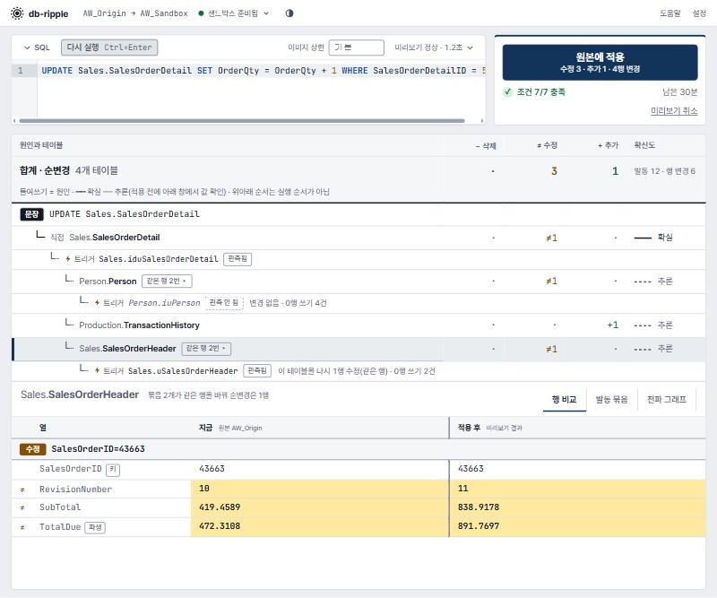
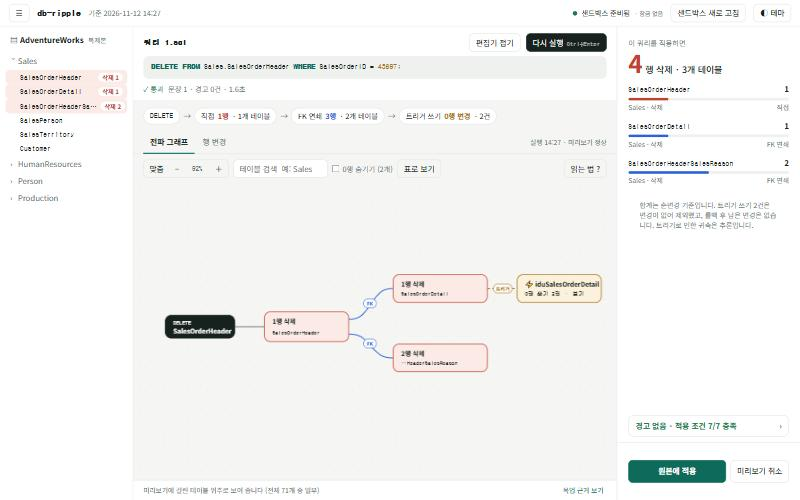
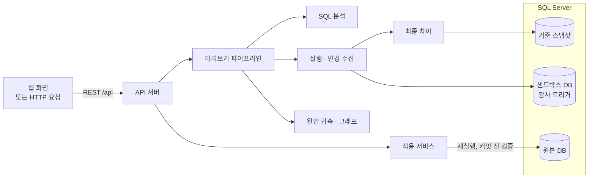

# db-ripple

**SQL Server에서 INSERT·UPDATE·DELETE나 저장 프로시저 호출을 실행하기 전에, 그 문장이 FK 연쇄와 트리거를 타고 어디까지 번지는지 실제 실행으로 보여 주고, 결과가 같을 때만 원본에 적용하는 도구.**

[](https://github.com/yoyowasi/db-ripple/actions/workflows/ci.yml)


[개요](#개요) • [기능](#기능) • [시작하기](#시작하기) • [사용법](#사용법) • [작동 방식](#작동-방식) • [문서](#문서)



> [!NOTE]
> 공개 샘플 DB(AdventureWorks, 합성 DB CascadeLab)로 개발·검증한 도구다. 실제 운영 DB는 대상이 아니다.

## 개요

`DELETE` 한 줄이 생각보다 많은 것을 바꾼다. 부모 행을 지우면 `ON DELETE CASCADE`로 자식 행이 같이 지워지고, 바뀐 테이블의 트리거가 또 다른 테이블을 고친다. `BEGIN TRAN` → 실행 → `ROLLBACK`으로 확인하려면 어느 테이블을 볼지 사람이 미리 알아야 하고, 어떤 FK나 트리거 때문에 바뀌었는지는 나오지 않는다.

db-ripple은 원본을 복제한 샌드박스 DB에서 문장(또는 저장 프로시저 호출)을 먼저 실행하고, 결과를 한 화면에 보여 준다.

- **무엇이 바뀌나:** 모든 테이블의 행 단위 before/after
- **왜 바뀌었나:** 각 변경을 일으킨 문장·FK·트리거와 전파 단계(원인 트리, 전파 그래프)
- **얼마나 바뀌나:** 테이블별 건수, 거부·경고

사용자는 그것을 보고 원본에 [적용]하거나 [취소]한다. [적용]은 원본에서 같은 SQL을 다시 실행하고, 결과가 미리보기와 같을 때만 커밋한다.

예를 들어 AdventureWorks에서 주문 1건을 지우면, FK 연쇄로 주문 상세 12행이 함께 지워지고 주문 상세의 트리거가 발동하는 것까지 실행 전에 보인다.

## 기능

- **원인 트리:** 바뀐 테이블을 한 줄씩, 원인대로 들여써 보인다(문장 → 직접·FK 연쇄·프로시저 쓰기 → 트리거 → 그 트리거가 바꾼 테이블). 숫자는 순변경이라 열을 더하면 맨 위 합계와 같다. 같은 행을 여러 원인이 바꾼 테이블은 펼쳐서 모든 경로를 본다. 선 모양으로 확신도(`certain` 확실, `inferred` 추론, `ambiguous` 모호, 원인 후보가 없으면 `unexplained`)를 구분하고, 감사 로그에 흔적이 없는 트리거는 "관측 안 됨"으로 흐리게 남긴다.
- **행 비교:** 고른 테이블의 행을 "지금(원본) | 적용 후"로 나란히 보인다. 바뀐 셀을 강조하고, 실행마다 달라지는 값(IDENTITY, GETDATE 등)은 "예상값", 계산 열은 "파생"으로 표시한다.
- **발동 묶음·전파 그래프:** 아래 창의 보조 탭. 발동 묶음 표는 "발동 보기"(묶음마다 일어난 그대로)와 "최종 차이 보기"(실행이 끝난 뒤 순변경)를 전환하고, 전파 그래프는 문장에서 바뀐 테이블 묶음까지의 간선마다 원인(FK 연쇄, 트리거, INSTEAD OF, 프로시저 본문의 직접 쓰기)과 확신도를 그린다.
- **안전 검사:** DDL, TRUNCATE, MERGE, 트랜잭션 제어, 동적 SQL, 다른 DB 참조, 외부 부작용이 있는 트리거에 닿는 문장은 실행하지 않고 규칙 ID와 위치를 붙여 거부한다.
- **저장 프로시저 호출:** `EXEC 스키마.이름 @매개변수 = 값` 형태의 호출(매개변수는 이름을 붙인 리터럴 값만)은 본문을 깊이 4까지 펼쳐 같은 방식으로 미리 보고 [적용]한다. [적용] 전에 원본의 실행 권한과, 미리보기 이후 프로시저 정의가 바뀌지 않았는지 확인한다.
- **검증 후 커밋:** [적용]은 원본 스냅샷, 드리프트 검사, 재실행, 커밋 전 비교를 거친다. 하나라도 다르면 롤백한다.
- **원격 원본(Split):** 원본 서버의 백업을 내 PC의 Docker 샌드박스로 가져와 미리 본다.
- **실행 파일:** Node·.NET 없이 Docker Desktop만으로 쓰는 Windows 배포본을 만들 수 있다.
- **PostgreSQL(미리보기만):** PostgreSQL 16~18에서 INSERT·UPDATE·DELETE를 같은 화면으로 미리 본다. 원인 트리·행 비교·문장별 결과는 같고, [적용]과 프로시저 호출(`CALL`)은 아직 없다.

## 시작하기

**필요한 것:** Windows, [Docker Desktop](https://www.docker.com/products/docker-desktop/)(WSL2 백엔드), [.NET 10 SDK](https://dotnet.microsoft.com/download), [Node.js](https://nodejs.org/), PowerShell. 처음 설치 과정과 주의점은 [docs/dev-setup.md](docs/dev-setup.md)에 있다.

1. **비밀값 파일을 만든다.** `.env`는 커밋하지 않는다.

   ```powershell
   Copy-Item .env.example .env   # MSSQL_SA_PASSWORD를 강한 값으로 바꾼다
   ```

2. **SQL Server 컨테이너를 띄운다.** SQL Server 2025가 `127.0.0.1:14333`에만 열린다.

   ```powershell
   .\scripts\db-up.ps1
   ```

3. **AdventureWorks 원본을 준비한다.** 공식 백업을 받아 원본 역할 DB `AW_Origin`에 복원한다. [적용]이 쓰는 실행 사용자(로그인 없음, DML 권한만)도 이때 만든다.

   ```powershell
   .\scripts\fetch-adventureworks.ps1
   .\scripts\restore-aw-origin.ps1
   ```

4. **API 서버를 켠다.** `env.ps1`은 `.env`를 읽어 연결 문자열을 이 프로세스 안에서만 만든다. 서버는 `http://127.0.0.1:5080`에서 돈다.

   ```powershell
   . .\scripts\env.ps1
   dotnet run --project src\DbRipple.Host
   ```

5. **웹 화면을 켠다.** 다른 PowerShell 창에서 실행하고 `http://localhost:5273`을 연다.

   ```powershell
   cd web
   npm install
   npm run dev
   ```

### 실행 파일로 쓰기

```powershell
.\scripts\publish.ps1   # web 의존성은 미리 설치돼 있어야 한다
```

결과는 `artifacts\db-ripple\`와 `artifacts\db-ripple-win-x64.zip`이다. 받는 사람은 Docker Desktop만 설치하고, 폴더 안 `README-실행.txt`대로 `docker compose up -d`로 샌드박스를 띄운 뒤 `DbRipple.Host.exe`를 실행한다.

- 기본 브라우저가 일회용 실행 주소로 열린다. 그 창에서만 API를 쓸 수 있다.
- 처음에는 화면의 설정에서 원본·샌드박스 연결을 저장한다(`%LOCALAPPDATA%\db-ripple\profile.json`, 비밀번호는 이 Windows 계정에서만 풀리게 암호화).
- 브라우저를 열지 않으려면 `DbRipple.Host.exe --no-browser`로 실행하고 콘솔에 찍힌 주소를 연다.
- 개발 모드(`dotnet run`)와 실행 파일 모드를 가르는 규칙은 [설계 문서 §3.2](docs/architecture.md)에 있다.

### PostgreSQL로 쓰기

샌드박스는 원본과 같은 PostgreSQL 서버에 원본 DB를 TEMPLATE으로 복제해 만든다. 연결은 환경 변수로만 정한다(설정 화면에는 저장하지 않는다). 4번처럼 API 서버를 켜기 전에 같은 창에서 설정한다.

```powershell
$env:DBRIPPLE_ENGINE = 'Postgres'
$env:DBRIPPLE_PG_CONNECTION = 'Host=127.0.0.1;Port=5432;Username=<관리 계정>;Password=<비밀번호>;Database=postgres'
$env:DbRipple__Pg__OriginDb = 'shop'   # 원본 DB 이름(소문자·숫자·밑줄만)
dotnet run --project src\DbRipple.Host
```

- 관리 계정은 superuser가 아닌 CREATEDB·CREATEROLE 계정을 권장한다.
- 도구는 미리보기용 LOGIN 역할(기본 `dbr_preview`)을 만든다. 사용자 문장은 그 역할로 로그인한 연결에서 돈다. 그래서 서버 `pg_hba.conf`가 그 역할의 비밀번호(SCRAM) 로그인을 허용해야 한다.
- 원본 DB에 다른 연결이 열려 있으면 PostgreSQL이 복제를 거절한다(55006). 도구는 그 연결을 끊지 않고, 메뉴 줄의 샌드박스 상태를 펼치면 실패 이유를 보인다.
- 범위와 설계는 [PostgreSQL 최소판 설계](docs/superpowers/specs/2026-11-18-postgres-preview-minimal.md)에 있다.

## 사용법

### 화면에서

1. 처음 한 번은 위쪽 메뉴 줄의 **[샌드박스 새로 고침]** 으로 기준선을 만든다.
2. 편집기에 SQL을 쓰고 **Ctrl+Enter** 를 누른다.
3. 가운데 **원인 트리**에서 무엇이 왜 바뀌는지 보고, 줄을 골라 아래 창에서 그 테이블의 행을 비교한다. 묶음 단위로 보려면 아래 창의 **[발동 묶음]**·**[전파 그래프]** 탭을 쓴다.
4. 오른쪽 위 **[원본에 적용]** 또는 **[미리보기 취소]** 를 누른다. [원본에 적용]은 확인 상자에서 원본 DB 이름을 입력해야 확정되고, 확정 단추의 문구는 결과에 따라 "원본에서 N행 삭제"처럼 바뀐다. 이 문서에서 [적용]·[취소]라고 부르는 것이 이 두 단추다.

화면 구성은 [web/README.md](web/README.md)에 있다.

지금 화면의 색·상태 표시·움직임은 2026-11-23 리디자인 시안 [docs/mockups/r3/db-ripple-redesign.html](docs/mockups/r3/db-ripple-redesign.html)([개선안 설명](docs/mockups/r3/db-ripple-redesign.md))에서 왔다. 시안은 옛 3분할 화면(탐색기 · 전파 그래프 · 요약)을 바탕으로 그려졌고, 실제 화면은 원인 트리 구조를 그대로 두고 색, 초록 점 상태 한 줄, 전파 단계 칩, 큰 합계 숫자, 행 수 막대, 그래프 순차 등장, "읽는 법 ?" 팝오버를 옮겼다. 원본 적용 확인은 시안의 인라인 2단계 대신 원본 DB 이름을 입력하는 확인 상자를 그대로 쓴다.



화면 구조(원인 트리)의 바탕인 목업은 [docs/mockups/r2/](docs/mockups/r2/index.html)에 있다(`3-compare.html`과 다른 시안 3종, 옛 화면 검토). 그 전 라운드 시안은 [docs/mockups/](docs/mockups/index.html)에 남아 있다.

### HTTP로

개발 모드에서는 `/api` 아래의 POST에 헤더 `X-DbRipple-Request: 1`을 붙인다.

```powershell
$h = @{ 'X-DbRipple-Request' = '1' }
$body = @{ sql = 'DELETE FROM Sales.SalesOrderHeader WHERE SalesOrderID = 43659;' } | ConvertTo-Json
$r = Invoke-RestMethod -Method Post -Uri http://127.0.0.1:5080/api/previews -Headers $h -ContentType 'application/json' -Body $body

# 원본에 적용
Invoke-RestMethod -Method Post -Uri "http://127.0.0.1:5080/api/previews/$($r.previewId)/apply" -Headers $h -ContentType 'application/json' -Body (@{ sqlHash = $r.sqlHash } | ConvertTo-Json)
```

> [!WARNING]
> 두 번째 요청은 결과가 `committed`이면 `AW_Origin`에 실제로 커밋한다. 되돌리려면 `restore-aw-origin.ps1`로 다시 복원한다.

원본에 데이터베이스 스냅샷을 만들 수 없는 환경이면 [적용] 본문에 `allowKeysetVerification = $true`를 더해야 건수·해시 비교(`KEYSET_HASH`)로 낮춰 검증한다. 빼면 `precondition_failed`로 끝난다.

요청 예시는 [DbRipple.Host.http](src/DbRipple.Host/DbRipple.Host.http)와 데모 대본 [demo.http](scripts/demo/demo.http)에 더 있다.

### API

| 메서드·경로 | 하는 일 |
|---|---|
| `GET /api/sandbox` | 샌드박스 상태(building, ready, dirty, error)와 실패 이유, 기준 시각, 환경 지문, 엔진 |
| `POST /api/sandbox/refresh` | 기준선 다시 만들기(202) |
| `POST /api/analyze` | SQL 분석만(거부·경고·위치) |
| `POST /api/previews` | 미리보기 실행. 거부면 422와 `rejects[]` |
| `GET /api/previews/{id}` | 결과 요약·발동 묶음·그래프 |
| `GET /api/previews/{id}/rows?view=event\|net` | 행 페이지(최대 1000행). `view=net`에 `&table=스키마.테이블`로 한 테이블만 거른다 |
| `GET /api/previews/{id}/export` | 결과 JSON 내보내기 |
| `POST /api/previews/{id}/cancel` | 취소(204) |
| `POST /api/previews/{id}/apply` | [적용]. 결과는 `committed`, `rolled_back_mismatch`, `drift_detected`, `precondition_failed`, `error` |
| `GET /api/catalog/schema` | 편집기 자동완성용 스키마 |
| `GET`·`PUT /api/settings`, `POST /api/settings/test` | 원본·샌드박스 연결 조회·저장·시험(비밀값은 돌려주지 않는다) |

오류는 ProblemDetails 형식이다(400 입력 오류, 401 실행 파일 모드 세션 불일치, 403 보안 규칙 위반, 404 없는 미리보기, 409 다른 작업 실행 중 등, 422 거부된 문장, 501 PostgreSQL에서 [적용], 503 DB 연결 불가). 계약 타입은 `src/DbRipple.Contracts`에 있다.

API는 사용자 인증이 없는 로컬 서버다. 다른 웹사이트가 부르지 못하게 개발 모드는 전용 헤더·`Origin` 허용 목록·`Sec-Fetch-Site` 검사를, 실행 파일 모드는 일회용 실행 주소로 만든 세션 쿠키와 세션별 요청 키를 요구한다. Host 헤더는 `127.0.0.1`·`localhost`·`[::1]`만 받는다. 자세한 것은 [설계 문서 §6.4](docs/architecture.md)에 있다.

## 작동 방식



1. **분석:** Microsoft ScriptDom으로 SQL을 파싱하고 허용된 문장만 통과시킨다.
2. **샌드박스:** 원본을 COPY_ONLY 백업으로 복제하고, 테이블마다 감사 트리거를 설치한 뒤 데이터베이스 스냅샷(기준선)을 찍는다. 기본은 원본과 같은 서버, Split이면 내 PC의 Docker 컨테이너다.
3. **실행:** 트랜잭션 안에서 DML 권한만 가진 전용 사용자로 실행한다. FK 연쇄나 트리거로 바뀐 행은 감사 트리거가 before/after와 순번으로 기록한다. 실행 뒤 감사 기록의 키로 지금 행을 다시 읽어 감사 기록과 맞는지 대조한다(재조회, DELETE로만 나온 키는 건너뛴다).
4. **최종 차이:** 같은 트랜잭션 안에서 샌드박스와 기준 스냅샷을 비교해, 감사가 놓친 변경이 없는지 확인한다.
5. **롤백:** 샌드박스를 원래대로 돌린다. 트리거가 트랜잭션 밖에 남긴 변경이 있으면 샌드박스를 다시 만든다.
6. **원인 귀속:** FK 연쇄는 FK 정의와 키 값으로 판정한다. 트리거 효과는 트리거 본문이 쓰는 테이블을 정적으로 분석해 추론한다(최고 `inferred`).

[적용]은 원본에서 스냅샷을 만들고(만들 수 없으면 사용자 동의를 받아 건수·해시 비교로 낮춘다), 미리보기 이후 원본이 바뀌었는지 확인한 뒤, 같은 SQL을 트랜잭션 안에서 다시 실행한다. 문장별 행 수, 테이블별 건수, 행 값이 미리보기와 모두 같을 때만 커밋한다. 저장 프로시저 호출이면 원본 실행 주체의 실행 권한과, 호출하는 프로시저(펼친 중첩 프로시저 포함)의 정의가 기준선과 같은지 먼저 확인하고(모듈 서명된 프로시저는 막는다), 실행 직전과 커밋 직전에 정의를 다시 확인한다. 반환 값과 결과 집합 수도 미리보기와 대조한다.

PostgreSQL은 같은 흐름을 쓰되 샌드박스를 TEMPLATE으로 복제하고, 문장 단위 감사 트리거의 전이 테이블로 변경을 모으며, 최종 차이를 감사 기록으로 계산한다(기준 스냅샷 없음).

설계 결정과 대안 비교는 [docs/architecture.md](docs/architecture.md)에 있다.

### 프로젝트 구성

| 경로 | 하는 일 |
|---|---|
| `src/DbRipple.Contracts` | 컴포넌트 사이 공용 타입 |
| `src/DbRipple.Core` | 카탈로그 읽기, 기준선 구축, 감사 트리거 생성·설치 |
| `src/DbRipple.Analysis` | SQL 허용 목록, 트리거·프로시저 본문 정적 분석 |
| `src/DbRipple.Execution` | 샌드박스 실행, 감사 기록에서 변경 재구성 |
| `src/DbRipple.Diff` | 샌드박스 대 스냅샷 최종 차이 |
| `src/DbRipple.Attribution` | 원인·확신도 판정, 그래프 데이터 |
| `src/DbRipple.Preview` | 미리보기 순서 조립, 샌드박스 상태, 결과 저장 |
| `src/DbRipple.Apply` | [적용] 검증과 커밋 |
| `src/DbRipple.Postgres` | PostgreSQL 미리보기(샌드박스 복제, 감사, 문장 분석, 실행) |
| `src/DbRipple.Api`, `src/DbRipple.Host` | REST API와 실행 파일(웹 서버) |
| `src/DbRipple.Cli` | 기준선 구축·복원 명령줄 도구 |
| `web/` | 웹 화면(Vue 3, CodeMirror 6, Vue Flow, AG Grid Community) |
| `eval/` | 평가 하네스(독립 오라클·비교기, 대조군) |
| `cascadelab/` | 평가용 합성 정답 DB |
| `tests/` | 단위·통합 테스트 |

## 테스트와 평가

```powershell
. .\scripts\env.ps1
dotnet test DbRipple.slnx
```

테스트는 `dbrt_` 접두의 임시 DB를 만들고 지운다. `env.ps1`을 부르지 않으면 DB 테스트는 건너뛰고 단위 테스트만 돈다. PostgreSQL 통합 테스트는 `DBRIPPLE_PG_TEST_CONNECTION`(superuser가 아닌 계정, 관리용 DB `postgres`)이 있을 때만 돈다. 웹 화면은 `cd web; npm run typecheck; npm run build`로 검사한다.

GitHub Actions CI는 PR과 main마다 다음을 돌린다.
- .NET 빌드·테스트, 웹 빌드, PowerShell 5.1 스크립트 회귀
- SQL Server 2025 컨테이너 DB 테스트와 기본 평가
- PostgreSQL 16·17·18 통합 테스트

그 밖에 두 가지는 따로 돈다.
- Split 모드의 EXEC [적용](원본 SQL Server 2022 + 샌드박스 2025): 관련 파일이 바뀐 PR과 수동 실행에서 확인한다(`split-exec.yml`).
- 정식 20회 평가: CI 수동 실행의 `eval_repeat`로 돌린다.

평가는 합성 DB [CascadeLab](cascadelab/README.md)의 손 정답과, 감사 장치 없는 사본에서 같은 SQL을 실행한 결과(오라클)로 한다.
- 2026-11-12 측정: 사례 30개를 20회 반복해 셀 일치 176/176, 변경 탐지 115/115, 원인 간선 102/102였다.
- 다른 방법과의 비교(변경 탐지): 직접 대상 테이블만 보는 방법은 0.3652, FK 정의만 따라가는 방법은 0.7391이었다(2026-11-19, 20회).
- 큰 DELETE(CL20)는 2026-11-25 재측정에서 1만·5만·10만 행의 total p50이 각각 2.6·10.6·16.6초였다(GitHub Actions, vCPU 4개).

지표 정의와 전체 결과는 [docs/evaluation.md](docs/evaluation.md)에 있다.

## 지원 범위

- **문장:** INSERT·UPDATE·DELETE(여러 문장, `GO`로 나눈 배치 가능)와 저장 프로시저를 부르는 `EXEC`. SELECT, MERGE, OUTPUT 절, 변수·제어 흐름, 동적 SQL은 거부한다.
- **[적용]:** 미리보기가 잘리지 않았을 때, 미리보기 후 30분 안에. 바뀐 행 이미지가 10만 개를 넘으면 키만 수집해 [적용]이 막힌다(UPDATE는 한 행이 이미지 2개, FK 연쇄·트리거로 바뀐 행도 센다). `EXEC`는 원본 실행 주체에 그 프로시저 실행 권한이 있고, 프로시저 정의가 기준선과 같고, 모듈 서명이 없을 때. 도구는 원본에 권한을 주지 않는다(시연 원본 `AW_Origin`은 `restore-aw-origin.ps1`이 준다).
- **확인한 환경:** SQL Server 2025 CU10(Linux 컨테이너). Split 원본은 SQL Server 2022 컨테이너에서도 확인했다(EXEC [적용] 포함). 데이터베이스 스냅샷 기능이 필요하다.
- **PostgreSQL:** 미리보기만 된다. INSERT·UPDATE·DELETE만 받고, 원본과 샌드박스가 같은 서버에 있어야 한다. [적용](501), `CALL`·`DO`, Split, 설정 화면 저장은 없다. PostgreSQL 16·17·18에서 확인했다(CI).
- **미리보기:** 한 번에 하나만 돈다.

## 문서

| 문서 | 내용 |
|---|---|
| [docs/architecture.md](docs/architecture.md) | 설계: 결정 기록, 데이터 계약, 원인 귀속 규칙, 위험 |
| [docs/evaluation.md](docs/evaluation.md) | 평가 보고서: 지표, 대조군, 결과, 타당성 위협 |
| [docs/spikes/](docs/spikes/README.md) | 설계 전제를 실제 DB로 확인한 실험 기록(SP0~SP22) |
| [PostgreSQL 최소판 설계](docs/superpowers/specs/2026-11-18-postgres-preview-minimal.md) | PostgreSQL 미리보기의 범위, 결정, 권한 경계 |
| [docs/home-test-plan.md](docs/home-test-plan.md) | DB로 확인할 항목과 순서, 실행 결과표 |
| [docs/test-reports/](docs/test-reports/) | 날짜별 검증 보고서 |
| [docs/dev-setup.md](docs/dev-setup.md) | 개발 환경 준비 |
| [web/README.md](web/README.md) | 웹 화면 구성과 실행 |
| [cascadelab/](cascadelab/README.md) | 합성 정답 DB와 손 정답 형식 |
