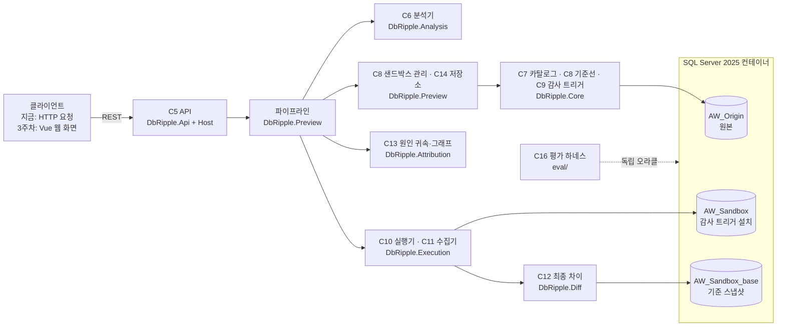

# db-ripple

INSERT·UPDATE·DELETE를 실제 DB에 반영하기 전에 복제 DB에서 먼저 실행해 보고, FK 연쇄와 트리거까지 포함해 어느 테이블의 어떤 행이 바뀌는지 보여 주는 SQL Server용 도구다. 변경이 어떤 FK·트리거 때문에 어떤 순서로 퍼졌는지는 그래프로, 행 값은 before/after로 보여 주고, 사용자가 [적용] 또는 [취소]를 고른다. 결과는 LLM 추론이 아니라 실제 실행에서 나온다.

## 지금 상태 (2026-11-10, 2주차 끝)

- **동작 방식:** ASP.NET Core 웹 API 서버(`src/DbRipple.Host`, 기본 주소 `http://127.0.0.1:5080`)로 돈다. 브라우저 화면(프런트)은 아직 없다. 지금은 HTTP 요청(`.http` 파일, `curl`, `Invoke-RestMethod`)으로 쓴다. 웹 화면(Vue 3)과 [적용]은 3주차에 만든다.
- **된 것:** SQL 분석, 샌드박스 실행과 변경 수집, 최종 차이, 원인 귀속과 그래프 데이터, 미리보기 저장·조회 API, 평가 하네스
- **평가(CascadeLab CL01~CL08b, 11사례):**
  - M1 셀 일치 precision·recall 1.0000(54/54)
  - M2 연쇄·트리거 변경 탐지 45/45
  - 원인 간선 40/40, certain 과신 0
  - 결과 파일: `logs/week2/eval/eval-20261110-135700/`
- **데이터:** 공개 샘플 DB만 쓴다. AdventureWorks(공식 백업)와 직접 만든 합성 정답 DB CascadeLab이다.

## 어떻게 작동하나

미리보기 한 번은 다음 순서로 돈다.

1. **분석(C6):** Microsoft ScriptDom으로 SQL을 파싱한다. 허용 목록(기반 사용자 테이블 대상 INSERT·UPDATE·DELETE)만 통과시킨다. DDL, TRUNCATE, MERGE, 트랜잭션 제어, EXEC, 다른 DB 이름, 외부 부작용이 있는 트리거가 붙은 테이블 등은 실행하지 않고 422로 거부한다(규칙 ID와 위치 포함).
2. **샌드박스(C8, 미리 한 번 만들어 둠):**
   - 원본 DB를 COPY_ONLY로 백업해 같은 인스턴스의 샌드박스 DB로 복원한다.
   - 미리보기 실행 사용자(`dbr_preview_user`, DML 권한만)를 만든다.
   - 테이블마다 감사 트리거를 설치한다(C9).
   - 데이터베이스 스냅샷(기준선)을 찍는다.
3. **실행(C10):**
   - 전용 연결에서 트랜잭션을 연다.
   - 문장마다 `EXECUTE AS USER`로 실행하고 `REVERT`한다.
   - FK 연쇄나 사용자 트리거로 바뀐 행은 각 테이블의 감사 AFTER 트리거(마지막 순서로 지정)가 before/after 이미지와 순번으로 기록한다.
4. **수집(C11):** 감사 기록에서 "어느 테이블에 어떤 연산이 몇 행, 어떤 깊이로" 일어났는지(발동 묶음)와 행별 before/after를 재구성한다.
5. **최종 차이(C12):** 같은 트랜잭션 안에서 샌드박스와 기준 스냅샷을 테이블별로 비교한다. 감사가 놓친 변경이 있으면 잔차로 드러난다.
6. **롤백:** 트랜잭션을 ROLLBACK해 샌드박스를 원래대로 돌린다. 트리거가 몰래 COMMIT한 흔적이 보이면 샌드박스를 "오염"으로 표시하고 다음 미리보기 전에 다시 만든다.
7. **원인 귀속(C13):**
   - FK 연쇄는 FK 메타데이터와 키 값 일치로 판정한다(`certain` 또는 `inferred`).
   - 트리거 효과는 트리거 본문의 정적 쓰기 대상으로 추론한다(최고 `inferred`, 후보가 여럿이면 `ambiguous`).
   - 결과로 전파 그래프(문장 → 묶음 → 테이블)와 확신도를 만든다.
8. **저장·조회(C14·C5):** 결과를 30분 동안 보관하고, API로 요약·그래프·행 페이지·내보내기를 준다.

이 방식을 고른 까닭과 대안 비교는 [설계 문서](docs/architecture.md) §8에 있다.

## 구조



| 프로젝트 | 컴포넌트 | 하는 일 |
|---|---|---|
| `src/DbRipple.Contracts` | 공용 계약 | 컴포넌트 사이 타입(DTO, 인터페이스) |
| `src/DbRipple.Core` | C7·C8·C9 | 카탈로그 읽기, 기준선 구축, 감사 트리거 생성·설치 |
| `src/DbRipple.Analysis` | C6 | SQL 분석(허용 목록, 거부·경고), 트리거 본문 정적 분석 |
| `src/DbRipple.Execution` | C10·C11 | 샌드박스 실행(트랜잭션, EXECUTE AS), 감사 기록에서 변경 재구성 |
| `src/DbRipple.Diff` | C12 | 샌드박스 대 스냅샷 최종 차이 |
| `src/DbRipple.Attribution` | C13 | 원인·확신도 판정, 그래프 데이터 |
| `src/DbRipple.Preview` | 파이프라인·C8·C14 | 미리보기 순서 조립, 샌드박스 상태·잠금, 결과 저장 |
| `src/DbRipple.Api`, `src/DbRipple.Host` | C5 | REST API, 실행 파일(웹 서버) |
| `src/DbRipple.Cli` | 도구 | 기준선 구축·복원 등 명령줄 도구 |
| `eval/` | C16 | 평가 하네스(제품 코드와 독립된 오라클·비교기, M1·M2 CSV) |
| `tests/` | — | 컴포넌트별 테스트, 통합 테스트, 테스트 DB 지원 |

## 실행 방법

**필요한 것:** Windows, Docker Desktop(WSL2 백엔드), .NET 10 SDK, PowerShell. 처음 설치 과정과 주의점은 [docs/dev-setup.md](docs/dev-setup.md)에 있다.

1. **비밀값 파일:** `Copy-Item .env.example .env` 후 `MSSQL_SA_PASSWORD`를 강한 값으로 바꾼다. `.env`는 커밋하지 않는다.
2. **SQL Server 컨테이너:** `.\scripts\db-up.ps1`. 2025 CU10이 `127.0.0.1:14333`에만 열린다.
3. **AdventureWorks 원본:** `.\scripts\fetch-adventureworks.ps1`로 공식 백업을 받고, `.\scripts\restore-aw-origin.ps1`로 `AW_Origin`에 복원한다.
4. **웹 API 서버 실행:** 같은 PowerShell 창에서 실행한다.

   ```powershell
   . .\scripts\env.ps1
   dotnet run --project src\DbRipple.Host
   ```

   `env.ps1`은 `.env`를 읽어 연결 문자열을 이 프로세스 안에서만 만든다(화면에 출력하지 않는다).
5. **기준선 만들기(처음 한 번):** `POST /api/sandbox/refresh`(202)를 보낸 뒤, `GET /api/sandbox`의 `state`가 `ready`가 될 때까지 기다린다.
6. **미리보기:**

   ```powershell
   $body = @{ sql = 'DELETE FROM Sales.SalesOrderHeader WHERE SalesOrderID = 43659;' } | ConvertTo-Json
   Invoke-RestMethod -Method Post -Uri http://127.0.0.1:5080/api/previews -ContentType 'application/json' -Body $body
   ```

   이 예시는 주문 1건 삭제가 FK 연쇄로 주문 상세 12행 삭제를 일으키는 것을 보여 준다. 요청 예시는 [src/DbRipple.Host/DbRipple.Host.http](src/DbRipple.Host/DbRipple.Host.http)에 더 있다(VS Code REST Client, Rider, Visual Studio에서 바로 보낼 수 있다).

**테스트:**

```powershell
. .\scripts\env.ps1
dotnet test DbRipple.slnx
```

테스트는 `dbrt_` 접두의 임시 DB를 만들고 지운다. 2026-11-10 기준 484개가 통과하고 1개를 건너뛴다. 건너뛰는 SP7은 따로 실행한다.

**평가(CascadeLab):**

```powershell
. .\scripts\env.ps1
dotnet run --project eval\DbRipple.Eval.Cli -- cascadelab --out logs\week2\eval
```

`cases.csv`, `m1.csv`, `m2.csv`, `metrics.csv`, `env.json`이 실행마다 새 폴더에 생긴다.

## API

| 메서드·경로 | 하는 일 |
|---|---|
| `GET /api/sandbox` | 샌드박스 상태(building, ready, dirty, error), 기준 시각, 환경 지문 |
| `POST /api/sandbox/refresh` | 기준선 다시 만들기(202) |
| `POST /api/analyze` | SQL 분석만(거부·경고·위치) |
| `POST /api/previews` | 미리보기 실행. 거부면 422와 `rejects[]` |
| `GET /api/previews/{id}` | 결과 요약·발동 묶음·그래프 |
| `GET /api/previews/{id}/rows?view=event\|net` | 행 페이지(발동 보기, 최종 차이 보기, 최대 1000행) |
| `GET /api/previews/{id}/export` | 결과 JSON 내보내기 |
| `POST /api/previews/{id}/cancel` | 취소(204) |
| `POST /api/previews/{id}/apply` | 원본 적용 — 3주차(지금은 501) |
| `GET /api/catalog/schema` | 편집기 자동완성용 스키마 — 3주차(지금은 501) |

오류는 ProblemDetails 형식으로 돌려준다. 계약 타입은 `src/DbRipple.Contracts`에 있다.

## 문서

- [docs/architecture.md](docs/architecture.md): 설계 v1.4(결정 기록, 데이터 계약, 원인 귀속 규칙, 평가 방법, 위험)
- [docs/week2-plan.md](docs/week2-plan.md): 2주차 계획·결과·결정 27건·3주차 인계
- [docs/spikes/](docs/spikes/README.md): 설계 전제를 실측한 기록(SP0~SP7, SP10)
- [cascadelab/](cascadelab/README.md): 합성 정답 DB와 손 정답, 정정 기록
- [docs/dev-setup.md](docs/dev-setup.md): 개발 환경 준비

## 한계

- 웹 화면과 [적용]이 아직 없다(3주차).
- 지원 문장은 단독 INSERT·UPDATE·DELETE다. MERGE, 변수·제어 흐름, 프로시저 호출은 거부한다.
- 트리거의 원인은 정적 분석으로 추론하므로 최고 확신도가 `inferred`다. 트리거가 저장 프로시저를 부르면 쓰기 대상을 미상으로 보수 처리해 확신도가 낮아진다(3주차에 프로시저 본문 분석으로 개선 예정).
- 평가는 아직 CascadeLab만 했다. AdventureWorks와 CL09~CL20은 3주차다.
