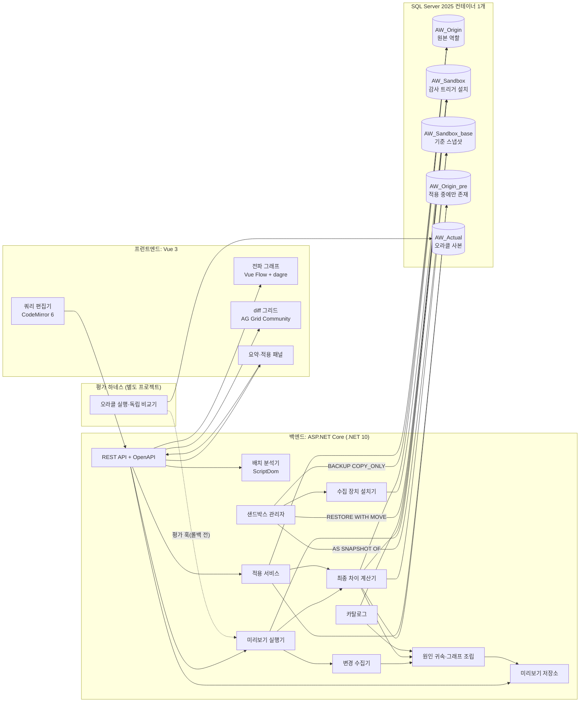
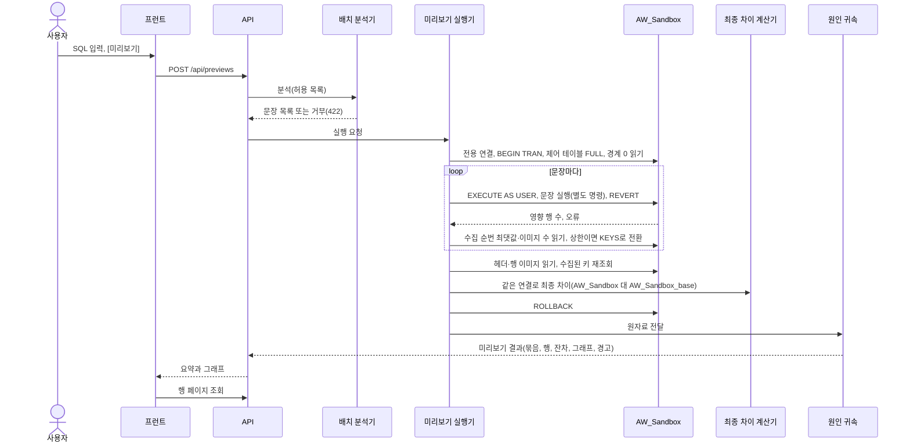
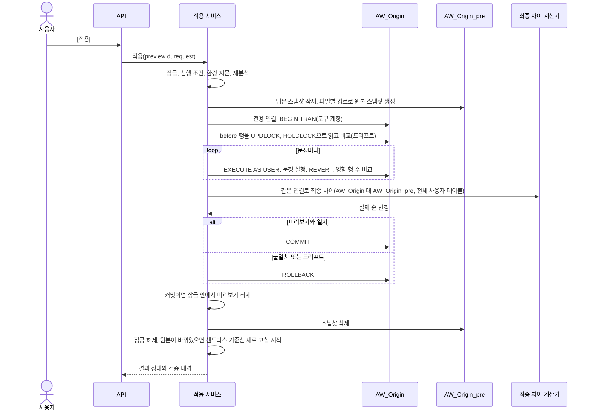

# SQL 실행 전 변경 미리보기 도구 — 아키텍처 설계

> 상태: 설계 v1.5 (3·4주차 코드 반영, 2026-11-11: 3·4주차 범위 코드 완료, **DB 테스트·평가 실행 전**. [적용](C15)·실행 봉투 공유·/catalog/schema·교차 사이트 요청 방어·프로시저 펼치기·M3~M5와 대조군 B0·B2 정의를 확정했다. 바꾼 곳마다 "v1.5"를 적었고, 세부 결정은 [week3-plan.md](week3-plan.md) §2 AD6~AD11, §9 Q24·Q28~Q42에 있다. 평가 보고서 틀은 [evaluation.md](evaluation.md)) · v1.4 (2주차 구현 반영, 2026-11-10: SP7 통과, 컴포넌트 시그니처·실행 사용자·오류 판정 규칙 확정. 바꾼 곳마다 "v1.4"를 적었고, 세부 결정은 [week2-plan.md](week2-plan.md) §9에 있다) · v1.3 (1주차 실측 반영, 2026-11-10: SP0~SP6·SP10 결과로 D1·D3·D4 확정, H1~H5 성립. 바꾼 곳마다 "v1.3"과 근거 스파이크를 적었다) · v1.2 작성 2026-11-06(독립 검토 2회 반영) · 조사 기준일 2026-11-06
> 범위: 졸업작품, 1인, 약 1달(AI 보조), MVP를 먼저 만들고 계속 개선 · 공개 샘플 DB만 사용

**ID 규칙**

| 접두사 | 뜻 | 위치 |
|---|---|---|
| G | 목표 | §1 |
| A | 가정 검증 | §2 |
| C | 컴포넌트 | §4 |
| H | 귀속 전제 | §7 |
| D | 결정 | §8 |
| E | 경계 사례 | §9 |
| M, B, CL, DM | 지표, 대조군, CascadeLab 패턴, 데모 | §10 |
| R | 위험 | §12 |
| SP | 스파이크 | §13 |

## 0. 요약

**결론.** 대상은 SQL Server 2025(Developer 계열, Linux 컨테이너)다. 샌드박스는 같은 인스턴스에 만든 원본 복제 DB다. 미리보기는 그 DB에서 도구가 연 트랜잭션 안에 사용자의 문장을 실제로 실행하고, 결과를 모은 뒤 ROLLBACK한다. 사용자 문장은 원본과 같은 DB 사용자 권한으로 실행하고, 수집 기록 읽기와 비교는 도구 계정으로 한다.

변경은 두 경로로 모아 서로 대조한다.

- 도구가 샌드박스에만 설치하는 감사 트리거(테이블·연산마다 Last 순서)가 행 이미지와 발동 순번을 남긴다.
- 실행 전 상태를 담은 데이터베이스 스냅샷과 현재 상태를 비교한 최종 차이(net diff)로 감사 트리거가 놓친 변경을 찾는다.

원인 귀속은 두 수준으로 나눈다.

- FK 연쇄: 메타데이터와 키 값 일치로 **확정**한다.
- 트리거: 중첩 깊이, 발동 순번, 트리거 본문의 정적 쓰기 대상으로 **추론**한다.

확정할 수 없는 것은 후보 목록으로 보여 준다. [적용]은 원본에서 같은 실행 방식으로 다시 실행하고, 커밋 전에 원본 스냅샷과의 최종 차이가 미리보기와 같을 때만 커밋한다.

| # | 결정 | 추천 | 확신도 |
|---|---|---|---|
| D1 | 대상 DBMS | SQL Server 2025 EnterpriseDeveloper(2025-CU10 태그 고정). **확정(2026-11-10, SP0)** | 높음 |
| D2 | 샌드박스 | 같은 인스턴스의 COPY_ONLY 복제 DB + 읽기 전용 기준 스냅샷 1개. 미리보기는 트랜잭션 실행 후 ROLLBACK | 중 |
| D3 | 변경 수집 | 감사 AFTER 트리거(테이블·연산마다 1개, Last, First 금지) + 롤백 전 재조회와 최종 차이 대조. **확정(2026-11-10, SP2·SP3·SP6·SP10, C9 실DB 검증)** | 높음 |
| D4 | 원인·순서 | FK는 확정, 트리거는 추론, 모호하면 후보. 순서는 "인과 단계"가 주, "수집 발동 순번"은 보조. **확정(2026-11-10, SP1·SP3)**: H1~H5 성립, §7.2 2·6단계 보완 | 높음 |
| D5 | 배치 분석 | ScriptDom 허용 목록(INSERT/UPDATE/DELETE), 파싱 실패나 규칙 위반이면 실행 거부, 문장별 실행 | 높음 |
| D6 | 기술 스택 | .NET 10 + ASP.NET Core + ScriptDom + Microsoft.Data.SqlClient / Vue 3 + CodeMirror 6 + Vue Flow + dagre + AG Grid Community | 높음 |
| D7 | [적용] | 같은 실행 봉투로 원본 재실행 → 드리프트 검사 → 커밋 전 최종 차이 대조 → COMMIT 또는 ROLLBACK | 중 |
| D8 | 대량 변경 | 상한까지 행 이미지 수집. 넘으면 키만 남기고 테이블별 정확한 건수를 보이며 [적용]을 막음 | 중 |
| D9 | 평가 | 정답을 아는 합성 DB와 수집 장치 없는 오라클 사본으로 지표 M1~M5를 재고, 대조군 B0~B2와 비교 | 중 |

**가장 큰 위험 셋**

- 감사 트리거가 원래 동작을 바꾸는 관찰자 효과
- 트리거 원인 귀속 규칙의 전제(H1~H5)가 실제와 다를 가능성
- 1인·1달 일정

그래서 1주차 처음 이틀은 문서로 확정하지 못한 가정을 실험으로 확인한다(§13 SP0~SP6, SP10). 그 결과로 1주차 끝에 D1, D3, D4를 확정한다. **v1.3(2026-11-10):** 실측으로 셋 모두 확정했다. 전제 H1~H5는 깨지지 않았고, 바뀐 규칙은 감사 트리거 연산별 분리, §6.1 형식 변환, §7.2 2·6단계 보완이다(각 결정 기록과 docs/spikes/).

**차별점.** 실제 실행 자체는 신규성이 아니다(§1.5). 신규성은 "기존 SQL Server DB에서 실행 전에, 모든 테이블의 행 단위 diff와 그 변경을 일으킨 FK·트리거·전파 단계를 함께 보여 주는 것"에 둔다.

## 1. 배경과 범위

### 1.1 문제

INSERT/UPDATE/DELETE 한 문장이 FK 연쇄(CASCADE, SET NULL, SET DEFAULT)와 트리거를 거쳐 다른 테이블까지 바꾼다. 실행 전에는 무엇이, 왜, 어떤 순서로 바뀌는지 알기 어렵다.

흔한 확인 방법인 `BEGIN TRAN` → 실행 → `SELECT` → `ROLLBACK`에는 세 가지 한계가 있다.

- 어느 테이블을 볼지 사람이 미리 알아야 한다.
- 어떤 FK나 트리거 때문에 바뀌었는지는 결과에 나오지 않는다.
- 운영 DB에서 하면 끝날 때까지 배타 잠금을 잡고, 롤백해도 IDENTITY 값이 회수되지 않는다(A13).

### 1.2 목표

| ID | 목표 |
|---|---|
| G1 | 실제 엔진으로 실행한 결과를 바탕으로, 영향받은 **모든 테이블**의 행 단위 before/after를 보여 준다. |
| G2 | 각 변경을 일으킨 원인(어느 문장, 어느 FK, 어느 트리거)과 전파 단계를 그래프로 보여 준다. |
| G3 | 사용자가 [적용] 또는 [취소]를 고른다. [적용]은 원본에서 다시 실행하고, 결과가 미리보기와 다르면 커밋하지 않는다. |
| G4 | 일치율, 연쇄·트리거 변경 탐지 수, 행 수별 응답 시간을 재현 가능한 절차로 측정한다. |

### 1.3 비목표 (MVP)

- LLM 사용, 실행하지 않고 추정하는 분석
- DDL 미리보기, 저장 프로시저 호출 미리보기
- 운영 환경 배포, 다중 사용자, 인증
- 수십 GB 이상 DB 최적화, PostgreSQL 지원

### 1.4 제약

- 1인 개발, 약 1달(AI 보조). 제출은 결과물 제출 방식이다(발표·포스터 요구 없음으로 파악).
- 회사 업무 DB는 쓰지 않는다. 공개 샘플 DB만 쓴다.
- 이 문서는 설계만 다룬다. 로직은 말과 단계 목록으로, 데이터 계약은 필드 목록과 JSON 예시로 적는다.
- 사용자 숙련 기술: Vue 3, SQL Server. 백엔드 언어는 C#(ASP.NET Core)으로 정했다(2026-11-06 사용자 선택, D6).

### 1.5 선행 도구와 차별점

사용자의 선행 조사(2026-11) 가운데 한 항목은 사실과 달라 정정한다.

| 도구 | 실제로 하는 일 | 이 도구와 다른 점 |
|---|---|---|
| postgres-mcp-server `mutation_dry_run` | PostgreSQL에서 DML을 **트랜잭션 안에서 실제로 실행한 뒤 ROLLBACK**하고, 영향 행 수, 대상 테이블 기준 before/after 샘플(기본 10행), EXPLAIN을 돌려준다. README는 "트리거 효과"를 잡는다고 적는다. **정정:** 롤백 SQL 텍스트만 돌려준다는 선행 조사 요약과 다르다. | 실제 실행 자체는 신규성이 아니다. README에는 연쇄·트리거 원인 귀속과 시각화에 대한 언급이 없다. "트리거 효과"가 다른 테이블 행까지 포함하는지는 확인하지 못했다(소스 확인 필요). |
| DBeast `analyze_impact` | 실행하지 않고 영향·위험도·영향 행을 추정한다. | 추정형이다. 이 도구는 실행형이다. |
| Dolt Workbench | 미커밋 변경 행을 색으로 표시한다. Agent mode에서 변경을 미리 보고 커밋을 승인한다. 버전관리 기능은 Dolt/Doltgres 전용이다. | DB 엔진을 Dolt로 바꿔야 한다. 원인 표시가 없다. |
| Bytebase Prior Backup | SQL Server를 포함한 6개 엔진에서 변경 전 영향 행을 백업해 두고 사후 롤백 SQL을 만든다(UPDATE/DELETE만). | 사후 복구다. 실행 전 미리보기가 아니다. |
| Redgate SQL Data Compare, dbForge Data Compare | 두 DB(또는 백업과 DB)를 행 단위로 비교하고 동기화 스크립트를 미리 보여 준다. | "사본에서 실행 + Data Compare"로 행 diff는 손으로 만들 수 있다. 가장 강한 반론이다. 원인과 순서는 나오지 않는다. |
| SSMS 예상 실행 계획 | 실행하지 않고 예상 행 수만 보여 준다. 트리거는 호출 배치와 별도 계획으로 실행된다. | 테이블 수준 추정이다. 행 값과 원인은 없다. |
| 학술 연구 | GProM reenactment(사후 provenance, TaPP 2014, TKDE 2018), 트랜잭션 디버거(PVLDB 2017), Mahif(historical what-if, SIGMOD 2022), 트리거 정적 분석(Aiken 외 SIGMOD 1992, Baralis·Widom TODS 2000) | 사후 재연이거나 정적 분석이다. 실행 전 귀속이 아니다. |

차별점은 이 결합에 둔다. **기존 SQL Server DB에서, 실행 전에, 실제 엔진으로 실행한 결과로 모든 테이블의 행 단위 diff를 보여 주고, 각 변경을 일으킨 문장·FK·트리거와 그 전파 단계를 귀속한 그래프를 함께 보여 준다.** 신규성 주장은 "원인·순서 귀속과 그 시각화"에 두고, 나머지는 "조합의 실용성"으로 표현한다.

## 2. 핵심 가정 검증 (공식 문서)

**조사 방법**

- researcher 9명이 Microsoft Learn, postgresql.org, 공식 GitHub 저장소를 조사했다. 그중 SQL Server 관련이 7명이다.
- evidence-reviewer 4명이 SQL Server 항목과 서버 쪽 분석의 출처를 다시 열어 원문과 대조했다.
- 아래 표는 그 정정과 설계 문서 독립 검토의 지적을 반영한 결과다.

증거 범위는 정적 문서 조사뿐이다. DB 실측은 하지 않았고, 실측이 필요한 항목은 §13 스파이크로 넘긴다.

| ID | 가정 | 확인 결과 | 출처 | 설계 반영 |
|---|---|---|---|---|
| A1 | FK 연쇄 동작이 연쇄 대상 테이블의 AFTER 트리거를 발동하는가? (사용자 지정 핵심 가정) | **발동한다.** 원래 DELETE/UPDATE가 직접 일으킨 연쇄를 먼저 모두 수행한다. 영향받은 테이블의 AFTER 트리거는 그 뒤 "연쇄의 반대 순서"로 발동한다(반대 순서의 정확한 정의는 문서에 없다). AFTER 트리거는 모든 연쇄 동작과 제약 검사가 성공해야 발동한다. | [PK/FK constraints](https://learn.microsoft.com/en-us/sql/relational-databases/tables/primary-and-foreign-key-constraints) "Triggers and cascading referential actions", [CREATE TRIGGER](https://learn.microsoft.com/en-us/sql/t-sql/statements/create-trigger-transact-sql) "FOR \| AFTER" | 샌드박스 테이블마다 감사용 AFTER 트리거만 깔아도 연쇄로 바뀐 행이 수집된다. |
| A2 | 트리거와 연쇄 체인 사이의 실행 순서가 정해져 있는가? | **일부만 정해져 있다.** 한 테이블의 트리거는 First/Last로 지정한 것 외에는 무작위다. 직접 대상에서 갈라진 체인 사이 순서는 미정이다(한 체인이 트리거를 모두 발동한 뒤 다음 체인이 시작). 문서는 트리거가 일으킨 2차 체인을 "모든 1차 체인의 트리거가 발동한 뒤" 처리한다고 쓰지만 그 의미는 분명하지 않다. 체인 안에서 오류가 나면 그 체인의 AFTER 트리거는 발동하지 않고, 그 체인을 만든 DELETE/UPDATE 작업이 롤백된다. CASCADE·SET NULL·SET DEFAULT를 먼저 적용하고 NO ACTION을 나중에 검사한다는 규칙은 DELETE에만 명시돼 있다. | PK/FK constraints, [sp_settriggerorder](https://learn.microsoft.com/en-us/sql/relational-databases/system-stored-procedures/sp-settriggerorder-transact-sql) | 그래프는 "인과 단계" 기준으로 그리고, 관측 순번은 "보장되지 않는 순서"로 표시한다. 2차 체인 처리 시점은 전제 H5로 두고 SP1로 확인한다(§7). |
| A3 | 행 단위 트리거가 있는가? 0행이어도 발동하는가? | 행 단위 트리거는 **없다.** DML 트리거는 이벤트마다 발동하고, 여러 행이 inserted/deleted에 함께 담긴다(문서 표현은 "may cause a single trigger invocation"). 직접 대상 테이블의 AFTER 트리거는 영향 행이 0이어도 발동한다. FK 연쇄 대상에서 연쇄 행이 0개일 때와 MERGE의 0행 액션에서 발동하는지는 문서에 없다. MERGE는 액션별로, BULK INSERT(FIRE_TRIGGERS)는 완료된 배치별로 발동한다. | CREATE TRIGGER, [Create DML triggers to handle multiple rows](https://learn.microsoft.com/en-us/sql/relational-databases/triggers/create-dml-triggers-to-handle-multiple-rows-of-data), [MERGE](https://learn.microsoft.com/en-us/sql/t-sql/statements/merge-transact-sql) "Trigger implementation" | 수집 단위는 "변경 묶음"(감사 트리거 발동 1회)이다. 묶음 안 행 순서에는 의미를 두지 않는다. 0행 발동은 헤더만 기록하고, 연쇄 0행 경우는 SP2(d)로 실측한다. **SP2(d) 실측(2026-11-10):** 직접 대상의 0행 발동은 기록된다. FK 연쇄로 바뀐 자식 행이 0개이면 자식 테이블의 트리거는 발동하지 않았다(감사 헤더 없음). 관측은 ON DELETE CASCADE 1단계 하나이고, SET NULL·SET DEFAULT·ON UPDATE CASCADE·다단 연쇄의 0행은 재지 않았다. |
| A4 | 한 테이블로 가는 연쇄 경로가 둘 이상이거나 순환할 수 있는가? | **불가.** 한 DELETE/UPDATE가 시작하는 연쇄 목록에 같은 테이블이 두 번 나올 수 없다. 이를 어기는 FK는 만들 때 오류 1785로 거부된다. 갈라지는 것(트리)은 허용된다. | [MSSQLSERVER_1785](https://learn.microsoft.com/en-us/sql/relational-databases/errors-events/mssqlserver-1785-database-engine-error) | 한 문장이 시작한 FK 연쇄는 트리다. 순환과 같은 테이블 재도달은 트리거 간선과 2차 체인에서만 생긴다. |
| A5 | INSTEAD OF와 뷰의 제약 | 연쇄 FK를 가진 테이블에는 해당 이벤트의 INSTEAD OF 트리거를 둘 수 없다. 뷰에는 AFTER 트리거를 둘 수 없다. 임시 테이블에는 DML 트리거를 둘 수 없다. | CREATE TRIGGER "Trigger limitations", [DML triggers](https://learn.microsoft.com/en-us/sql/relational-databases/triggers/dml-triggers) | 감사 트리거는 기반 테이블의 AFTER 트리거로만 만든다. 사용자 INSTEAD OF 트리거는 "원래 동작을 대체한 노드"로 표시한다(§6.3 REPLACES). |
| A6 | 감사 트리거의 순서를 고정할 수 있는가? | 문장 종류별로 First 1개, Last 1개만 지정할 수 있다. INSTEAD OF는 지정할 수 없다. ALTER TRIGGER를 하면 None으로 초기화된다. 어느 트리거든 ROLLBACK하면 그 뒤 트리거는 실행되지 않는다. | sp_settriggerorder, [Specify first and last triggers](https://learn.microsoft.com/en-us/sql/relational-databases/triggers/specify-first-and-last-triggers), CREATE TRIGGER | 감사 트리거는 연산별 Last로만 지정한다. First에는 두지 않는다(D3). 그 연산에 사용자 Last가 이미 있으면 지정하지 않고(`NONE`) 매니페스트에 표시한다. Last 지정 가능 여부와 기존 점유는 SP2(a)로 확인한다. |
| A7 | 트리거 중첩 깊이를 알 수 있는가? | 인자 없는 `TRIGGER_NESTLEVEL()`은 자기 자신을 포함한 호출 스택의 트리거 수다. object_id 인자는 "그 문장에서 그 트리거가 실행된 횟수"이지 스택 위치가 아니다. FK 연쇄로 발동된 트리거의 값은 문서에 없다. | [TRIGGER_NESTLEVEL](https://learn.microsoft.com/en-us/sql/t-sql/functions/trigger-nestlevel-transact-sql) | 깊이만 기록하고, 부모 트리거는 §7 규칙으로 귀속한다. 연쇄 시 값은 SP1로 실측한다(H2). |
| A8 | 중첩·재귀 설정 | 중첩은 최대 32단계다. 서버 옵션 nested triggers의 기본값은 1이다. DB 옵션 RECURSIVE_TRIGGERS는 model 기본값이 OFF이고, 실제 값은 원본 DB를 따른다. | CREATE TRIGGER "Nested triggers", [nested triggers option](https://learn.microsoft.com/en-us/sql/database-engine/configure-windows/configure-the-nested-triggers-server-configuration-option), [Create nested triggers](https://learn.microsoft.com/en-us/sql/relational-databases/triggers/create-nested-triggers) | 기준선을 만들 때 원본과 샌드박스의 서버·DB 설정을 비교한다(환경 지문). 다르면 미리보기와 [적용]을 막는다. |
| A9 | 실행 사이에 끼운 호출이 @@ROWCOUNT를 바꾸는가? | 공식 문구는 "EXECUTE statements preserve the previous @@ROWCOUNT"다. SET <option>, PRINT, BEGIN/COMMIT TRAN은 0으로, `SET @v`는 1로 만든다. 호출된 프로시저 내부 문장의 영향은 문서에 없다. | [@@ROWCOUNT](https://learn.microsoft.com/en-us/sql/t-sql/functions/rowcount-transact-sql) | 사용자 문장 사이에 계측 호출을 끼우지 않는다. 문장은 별도 명령으로 하나씩 실행하고, 경계는 수집 순번 최댓값으로 잡는다(D3). DML 직후 행 수가 계측 전과 같은지는 SP2(c)로 실측한다. **SP2(c) 실측(2026-11-10):** 감사 유무에 따라 DML 직후 @@ROWCOUNT·ROWCOUNT_BIG()과 드라이버(System.Data.SqlClient) 영향 행 수가 같았다. 트리거 안 행 수는 호출자에게도, 다음 트리거 시작 시점에도 새지 않았다. NOCOUNT 없는 트리거의 DML 행 수는 드라이버 영향 행 수에 더해진다(감사와 무관한 대조 트리거로 3→5). 감사 트리거 자체를 NOCOUNT 없이 잰 것은 아니다. |
| A10 | SESSION_CONTEXT로 문장 번호를 넘길 수 있는가? | 키 128바이트, 값 8,000바이트, 전체 1MB 제한이 있다. read_only 키는 다시 바꿀 수 없다. 롤백 시 값이 되돌아가는지는 문서에 없다. 병렬 계획과 세션 재설정(연결 풀링)이 겹치면 생기는 알려진 문제가 있다(2019 CU14 이후, TF 11042로 우회). | [sp_set_session_context](https://learn.microsoft.com/en-us/sql/relational-databases/system-stored-procedures/sp-set-session-context-transact-sql), [SESSION_CONTEXT](https://learn.microsoft.com/en-us/sql/t-sql/functions/session-context-transact-sql) | **쓰지 않는다**(D3). 롤백 시 동작이 문서에 없고 알려진 문제가 있기 때문이다. 감사 트리거에 전달할 값(수집 모드, 상한)은 감사 스키마의 제어 테이블로 넘긴다(§6.2). 실행용 연결은 풀링을 끈 전용 연결로 둔다. |
| A11 | OUTPUT 절로 연쇄·트리거 변경을 받을 수 있는가? | **받을 수 없다.** OUTPUT 값은 트리거 실행 전 값이다. 대상 테이블에 활성 트리거가 있으면 INTO 없는 OUTPUT은 오류다. OUTPUT INTO 대상은 활성 트리거, FK, CHECK를 가질 수 없다. 연쇄 행이 빠진다는 점은 문서 구조에서 나온 추론이다. | [OUTPUT clause](https://learn.microsoft.com/en-us/sql/t-sql/queries/output-clause-transact-sql) | OUTPUT은 수집 수단에서 뺀다. 감사 트리거 때문에 사용자의 OUTPUT 문장이 실패할 수 있으므로 배치 분석에서 거부한다(E11). |
| A12 | UPDATE 전후 행을 짝지을 수 있는가? | UPDATE는 삭제 후 삽입과 비슷하게 inserted/deleted에 담긴다. `UPDATE()`와 `COLUMNS_UPDATED()`는 값이 같아도 true다(SET 목록 기준). AFTER 트리거는 text/ntext/image 열을 참조할 수 없다. PK가 바뀔 때 짝짓는 방법은 문서에 없다. | [Use the inserted and deleted tables](https://learn.microsoft.com/en-us/sql/relational-databases/triggers/use-the-inserted-and-deleted-tables), [UPDATE()](https://learn.microsoft.com/en-us/sql/t-sql/functions/update-trigger-functions-transact-sql) | 바뀐 열은 값 비교로 계산한다. PK가 바뀐 다중 행 UPDATE는 "짝 미확정"으로 표시한다. text/ntext/image는 수집 불가 열로 둔다. |
| A13 | 트랜잭션 + 롤백은 흔적 없이 되돌리는가? | **아니다.** 데이터를 수정하는 트랜잭션은 끝날 때까지 배타 잠금을 유지한다. IDENTITY 값은 롤백돼도 회수되지 않는다. SEQUENCE는 트랜잭션과 무관하게 소비된다. | [Locking guide](https://learn.microsoft.com/en-us/sql/relational-databases/sql-server-transaction-locking-and-row-versioning-guide), [IDENTITY](https://learn.microsoft.com/en-us/sql/t-sql/statements/create-table-transact-sql-identity-property), [CREATE SEQUENCE](https://learn.microsoft.com/en-us/sql/t-sql/statements/create-sequence-transact-sql) | 원본 DB에서는 미리보기를 하지 않는다. 샌드박스에서는 트랜잭션 실행 후 ROLLBACK한다(D2). 소비된 IDENTITY·SEQUENCE 값은 "예상값"으로 표시하고 기준선 새로 고침으로 맞춘다. 스냅샷 되돌리기는 평가 회차 초기화에만 쓴다. |
| A14 | 데이터베이스 스냅샷을 쓸 수 있는가? | 에디션 표: 2022 Windows는 모든 에디션, 2025 Windows는 모든 에디션, 2025 Linux는 Express만 지원하지 않는다. 2022 Linux 표는 확인하지 않았다. 스냅샷을 만들 때는 원본의 데이터 파일마다 논리 이름과 스파스 파일 경로를 지정해야 한다. 스냅샷이 있는 동안 원본 DB는 RESTORE·DROP·DETACH할 수 없다. 되돌리기 조건은 다음과 같다: 스냅샷이 1개뿐이어야 하고, 읽기 전용·압축 파일 그룹과 새로 오프라인된 파일이 없어야 한다. 되돌리면 로그를 다시 만들고(백업 체인 끊김), 전체 텍스트 카탈로그를 지우며, 진행 중에는 DB를 쓸 수 없다. FILESTREAM이 있으면 되돌릴 수 없다. 메모리 최적화 파일 그룹은 2019부터 지원한다. | [Database snapshots](https://learn.microsoft.com/en-us/sql/relational-databases/databases/database-snapshots-sql-server), [Create a database snapshot](https://learn.microsoft.com/en-us/sql/relational-databases/databases/create-a-database-snapshot-transact-sql), [Revert to a snapshot](https://learn.microsoft.com/en-us/sql/relational-databases/databases/revert-a-database-to-a-database-snapshot), [Linux 2025 editions](https://learn.microsoft.com/en-us/sql/linux/sql-server-linux-editions-and-components-2025) | 컨테이너는 Developer 계열로 띄운다. 기준 스냅샷은 1개만 두고 읽기 전용 비교 기준으로만 쓴다. RESTORE 전에는 반드시 스냅샷을 먼저 지운다(§5.1). 2022로 폴백하면 SP0에서 스냅샷 생성을 다시 확인한다. **SP0·SP5 실측(2026-11-10):** 2025 Linux 컨테이너에서 스냅샷 생성 362ms, 되돌리기 411ms. 스냅샷이 있으면 RESTORE는 오류 5094로 거부된다. AW2025에는 FILESTREAM·메모리 최적화가 없고 전체 텍스트 카탈로그 1개(인덱스 3개)가 있다. 컨테이너에는 전체 텍스트 검색이 설치돼 있지 않아(`IsFullTextInstalled = 0`) `CONTAINS`는 오류 7609다. 전체 텍스트 인덱스가 걸린 Production.ProductReview의 UPDATE(값 동일)·DELETE 각 1행은 정상이었다(다른 두 테이블과 값이 바뀌는 UPDATE는 미측정). |
| A15 | 원본 스키마·데이터를 어떻게 복제하는가? | `BACKUP ... WITH COPY_ONLY`는 기존 백업 체인에 영향이 없다. 백업은 같은 버전 이상에만 복원된다. 복원한 DB는 허용 범위 안이면 호환성 수준을 유지한다. Linux 컨테이너에 복원할 때는 `WITH MOVE`가 필요하다. bacpac은 PreserveIdentityLastValues 기본값이 False이고 Azure SQL DB 표면적으로 제한된다. DBCC CLONEDATABASE는 스키마 전용이며 다른 용도는 지원하지 않는다. | [Copy-only backups](https://learn.microsoft.com/en-us/sql/relational-databases/backup-restore/copy-only-backups-sql-server), [BACKUP](https://learn.microsoft.com/en-us/sql/t-sql/statements/backup-transact-sql), [RESTORE](https://learn.microsoft.com/en-us/sql/t-sql/statements/restore-statements-transact-sql), [Compatibility level](https://learn.microsoft.com/en-us/sql/t-sql/statements/alter-database-transact-sql-compatibility-level), [SqlPackage Import](https://learn.microsoft.com/en-us/sql/tools/sqlpackage/sqlpackage-import), [DBCC CLONEDATABASE](https://learn.microsoft.com/en-us/sql/t-sql/database-console-commands/dbcc-clonedatabase-transact-sql) | COPY_ONLY 백업 → 샌드박스 복원을 채택한다. bacpac과 CLONEDATABASE는 쓰지 않는다. |
| A16 | 트랜잭션 안에서 할 수 없는 것 | CREATE/ALTER DATABASE, BACKUP, RESTORE는 트랜잭션 안에서 실행할 수 없다. CREATE TRIGGER는 배치의 첫 문장이어야 한다. CREATE TRIGGER가 롤백되는지 밝힌 현행 문서는 찾지 못했다. **SP1 실측(2026-11-10):** 트랜잭션 안에서 만든 트리거는 ROLLBACK으로 되돌려졌다. | [CREATE DATABASE](https://learn.microsoft.com/en-us/sql/t-sql/statements/create-database-transact-sql), BACKUP, RESTORE, CREATE TRIGGER | 기준선 구축과 스냅샷 생성은 자동 커밋 모드에서 배치를 나눠 실행한다. |
| A17 | 컨테이너 조건 | 이미지 `mcr.microsoft.com/mssql/server`는 Linux x86-64 전용이고, 최소 2GB RAM과 ACCEPT_EULA가 필요하며, Agent는 기본으로 꺼져 있다. 2025의 MSSQL_PID 표에는 EnterpriseDeveloper/StandardDeveloper가 있으나 예시는 'Developer'를 쓴다(불일치). SQL Server 2025는 2025-11-18 GA, 최신 CU10(2026-10-22), 호환성 수준 170이다. | [Container deployment](https://learn.microsoft.com/en-us/sql/linux/sql-server-linux-docker-container-deployment), [Environment variables](https://learn.microsoft.com/en-us/sql/linux/sql-server-linux-configure-environment-variables), [What's new 2025](https://learn.microsoft.com/en-us/sql/sql-server/what-s-new-in-sql-server-2025), [GA 발표](https://techcommunity.microsoft.com/blog/SQLServer/sql-server-2025-is-now-generally-available/4470570) | `MSSQL_PID=EnterpriseDeveloper`를 명시하고 SP0로 확인한다. **SP0 실측(2026-11-10):** 2025-CU10 이미지에서 `EnterpriseDeveloper`와 `Developer` 모두 "Enterprise Developer Edition (64-bit)"이 된다. 표와 예시의 불일치는 결과에 영향이 없다. |
| A18 | 권한과 실행 주체가 결과를 바꾸는가? | 트리거의 기본 실행 컨텍스트는 CALLER다. 소유권 체인은 소유자가 같고 정적 DML일 때만 권한 검사를 건너뛴다. 동적 SQL과 DB 간 호출은 권한을 다시 검사한다. `EXECUTE AS USER`의 가장 범위는 현재 DB로 제한되어, 3·4부분 이름으로 다른 DB를 참조하면 문장이 실패한다. | [EXECUTE AS clause](https://learn.microsoft.com/en-us/sql/t-sql/statements/execute-as-clause-transact-sql), [EXECUTE AS](https://learn.microsoft.com/en-us/sql/t-sql/statements/execute-as-transact-sql), [GRANT schema permissions](https://learn.microsoft.com/en-us/sql/t-sql/statements/grant-schema-permissions-transact-sql) | 사용자 문장 구간에만 `EXECUTE AS USER`(원본과 같은 DB 사용자)를 쓰고, 문장마다 REVERT한 뒤 도구 계정으로 수집 기록을 읽고 다른 DB(스냅샷)와 비교한다(§5.2). 감사 테이블과 SEQUENCE는 사용자 테이블과 같은 소유자(dbo)로 둔다. 트랜잭션 안 EXECUTE AS/REVERT, 감사 쓰기의 소유권 체인은 SP10으로 확인한다. **SP10 실측(2026-11-10):** 열린 트랜잭션 안에서 EXECUTE AS USER/REVERT를 반복할 수 있고, DML 권한만 가진 사용자 문맥에서도 감사 헤더 INSERT와 NEXT VALUE FOR가 소유권 체인으로 성공했다. AW에서 그 사용자와 dbo의 결과가 같았다(감사 유무 모두). 소유자가 다르면 체인이 끊겨 229가 난다. 가장 중 다른 DB를 참조하면 916과 함께 트랜잭션이 doomed(XACT_STATE −1)가 되고, 그 상태에서는 REVERT가 3930으로 실패해 가장이 남는다. ROLLBACK한 뒤에는 REVERT가 된다. 이 관측은 T-SQL TRY/CATCH 안, XACT_ABORT를 지정하지 않은 상태의 값이다. 제품 실행기(SqlClient, XACT_ABORT ON)에서는 상태가 다를 수 있다. |
| A19 | 행 이미지를 JSON으로 직렬화할 때의 제약 | FOR JSON은 INCLUDE_NULL_VALUES가 없으면 NULL 속성을 뺀다. binary는 base64, money와 uniqueidentifier는 문자열이 된다. int, bigint, float, decimal, numeric은 JSON 숫자다. CLR 형식(hierarchyid, geography 등)은 오류라 문자열 변환이 필요하다. EXCEPT는 NULL끼리 같다고 보며 xml/text/ntext/image/비이진 CLR UDT 열을 쓸 수 없다. | [FOR JSON](https://learn.microsoft.com/en-us/sql/relational-databases/json/format-query-results-as-json-with-for-json-sql-server), [FOR JSON 형식 변환](https://learn.microsoft.com/en-us/sql/relational-databases/json/how-for-json-converts-sql-server-data-types-to-json-data-types-sql-server), [EXCEPT and INTERSECT](https://learn.microsoft.com/en-us/sql/t-sql/language-elements/set-operators-except-and-intersect-transact-sql) | 감사 트리거 생성기와 최종 차이 계산기에 형식별 변환 규칙을 둔다(§6.1). SP6로 실측한다. **SP6 실측(2026-11-10)으로 정정:** FOR JSON 오류(13604)는 geography·geometry뿐이고 hierarchyid는 문자열로 나온다. money는 문자열이 아니라 JSON 숫자다. float는 16자리로 나와 정밀도가 줄고(최댓값을 되읽으면 overflow), 공간 형식의 `STAsText()`는 Z/M 값을 버린다. text/ntext/image를 inserted/deleted에서 참조하면(`SELECT *` 포함) 트리거 생성 시점에 311이 난다. 바꾼 규칙은 §6.1에 있다. |
| A20 | 다른 수집 기능(CDC, Change Tracking, temporal)을 쓸 수 있는가? | CDC는 Agent가 필요하고(Express 불가), 커밋 기준 비동기이며, 원인 정보가 없다. 트랜잭션 안 순서는 _CT 문서 기준 `__$command_id`로 본다(개요 문서는 `__$seqval`이라고 써서 두 문서가 충돌한다). Change Tracking은 PK 값, 작업 종류, 바뀐 열 정보만 남기고 값과 중간 상태는 남기지 않는다. temporal 기간 값은 트랜잭션 시작 시각이라 트랜잭션 안 순서를 가리지 못한다. | [About CDC](https://learn.microsoft.com/en-us/sql/relational-databases/track-changes/about-change-data-capture-sql-server), [cdc _CT 테이블](https://learn.microsoft.com/en-us/sql/relational-databases/system-tables/cdc-capture-instance-ct-transact-sql), [About Change Tracking](https://learn.microsoft.com/en-us/sql/relational-databases/track-changes/about-change-tracking-sql-server), [Temporal tables](https://learn.microsoft.com/en-us/sql/relational-databases/tables/temporal-tables) | 주 수집 방식에서 뺀다. |
| A21 | TRUNCATE와 BULK INSERT도 수집되는가? | TRUNCATE는 DELETE 트리거를 발동하지 않고, FK로 참조되는 테이블에는 쓸 수 없다. BULK INSERT는 FIRE_TRIGGERS가 없으면 트리거가 발동하지 않고, CHECK_CONSTRAINTS가 없으면 CHECK·FK를 검사하지 않는다(그 제약은 not-trusted로 표시된다). | [TRUNCATE TABLE](https://learn.microsoft.com/en-us/sql/t-sql/statements/truncate-table-transact-sql), [BULK INSERT](https://learn.microsoft.com/en-us/sql/t-sql/statements/bulk-insert-transact-sql) | MVP에서는 거부한다. |
| A22 | 트리거 안에서 ROLLBACK하면? | 그때까지의 변경이 모두 롤백되고 배치가 끝난다. 다만 ROLLBACK 뒤 트리거의 나머지 문장은 계속 실행되고, 그 변경은 롤백되지 않는다(트랜잭션 밖에서 확정). 트리거 안에서는 XACT_ABORT 기본값이 ON이다. 오류 3609는 이 상황에서 흔히 보고되는 번호이고, 발생 조건은 2차 출처 기준이다. | [ROLLBACK TRANSACTION](https://learn.microsoft.com/en-us/sql/t-sql/language-elements/rollback-transaction-transact-sql) "Interoperability", [SET XACT_ABORT](https://learn.microsoft.com/en-us/sql/t-sql/statements/set-xact-abort-transact-sql) | "트리거가 거부함"은 오류 번호와 트랜잭션 상태로 판정한다. 그 뒤에는 기준 스냅샷과 비교해 롤백 뒤 남은 변경(예: 오류 로그 행)을 찾는다. 찾으면 결과에 보이고, 샌드박스를 "오염"으로 표시해 다음 미리보기 전에 다시 만든다(§5.2). |
| A23 | 실행 계획으로 연쇄·트리거를 미리 알 수 있는가? | 예상 계획은 실행하지 않으므로 예상 행 수만 담는다. 트리거는 호출 배치와 별도 계획으로 실행된다. 연쇄가 계획에 어떻게 나타나는지 설명한 공식 문서는 없다(2차 출처만 있음). | [Display the estimated execution plan](https://learn.microsoft.com/en-us/sql/relational-databases/performance/display-the-estimated-execution-plan), [Query processing architecture guide](https://learn.microsoft.com/en-us/sql/relational-databases/query-processing-architecture-guide) "Stored procedure and trigger execution" | 평가의 정적 예측 대조군으로만 쓴다(이후 범위 B3). |
| A24 | 공개 샘플 DB에 연쇄·트리거가 있는가? | **AdventureWorks**(sql-server-samples 저장소 루트의 MIT 라이선스)는 FK 90개 가운데 참조 동작이 ON DELETE CASCADE 2개뿐이다(SalesOrderHeader→SalesOrderDetail, SalesOrderHeader→SalesOrderHeaderSalesReason). DML 트리거는 10개(AFTER 8, INSTEAD OF DELETE 2)이고 DDL 트리거가 1개 있다. dbo.DatabaseLog는 PK 없는 힙이다(**v1.3 정정, C7 실측 2026-11-10:** 힙은 맞지만 비클러스터형 PK가 있다. AW에 PK 없는 테이블은 0개이고, FK 90·CASCADE 2·DML 트리거 10(AFTER 8, INSTEAD OF DELETE 2)·DDL 트리거 1은 설계 값과 같다). **pubs**에는 PK 없는 테이블 2개(roysched, discounts)와 ROLLBACK하는 트리거 employee_insupd가 있다. **Northwind**는 확인한 구간에서 FK 13개가 모두 NO ACTION이었고 트리거가 없었다(스크립트 일부만 확인). | [instawdb.sql](https://raw.githubusercontent.com/microsoft/sql-server-samples/master/samples/databases/adventure-works/oltp-install-script/instawdb.sql), [instpubs.sql](https://raw.githubusercontent.com/microsoft/sql-server-samples/master/samples/databases/northwind-pubs/instpubs.sql), [instnwnd.sql](https://raw.githubusercontent.com/microsoft/sql-server-samples/master/samples/databases/northwind-pubs/instnwnd.sql), [AdventureWorks 설치](https://learn.microsoft.com/en-us/sql/samples/adventureworks-install-configure) — 스크립트를 WebFetch 요약으로 읽었으므로 설치 후 `sys.foreign_keys`, `sys.triggers`로 다시 확인한다 | 시연은 AdventureWorks로, 정확도 평가는 정답을 아는 합성 DB로 한다(§10). |

PostgreSQL 비교에 쓴 사실(내부 RI 트리거, 행 단위 트리거, 이름순 발동, `pg_trigger_depth`, TEMPLATE 복제, RETURNING old/new)은 D1 결정 기록(§8)에 출처와 함께 적는다.

## 3. 구성도

### 3.1 논리 구성



데이터는 한 방향으로 흐른다. 편집기의 SQL은 분석기를 거쳐 샌드박스에서 실행된다. 수집된 원자료는 원인 귀속을 거쳐 미리보기 결과가 되고, 그래프와 그리드는 그 결과만 읽는다. [적용]은 미리보기 결과와 원본에서 새로 실행한 결과를 비교한 뒤에만 커밋한다. 평가 하네스는 제품과 코드를 공유하지 않는 오라클 경로를 따로 가진다(§10.3).

### 3.2 배포 구성

| 항목 | MVP 구성 |
|---|---|
| SQL Server | 컨테이너 1개: `mcr.microsoft.com/mssql/server` 2025 이미지를 CU 태그로 고정하고 `MSSQL_PID=EnterpriseDeveloper`, `ACCEPT_EULA=Y`로 띄운다. 메모리는 4GB 이상(최소 요건 2GB, A17)을 준다. 백업 볼륨은 `/var/opt/mssql/backup`이고, 포트는 localhost에만 연다. |
| DB | `AW_Origin`(AdventureWorks .bak 복원, 원본 역할), `AW_Sandbox`(복제본과 감사 트리거), `AW_Sandbox_base`(기준 스냅샷), `AW_Origin_pre`([적용] 중에만 존재하는 원본 스냅샷). 평가용으로 `AW_Actual`(수집 장치 없는 오라클 사본)과 그 초기화용 스냅샷, 합성 DB `CascadeLab_*`를 둔다. pubs는 사용자가 내려받아 설치한다(§10.2). |
| 백엔드·프런트 | 개발 중에는 호스트에서 `dotnet run`과 Vite 개발 서버로 띄운다. 제출용으로는 compose 파일에 함께 넣는다. |
| 운영체제 | Windows 10 + Docker Desktop(WSL2)에서 Linux 컨테이너를 띄운다. Microsoft의 지원 문구는 "Linux 호스트"이고 Docker Desktop을 직접 언급한 문구는 찾지 못했다. 그래서 이 구성은 "개발·평가용 구성"이라고 명시한다(A17). 문제가 생기면 Windows용 Developer 설치로 바꾼다. |

**같은 인스턴스에 두는 이유:** 인스턴스마다 RAM 2GB 이상이 필요하다. 같은 인스턴스면 서버 옵션(nested triggers 등)이 자동으로 같고, 백업·복원 파일을 옮길 필요가 없으며, 스냅샷과 같은 인스턴스 안에서 비교할 수 있다.

**한계:** 사용자 SQL이 원본 역할 DB와 같은 인스턴스에서 실행되므로 자원을 나눠 쓴다. 공개 샘플 DB 데모에서는 문제가 되지 않지만, 실제 운영 DB에는 맞지 않는다.

**이후 범위:** 원본 서버와 분리한 샌드박스 인스턴스를 둔다. 주버전·CU·서버 옵션이 같아야 하고, 환경 지문(§6.2)이 일치해야 미리보기를 허용한다.

## 4. 컴포넌트 책임과 인터페이스

| # | 컴포넌트 | 책임 | 인터페이스(입력 → 출력) |
|---|---|---|---|
| C1 | 쿼리 편집기 | SQL 입력, MSSQL 구문 강조, 스키마 기반 자동완성, 분석 결과(거부·경고 위치)를 줄 표시로 보여 준다. | `GET /api/catalog/schema`, `POST /api/analyze` → `Diagnostic[]`(§6.4) |
| C2 | 전파 그래프 | §6.3의 노드 6종과 간선 7종을 그린다. 확신도별로 선 모양을 다르게 하고, 인과 단계 기준으로 dagre 배치를 한다. 노드가 200개를 넘으면 묶음 노드로 접는다. 노드를 누르면 그리드가 걸러진다. | `GraphDto`(§6.3) |
| C3 | diff 그리드 | 변경 묶음별 before/after를 보여 준다. 바뀐 셀을 강조하고, 비결정 열은 "예상값", 계산 열은 "파생"으로 표시한다. "최종 차이 보기"와 "발동 보기"를 전환하고 페이지 단위로 읽는다. | `GET /api/previews/{id}/rows` → `RowPage`(§6.4) |
| C4 | 요약·적용 패널 | 문장별 결과, 테이블별 건수, 거부·경고, 환경 지문, 수집 범위, 롤백 뒤 남은 변경을 보여 준다. [적용]·[취소]와 적용 결과(차이 목록)를 다룬다. | `POST .../apply`, `POST .../cancel` → `ApplyResult` |
| C5 | REST API | ASP.NET Core minimal API다. OpenAPI 문서를 만들고, 오류는 ProblemDetails 형식으로 돌려준다. 프런트 타입은 OpenAPI에서 생성한다. | §6.4 |
| C6 | 배치 분석기 | ScriptDom으로 파싱하고, GO 배치와 문장을 나누고, 허용 목록을 판정하고, 대상 테이블·위치·경고를 계산한다. 파싱에 실패하면 거부한다. | `Analyze(sql)` → `AnalysisResult{statements[], rejects[], warnings[]}` |
| C7 | 카탈로그 | 다음을 읽어 기준선마다 캐시한다.<br/>• 테이블, 열·형식, PK·유일 인덱스, 데이터 파일 논리 이름<br/>• FK와 참조 동작(`is_disabled` 포함)<br/>• 트리거(이벤트, AFTER/INSTEAD OF, First/Last, 암호화 여부)<br/>• 트리거 본문 정적 분석(ScriptDom: 쓰기 대상, 동적 SQL, ROLLBACK, 외부 호출)<br/>• 비결정 열(IDENTITY, SEQUENCE 기본값, GETDATE·NEWID 기본값, rowversion, 계산 열) | `GetCatalog(db)` → `Catalog` |
| C8 | 샌드박스 관리자 | 기준선을 만든다(§5.1: 기존 스냅샷 삭제 → 원본 COPY_ONLY 백업 → RESTORE WITH MOVE → 수집 장치 설치 → 파일별 경로를 지정한 기준 스냅샷). 새로 고침, 환경 지문 비교, 미리보기 1건 잠금, "오염" 표시와 재구축을 맡는다. | `BuildBaseline()`, `Refresh()`, `GetStatus()` → `SandboxStatus` |
| C9 | 수집 장치 설치기 | 감사 저장소(헤더·행 이미지·제어 테이블, SEQUENCE, §6.2)를 만든다. 테이블·연산별 감사 트리거를 생성하고(형식 변환 규칙 포함) 각각 그 연산의 Last로 지정한다. 감사 저장소에는 IDENTITY 열을 두지 않는다. 수집 범위 매니페스트를 쓴다. | `Install(catalog)` → `CaptureManifest` |
| C10 | 미리보기 실행기 | 실행 봉투(전용 연결, 풀링 끔, 고정 SET 옵션, 도구 소유 트랜잭션)를 연다. 문장마다 `EXECUTE AS USER` → 실행 → REVERT → 경계·이미지 수 읽기 → 상한 점검(제어 테이블 갱신)을 한다. 롤백 전에 수집 기록을 읽고, 수집된 키를 재조회하고, 최종 차이를 계산한다. 평가 모드에서는 ROLLBACK 직전에 평가 훅을 같은 연결로 부른다. BEGIN TRAN 직후 수집 순번 최댓값을 읽어 경계 0으로 둔다. 실패하면 전체 사용자 테이블을 대상으로 롤백 뒤 남은 변경을 검사한다. | `Execute(analysis)` → `RawCapture` |
| C11 | 변경 수집기 | 헤더와 행 이미지로 변경 묶음을 구성하고, UPDATE 전후 행을 짝짓고, 바뀐 열을 계산하고, 비결정 열을 표시하고, 값을 정규화한다. 재조회 값을 반영한다(§7.2 6단계). | `Collect(raw)` → `Firing[]`, `RowChange[]` |
| C12 | 최종 차이 계산기 | 스냅샷과 현재 DB의 테이블별 순 변경을 계산한다. PK로 조인하고, 힙은 다중집합으로 비교하고, 형식을 정규화한다. **열린 트랜잭션을 가진 연결을 받아 그 연결에서 계산한다**(미커밋 변경을 보기 위해). 제품 전용이며 평가 오라클과 코드를 공유하지 않는다. | `Diff(connection, liveDb, snapshotDb, tables)` → `NetChange[]` |
| C13 | 원인 귀속·그래프 조립 | §7의 단계로 부모 찾기, 원인 종류·확신도 판정, 잔차 귀속을 하고 그래프 DTO를 만든다. | `Resolve(firings, net, catalog, manifest)` → `CausalModel`, `GraphDto` |
| C14 | 미리보기 저장소 | 미리보기 결과를 메모리와 JSON 파일에 보관한다(활성 1건, 만료 30분). 행 페이지 조회와 내보내기를 제공한다. | `Save`, `Get`, `Page`, `Export` |
| C15 | 적용 서비스 | §5.3 절차와 일치 규칙(IDENTITY 짝 매핑 포함)을 실행한다. | `Apply(previewId)` → `ApplyResult`. v1.5: `ApplyAsync(previewId, request, ct)` → `ApplyResult?` |
| C16 | 평가 하네스 | 별도 프로젝트다. 오라클 사본 실행(제품 분석기를 거치지 않는 원문 경로 포함), 독립 해시 비교기와 그 자체 검증, 평가 훅, 지표 계산, CSV 출력을 맡는다(§10). | CLI 또는 테스트 실행 |

**v1.4(2026-11-10, 2주차 구현):** 위 인터페이스를 구현하면서 다음을 바꿨다. 계약은 `src/DbRipple.Contracts`, 프로젝트 배치는 week2-plan.md §1에 있다.
- **시그니처(Q1):** `C6 Analyze(sql, baseline)`, `C10 ExecuteAsync(analysis, baseline, options, hook, ct)`, `C11 Collect(raw, analysis, baseline)`로 넓혔다. baseline은 BaselineContext(카탈로그, 트리거 정적 분석, 매니페스트, DB 이름, 지문)다. C13 입력 `ResolveInput`은 문장 결과, CollectResult, 최종 차이, baseline, 선택 항목 StatementSql(문장 번호 → 원문, §6.3 label용)이다. C12는 연결과 트랜잭션을 함께 담은 SqlSession을 받는다.
- **C11·C13 분담(Q2):** §7.2 1·2단계(문장 나누기, 괄호와 NONE 보완)는 C11이 하고 `CollectResult.ContextLinks`로 넘긴다. 6단계의 "전위 순서 마지막 묶음"을 정하려면 이 트리가 필요하기 때문이다. C13은 3~7단계만 한다.
- **C6:** 진단 규칙 ID는 계약 상수 `AnalysisRules`(거부 25종, 경고 4종)다. 트리거 정적 분석 결과 `TriggerStaticInfo`에 `WriteTargetsUnknown`(암호화·CLR·파싱 실패)을 둔다. 이런 트리거가 붙은 테이블의 DML은 판정할 수 없어 거부한다(`REJECT_TRIGGER_OPAQUE`, `REJECT_TRIGGER_EXTERNAL_EFFECT`).
- **C8:** `StartRefresh()`(POST /api/sandbox/refresh 202, 진행은 GetStatus의 building)를 더했다. `Refresh()`는 미리보기 잠금이 풀릴 때까지 기다리므로 잠금을 쥔 채 부르지 않는다.
- **C11:** 계산 열은 RowChange.derived(COMPUTED)로 둔다(Q7). 키가 바뀐 짝의 key는 새 키이고, 키가 그대로인 UPDATE는 행 수와 상관없이 BY_PK/BY_UNIQUE다(Q11).
- **C12:** 계산 열은 서버 비교 조건에서 뺀다(SP7: 비지속 계산 열 오버플로 8115 회피). §6.1 JSON→문자열 규칙은 C11과 같은 Core `AuditJson`을 쓴다.
- **C14:** `Remove`(POST /api/previews/{id}/cancel 204, 없으면 404)를 더했다.

**v1.5(2026-11-11, 3·4주차 코드):** 결정 기록은 week3-plan.md §2(AD6~AD11)와 §9다. 계약 추가는 모두 비파괴(필드·형식 추가만)다.
- **C15 시그니처(Q24):** `IApplyService.ApplyAsync(previewId, ApplyRequest request, ct)` → `ApplyResult?`. 미리보기가 없거나 만료면 null(404)이고, 잠금 충돌·구축 중은 `PreviewConflictException`(409)이다. 선행 조건 위반·드리프트·불일치·실행 오류는 예외가 아니라 결과 상태다. `ApplyRequest`는 선택 필드 `sqlHash` 하나다. 생성자는 `(connectionString, ApplySettings, IPreviewStore, ISandboxManager, IBatchAnalyzer, IStatementRunner, INetDiffer, TimeProvider)`다. 근거: `src/DbRipple.Contracts/Apply.cs`, `src/DbRipple.Apply/ApplyService.cs`.
- **AD6 실행 봉투 공유:** `IStatementRunner`(`PrepareAsync`, `RunAsync`)를 C10과 C15가 함께 쓴다. 구현은 Execution `StatementRunner`(매개변수 없는 생성자)다. 순서는 EXECUTE AS → 실행 → @@TRANCOUNT·XACT_STATE·CURRENT_TRANSACTION_ID 확인 → doomed면 ROLLBACK → REVERT이고, 오류 판정은 §5.2 Q27 규칙(ErrorRules)을 재사용한다. 연결이 끊기면 `SandboxUnavailableException`이다. 결과 `StatementRunOutcome`에 `TransactionOpen`, `TransactionReplaced`, `TriggerRollbackConfirmed`(3609 보정용)를 담는다. PreviewExecutor가 이 클래스를 쓰도록 바꾸는 일은 회귀 테스트 뒤로 미뤘다. 그때까지 두 곳의 규칙을 함께 고친다. 근거: `src/DbRipple.Contracts/StatementRunner.cs`, `src/DbRipple.Execution/StatementRunner.cs`.
- **AD7 Apply 참조:** Apply 프로젝트는 Contracts만 참조하고 Execution·Diff를 참조하지 않는다(Core의 스냅샷 SQL·감사 저장소 판별은 Contracts를 거쳐 쓴다). 실행기와 차이 계산기는 생성자로 받는다(`src/DbRipple.Apply/DbRipple.Apply.csproj`). Host가 조립한다. Apply와 Eval의 IDENTITY 짝 매핑은 서로 독립 구현이다(§10.3).
- **C5:** `GET /api/catalog/schema`와 `POST /api/previews/{id}/apply`를 실제 엔드포인트로 바꿨다(2주차에는 501). 예외 → 상태 코드는 AD9다(§6.4 v1.5). `/api` 아래 변경 요청에 교차 사이트 요청 방어를 더했다(§6.4 v1.5). 근거: `src/DbRipple.Api/DbRippleApi.cs`, `src/DbRipple.Api/Middleware/`.
- **AD8 스키마 공급(Q23·Q25·Q37):** /catalog/schema는 Preview `CatalogSchemaProvider`가 만든다. sqlType은 Core를 바꾸지 않고 샌드박스 `sys.columns` 자체 조회와 `SqlTypes.Format`으로 만든다. 길이·정밀도를 읽지 못하면 형식 이름만 두고 그 결과는 캐시하지 않는다. 기준선(BaselineAt + 매니페스트 버전)마다 캐시한다. 행 DTO에는 형식을 싣지 않고 프런트가 스키마로 찾는다. 근거: `src/DbRipple.Contracts/CatalogSchema.cs`, `src/DbRipple.Preview/CatalogSchemaProvider.cs`.
- **AD10 단일 잠금:** 미리보기와 [적용]은 같은 잠금(`AcquirePreviewLockAsync`)을 쓴다. 새로 고침(`StartRefresh`)은 잠금을 푼 뒤 시작한다.
- **C6·C7(인계 1):** C7이 프로시저 모듈(`sys.sql_modules`)을 읽고(DbCatalog 끝에 기본값 null인 매개변수로 추가), C6 TriggerAnalyzer가 트리거가 부르는 프로시저를 깊이 4까지 펼친다. `TriggerStaticInfo`에 `ExpandedProcedureCalls`, `UnresolvedProcedureCalls`를 더했다. 귀속 규칙은 §7.2 4단계 v1.5다.
- **C10(인계 7, Q31):** 실패 경로의 롤백 뒤 비교가 예외로 끝나면 던지지 않고 `RawCapture`·`PreviewResult`의 `residualCheckFailed = true`, `residualCheckMessage`에 담고 샌드박스를 오염으로 둔다.
- **C10 행 수(Q33):** 미리보기도 [적용]과 같이 문장 끝 `SELECT ROWCOUNT_BIG();` 값을 `rowsAffected`로 쓴다(D7 v1.5).
- **그대로 둔 것:** 직접 대상 트리거의 SAVE TRAN·균형 잡힌 BEGIN…COMMIT은 거부를 유지한다(Q34, D5 "판정할 수 없으면 닫힌 쪽"). 대소문자만 바꾸는 키 UPDATE는 DB 정렬 규칙대로 UPDATED로 둔다(Q35, 평가 오라클을 정렬 규칙에 맞춤, §10.4 v1.5).
- **C1~C4 프런트(Q41):** `web/`의 Vue 3 앱이다. 타입은 week3-plan.md §5를 손으로 옮긴 `web/src/api/types.ts`이고, OpenAPI 생성 타입과의 대조는 테스트 라운드에서 한다.

## 5. 데이터 흐름

### 5.1 기준선 구축 (처음, 새로 고침, [적용] 직후, 오염 뒤)

1. `AW_Sandbox_base` 스냅샷이 있으면 먼저 지운다. 스냅샷이 있는 동안에는 `AW_Sandbox`를 RESTORE할 수 없다(A14, SP5 실측: 오류 5094). 이어서 `AW_Sandbox`에 남은 연결을 끊는다(`SET SINGLE_USER WITH ROLLBACK IMMEDIATE`). 연결이 남아 있으면 RESTORE … REPLACE가 실패한다.
2. C8이 `AW_Origin`을 `BACKUP ... WITH COPY_ONLY`로 백업한다. 자동 커밋 모드에서 실행한다(A15, A16).
3. 백업 파일의 논리 파일 목록을 읽고, 그 백업을 `AW_Sandbox`로 `RESTORE ... WITH MOVE, REPLACE`한다.
4. C7이 `AW_Sandbox`의 카탈로그를 읽는다.
   - **v1.4 4b단계(2026-11-10, 2주차 통합):** C9 설치 전에 미리보기 실행 사용자 `dbr_preview_user`(WITHOUT LOGIN, 기본 스키마 dbo, 사용자 스키마의 SELECT·INSERT·UPDATE·DELETE만, audit 권한 없음)를 만든다. AW의 DB DDL 트리거 `ddlDatabaseTriggerLog`는 CREATE_USER·GRANT_DATABASE에도 발동해 `dbo.DatabaseLog`에 자동 커밋 행을 남긴다(AW 실측 +7행). 이 행이 기준 스냅샷에 들어가야 미리보기마다 오염되지 않는다. 준비 전후 행 수 변화는 매니페스트 notes에 따로 적는다. C10은 같은 배치로 멱등 확인만 하고, 새로 DDL을 하게 되면 SandboxDirty를 알린다. 문장마다 이 사용자로 EXECUTE AS USER 하고 REVERT 한다.
5. C9가 수집 장치를 설치하고 매니페스트를 쓴다. AdventureWorks에는 DDL 트리거(`ddlDatabaseTriggerLog`)가 있어 설치 과정의 DDL이 `dbo.DatabaseLog`에 기록된다. 이 행은 기준선에 포함되고 원본과 다르다는 점을 매니페스트에 적는다.
   - **v1.3(2026-11-10, C8·C9 실DB 실행):** 설치 전후 사용자 테이블 행 수를 재서 바뀐 테이블을 매니페스트 notes에 적는다(AW: `dbo.DatabaseLog +431행`). 설치 DDL에 발동하는 DDL 트리거와 그 이벤트도 적는다(`sp_settriggerorder`는 ALTER_TRIGGER로 잡힌다). 설치 중 DDL 트리거가 쓴 행을 이미 깔린 감사 트리거가 기록하므로, 설치 마지막 배치에서 AuditHeader·AuditRowImage를 비운다(SEQUENCE는 재설정하지 않음). 기준 스냅샷은 설치가 끝난 뒤 만든다(7단계).
6. 원본과 샌드박스의 환경 지문(§6.2)을 비교해 기록한다. 다르면 `fingerprintMatch=false`로 기록한다. 상태(`state`)는 `ready`를 유지하되 미리보기와 [적용]은 막는다.
7. `AW_Sandbox`의 데이터 파일마다 논리 이름과 스파스 파일 경로를 지정해 `AW_Sandbox_base`를 `CREATE DATABASE ... AS SNAPSHOT OF`로 만든다.
8. 상태(기준 시각 = 백업 완료 시각, 지문, 매니페스트 요약)를 화면에 보인다.

### 5.2 미리보기



1. 분석에서 거부되면 실행하지 않는다. 결과를 저장하지 않고 422 ProblemDetails와 거부 목록(문장 번호, 위치, 규칙 ID, 근거)을 돌려준다.
2. 샌드박스가 "오염" 상태이면 먼저 §5.1로 다시 만든다.
3. 실행 주체 전환은 사용자 문장 구간에만 둔다. 수집 기록·재조회·최종 차이는 REVERT 뒤 도구 계정으로 같은 연결·같은 트랜잭션에서 한다(A18). 트랜잭션 안에서 EXECUTE AS/REVERT가 되는지는 SP10으로 확인한다. **v1.3(SP10):** 반복 전환이 된다. 문장이 실패해 XACT_STATE가 −1(doomed)이면 REVERT가 3930으로 실패한다(T-SQL TRY/CATCH, XACT_ABORT 미지정에서 관측). 그래서 C10 규칙은 "문장 뒤 XACT_STATE·@@TRANCOUNT 확인 → 트랜잭션이 남아 있으면 ROLLBACK → REVERT"로 한다. 사용자 문장의 3·4부분 이름은 D5에서 거부하지만, 트리거 본문의 3부분 이름은 거부 목록에 없다(4부분 이름만 외부 부작용으로 거부). 트리거는 CALLER 문맥이라 같은 916·doomed 경로가 생길 수 있다(추론).
   - **v1.4(C10 실측, SQL Server 2025 CU10, SqlClient 7.1.1):** 실행 봉투(XACT_ABORT ON)에서는 문장 오류, 트리거 안 엔진 오류(8115 포함), THROW, 트리거 ROLLBACK이 모두 트랜잭션을 즉시 롤백했다(@@TRANCOUNT = 0, doomed −1로 남지 않음). 그 직후 XACT_STATE()는 1로 읽혀 @@TRANCOUNT와 모순됐다. 그래서 실행기는 XACT_STATE를 믿지 않고 @@TRANCOUNT를 먼저 본다. 트랜잭션이 남아 있고 −1이면 ROLLBACK 뒤 REVERT 한다(SP10의 3930은 TRY/CATCH 안 doomed 경로). RAISERROR만 하는 트리거는 트랜잭션이 살아 있으므로 실행기가 ROLLBACK한다.
   - **v1.4 오류 판정(Q27):**
     1. 대표 오류는 심각도 11 이상인 첫 오류다.
     2. 오류 프로시저 이름(스키마 없이 온다)이 `dbr_audit_`로 시작하면 isToolFault = true이고 상태는 failed다.
     3. 3609가 있거나, 대표 오류가 사용자 DML 트리거에서 난 50000 이상이면 trigger_blocked다.
     4. 그 밖(547, 217, 트리거 본문의 엔진 오류)은 failed다.
     5. 실패 뒤 문장은 not_run이다.
     6. (검토 반영) 3609는 SqlError.Procedure가 비어 있다(실측). 그래서 문장 대상 테이블·연산의 사용자 트리거 정적 분석으로 ROLLBACK인지 판정한다. ROLLBACK 트리거로 확인되지 않고 롤백 뒤 사용자 테이블에 남은 변경이 있으면 trigger_blocked가 아니라 failed다(트리거 COMMIT 단독).
   - **v1.4 확정 감지(2주차 독립 검토):** BEGIN TRAN 직후 `CURRENT_TRANSACTION_ID()`를 기록하고 문장마다 비교한다. 다르면 트리거가 COMMIT 뒤 BEGIN TRAN 한 것이므로, 그 문장을 failed(isToolFault false)로 두고 롤백 뒤 전체 비교(ResidualCommitted)를 하고 SandboxDirty로 둔다. 최종 ROLLBACK 뒤 경계 0보다 큰 감사 헤더가 남아 있어도 확정이 일어난 것이므로 SandboxDirty로 둔다.
4. 문장 실행 중 오류가 나면 거기서 멈추고, 트랜잭션이 남아 있으면 ROLLBACK한다. 결과 상태는 `failed`다. 트리거가 거부한 경우(A22)는 `trigger_blocked`다. 두 경우 모두 롤백 뒤 같은 연결에서 전체 사용자 테이블(감사 스키마 제외)을 기준 스냅샷과 비교한다. 범위는 §5.3 `SNAPSHOT_NETDIFF`와 같다. 감사 기록이 함께 롤백되어 범위를 좁히는 데 쓸 수 없기 때문이다. 트랜잭션 밖에서 확정된 변경(예: 트리거 CATCH 블록이 쓴 오류 로그 행)이 나오면 "롤백 뒤 남은 변경"으로 결과에 보인다. 그 테이블의 감사 트리거도 자동 커밋으로 감사 행을 남기므로 샌드박스를 "오염"으로 표시한다. 이 변경은 [적용] 때 원본에도 똑같이 생길 수 있다.
5. 수집 이미지 수가 상한을 넘으면 제어 테이블을 `KEYS`로 바꾼다. 그 뒤 묶음은 헤더와 키만 남긴다. 결과 상태는 `truncated`이고, 테이블별 정확한 건수는 최종 차이로 계산한다(D8).
6. 롤백 전에 읽은 원자료만으로 결과를 만든다. 롤백한 뒤에는 샌드박스 상태를 다시 보지 않는다(4의 실패 검사는 예외).

### 5.3 적용



**선행 조건(하나라도 어기면 `precondition_failed`)**

- 미리보기 상태가 `ok`다.
- SQL 해시가 미리보기와 같다.
- 미리보기를 만든 지 30분(설정값) 안이다.
- 원본과 샌드박스의 환경 지문이 같다.
- v1.5: 원본에 실행 사용자가 있다(Q30). 코드와 기준선 변경 처리는 아래 v1.5 표에 있다.

**드리프트 검사:** 미리보기에 나온 before 행이 원본에서 바뀌었는지 확인하고, 그 행을 커밋까지 잠근다. 다음 두 가지는 이 검사로 잡지 못한다. 기준선 이후 원본에 새로 생겨 WHERE를 만족하게 된 행, 그리고 스냅샷 생성 직후의 변경이다. 이것들은 커밋 전 최종 차이 대조가 잡고, 결과는 `rolled_back_mismatch`가 된다.

**원본 스냅샷을 만들 수 없을 때(FILESTREAM 등, A14)** 검증 모드를 `KEYSET`으로 낮추고 결과에 표시한다. v1.5: 이름 충돌·권한 오류는 낮추지 않고 `error`다(아래 v1.5 표).

- BEGIN TRAN 직후 모든 사용자 테이블의 `COUNT_BIG(*)`를 읽고, 실행 뒤 건수 변화와 비교한다.
- 미리보기에 나온 키 집합의 after 값을 비교한다.
- 미리보기에 없는 테이블의 변경은 건수 변화로만 감지한다. 행 수가 그대로인 UPDATE는 놓칠 수 있다는 점을 결과에 명시한다.

**트리거가 거부하면** 트랜잭션은 이미 끝난 상태다. 원본 스냅샷과 비교해 롤백 뒤 남은 변경을 찾아 결과에 보이고(A22), 상태는 `error`다.

열린 트랜잭션 안에서 스냅샷과 미커밋 상태를 비교할 수 있는지는 SP7로 확인한다. **v1.4:** SP7 통과. 독립 확인 10/10이고, AW 71개 테이블 기준 열린 트랜잭션 안 p50은 1.55~1.65초다([spikes/SP7.md](spikes/SP7.md)).

**v1.5(2026-11-11, C15 구현, DB 테스트 전):** 구현 순서는 `src/DbRipple.Apply/ApplyService.cs` 클래스 주석의 12단계이고 위 그림 순서와 같다. 보완한 규칙은 다음과 같다.

| 항목 | 규칙 | 근거(코드) |
|---|---|---|
| 잠금 | 미리보기와 같은 잠금을 잡은 뒤 저장소에서 미리보기를 다시 읽는다. 동시 적용이 이미 지운 건을 다시 적용하지 않기 위해서다(AD10). 잠금 충돌·구축 중은 409다. | `ApplyService.ApplyAsync` |
| 선행 조건(Q28) | 아래 다섯 코드다. 하나라도 어기면 `precondition_failed`이고 원본에는 아무것도 하지 않는다. | `ApplyService.CheckPreconditionsAsync`, `ApplyPrecondition` |
| 기준선 변경 | 미리보기를 만든 뒤 기준선이 바뀌었으면(백업 완료 시각이나 DB 이름이 다름) `PREVIEW_EXPIRED`다. 30분이 지난 경우와 같은 코드다. | 같은 곳 |
| 재분석 | 문장 원문을 얻으려고 다시 분석한다. 거부되거나 문장 수·번호·종류·대상이 미리보기와 다르면 `SQL_HASH_MISMATCH`(메시지로 구분)다. | `ApplyService.SameStatements` |
| 원본 실행 사용자(Q30) | 원본에 `dbr_preview_user`가 없으면 `EXECUTE_AS_USER_MISSING`이다. [적용] 중에는 원본에 DDL을 하지 않는다. 사용자는 원본 준비 단계(`scripts/restore-aw-origin.ps1`)에서 멱등으로 만든다. 실제 운영 DB라면 미리 만들어 두는 설정 단계에 해당한다. | `OriginDatabase.UserExistsAsync`, `scripts/restore-aw-origin.ps1` |
| 원본 스냅샷 실패 | 스냅샷을 만들 수 없는 DB(A14: FILESTREAM 등, 그 밖의 SQL 오류)일 때만 `KEYSET`으로 낮추고 `limitations`에 이유를 적는다. 이름 충돌(50001·1801)·권한 오류(262·229·230·297·300·916·15247)·원본 파일 없음은 설정 문제이므로 낮추지 않고 실행 없이 `error`다. 권한 오류 번호는 문서 기준이고 실측 전이다. `ForceKeyset` 설정은 테스트·데모 전용이다. | `ApplySteps.cs` `OriginSnapshot`, `SnapshotOutcome` |
| 드리프트 | 미리보기 최종 차이의 before 행(UPDATED·DELETED·MULTISET_REMOVED)을 UPDLOCK, HOLDLOCK으로 읽어 비교한다. 다르면 실행하지 않고 ROLLBACK, `drift_detected`다. | `ApplyService.ExecuteAsync` |
| 문장 실패 | 문장이 ok가 아니거나, 트랜잭션이 끝났거나, 트랜잭션 ID가 바뀌면 ROLLBACK한 뒤 롤백 뒤 남은 변경을 원본 스냅샷과 비교하고 `error`다. 남은 변경이 있는데 `TriggerRollbackConfirmed = false`면 그 문장을 `failed`로 바꾼다(3609 보정). 비교가 예외면 `residualCheckFailed = true`이고, KEYSET은 스냅샷이 없어 늘 `residualCheckFailed = true`다. | `ApplyService.FailAsync`, `ResidualAsync` |
| 검증 중 예외 | 문장은 모두 성공했고 커밋 전이므로 ROLLBACK하고 `error`다(원본은 실행 전 상태). | `ApplyService.ExecuteAsync` |
| COMMIT 예외 | 서버가 커밋을 확정한 뒤 응답 전에 연결이 끊겼을 수 있으므로 **커밋 여부 불명**으로 본다. 상태는 `error`이고 메시지와 `limitations`에 "커밋 여부 불명"을 적는다. 닫힌 쪽으로 커밋과 같이 다룬다: 이 미리보기의 재적용을 막고, 저장소에서 지우고, 새로 고침을 시작한다. | `ApplyService.ExecuteAsync`, `MarkAppliedAsync` |
| 커밋 뒤 | 미리보기를 **잠금 안에서** 저장소에서 지운다(Q36). 잠금을 푼 직후 같은 건이 다시 적용되지 않게 하려는 것이다. 이 서버 프로세스는 커밋한 id를 따로 기억해 저장소 삭제가 실패해도 다시 적용하지 않는다(404). 그 밖의 상태는 미리보기를 남겨 둔다. | `ApplyService.MarkAppliedAsync` |
| 새로 고침 | 잠금을 푼 뒤, 원본이 바뀌었을 수 있으면(committed, 커밋 여부 불명, 롤백 뒤 남은 변경 있음, 남은 변경 검사 실패) `StartRefresh()`를 부르고 `sandboxRefreshStarted = true`다. 문장을 하나라도 실행한 뒤 예외로 끝나면 새로 고침을 시작하고 예외를 다시 던진다. | `ApplyService.ApplyAsync` |

선행 조건 코드(Q28):

| 코드 | 뜻 |
|---|---|
| `PREVIEW_NOT_OK` | 미리보기 상태가 ok가 아니다. truncated(D8 상한 초과)도 여기서 막는다. |
| `SQL_HASH_MISMATCH` | 저장된 원문의 해시, `PreviewResult.sqlHash`, 요청의 `sqlHash`(보냈을 때) 가운데 다른 것이 있다. 재분석 결과가 달라도 이 코드다. |
| `PREVIEW_EXPIRED` | 만든 지 30분(설정값)이 지났거나, 기준선이 바뀌었다. 저장소가 이미 지운 건은 404다. |
| `FINGERPRINT_MISMATCH` | 원본·샌드박스·미리보기의 환경 지문이 같지 않다. |
| `EXECUTE_AS_USER_MISSING` | 원본에 실행 사용자가 없다(Q30). |

### 5.4 취소와 새로 고침

- [취소]: 미리보기 결과를 버린다. 샌드박스는 이미 롤백돼 있다.
- [기준선 새로 고침]: §5.1을 다시 한다. 미리보기를 반복하면 IDENTITY·SEQUENCE 값이 소비되어 원본과 벌어진다(A13). 화면에 "샌드박스 IDENTITY가 원본과 다를 수 있음, 새 키는 예상값"이라고 표시하고, 새로 고침으로 맞춘다.

## 6. 데이터 계약

### 6.1 값 표현 규칙

모든 행 이미지와 API 값에 다음 규칙을 쓴다. 목적은 두 가지다. 하나는 FOR JSON이 JSON 숫자로 내보내는 bigint·decimal·numeric을 JavaScript에서 읽을 때 생기는 정밀도 손실(설계 판단)을 막는 것이고, 다른 하나는 형식 오류(A19)를 막는 것이다.

| SQL 형식 | 표현 |
|---|---|
| 모든 값 | API에서는 문자열로 내보낸다. 열 메타데이터에 `sqlType`을 함께 둔다. NULL은 JSON `null`이다. 백엔드는 감사 JSON의 숫자를 원문 그대로 읽어 문자열로 바꾼다. |
| datetime, datetime2, datetimeoffset, time | ISO 8601. FOR JSON은 소수 끝자리 0을 생략하므로(SP6), 표시 자릿수는 `sqlType`의 정밀도로 맞춘다. |
| binary, varbinary, rowversion | base64(FOR JSON 기본 변환) |
| int, bigint, decimal, numeric, money, smallmoney | FOR JSON의 JSON 숫자 원문을 그대로 문자열로 바꾼다. **v1.3(SP6):** money는 v1.2의 "문자열"이 아니라 JSON 숫자다. |
| uniqueidentifier | FOR JSON에서 이미 문자열이다. |
| float, real | **v1.3(SP6):** `CONVERT(varchar(30), 열, 3)`(real은 float로 바꾼 뒤 스타일 3)으로 17자리 문자열. FOR JSON 기본은 16자리라 값이 바뀐다. |
| xml | `CONVERT(nvarchar(max), 열)` 문자열 |
| hierarchyid | `ToString()` 결과 |
| geography, geometry | **v1.3(SP6):** `ToString()`(Z/M 값 유지)과 별도 속성 `열@srid`(`STSrid`). v1.2의 `STAsText()`는 Z/M을 버린다. |
| sql_variant | **v1.3(SP6):** 기저 값(float·real이면 스타일 3 문자열)과 별도 속성 `열@type`(`SQL_VARIANT_PROPERTY(…, 'BaseType')`) |
| 사용자 CLR UDT | `CONVERT(nvarchar(max), 열)`. 실측하지 않았다(서버 CLR 설정 변경이 필요해 범위 밖). |
| text, ntext, image | AFTER 트리거에서 참조할 수 없으므로(A12, SP6: 생성 시점 오류 311) `unobservable`로 표시하고 최종 차이에서만 비교한다. |
| JSON 키 충돌 열 | **v1.3(SP6):** 이름에 `.`이 있는 열은 FOR JSON PATH가 중첩 객체로 만들어 키와 열의 대응이 깨진다(`{"a":{"b":20}}`, `JSON_KEY_DOT`). 앞부분이 같은 열(`[a]`와 `[a.b]`)이 함께 있으면 13601로 실패한다. 다른 열의 생성 속성(`@srid`·`@type`)과 이름이 같은 열도 충돌한다(`JSON_KEY_CONFLICT`). 이런 열은 행 이미지에서 빼고 `unobservable`로 둔다. 키 열이 충돌하면 그 테이블을 제외한다. |

### 6.2 변경 이벤트 스키마

용어부터 정리한다.

- **변경 묶음(Firing):** 감사 트리거의 발동 1회다. 테이블 하나·연산 하나에 해당하고, 수집 장치가 보장하는 최소 단위다.
- **행 변경(RowChange):** 묶음 안의 행 하나다.
- 트리거 본문의 어느 문장이 그 변경을 만들었는지는 이 계약에 넣지 않는다. 문서화된 수단이 없기 때문이다(이후 범위, XE).

**감사 저장소 (샌드박스 안, C9가 만들고 C10·C11이 읽음)**

| 테이블 | 필드 | 설명 |
|---|---|---|
| AuditHeader | `captureSeq` | 감사 스키마 SEQUENCE 값(IDENTITY 금지: @@IDENTITY 관찰자 효과 방지) |
| | `tableObjectId`, `tableName` | 대상 테이블 |
| | `operation` | I, U, D |
| | `insertedCount`, `deletedCount` | inserted/deleted의 `COUNT_BIG(*)`(@@ROWCOUNT를 쓰지 않는다) |
| | `nestLevel` | `TRIGGER_NESTLEVEL()` |
| | `tranCount` | `@@TRANCOUNT` |
| | `imageMode` | FULL, KEYS(제어 테이블 값) |
| AuditRowImage | `captureSeq`, `imageKind`, `ordinal` | 헤더 순번, DELETED 또는 INSERTED, 묶음 안 일련번호(순서 의미 없음) |
| | `keyJson` | 키 열 JSON. 키 없는 테이블(ROW)은 null |
| | `rowJson` | 행 전체 JSON(§6.1). KEYS 모드에서는 null |
| AuditControl | `mode`, `cap` | 1행. FULL 또는 KEYS, 이미지 상한. 실행기가 문장 사이에 같은 트랜잭션 안에서 갱신한다. |

**저장 형식(v1.3, 2026-11-06 C9 첫판에서 고정):** 스키마 `audit`(소유자 dbo), 순번 `audit.CaptureSeq`(bigint SEQUENCE), `imageKind` 값은 `'DELETED'`·`'INSERTED'`, AuditRowImage 기본 키는 (`captureSeq`, `imageKind`, `ordinal`)이고 FK는 두지 않는다. AuditControl은 `id = 1` 한 행만 허용한다.

**감사 트리거의 마지막 문장:** 마지막 INSERT는 발동 행 수와 같은 행 수를 남긴다. INSERT·UPDATE는 inserted 쪽, DELETE는 deleted 쪽 이미지가 마지막이다. KEYS 모드에서도 키 이미지로 같은 행 수를 남기고, 키 없는 테이블은 keyJson·rowJson이 모두 null인 행으로 남긴다. 상한 판정에 쓰는 이미지 수는 rowJson이 있는 행만 센다(UPDATE 한 행은 deleted·inserted로 2).

**PreviewResult (최상위)**

```json
{
  "previewId": "pv_20261106_0001",
  "status": "ok",
  "createdAt": "2026-11-06T10:15:30.123+09:00",
  "sqlHash": "sha256:4f1c…",
  "baseline": {
    "originDb": "AW_Origin",
    "sandboxDb": "AW_Sandbox",
    "snapshotDb": "AW_Sandbox_base",
    "backupFinishedAt": "2026-11-06T09:58:02+09:00",
    "fingerprint": {
      "productVersion": "17.0.xxxx",
      "edition": "Enterprise Developer Edition",
      "compatibilityLevel": 170,
      "isRecursiveTriggersOn": false,
      "nestedTriggers": 1,
      "disallowResultsFromTriggers": 0,
      "sessionOptions": 5496,
      "collation": "SQL_Latin1_General_CP1_CI_AS"
    }
  },
  "statements": [],
  "firings": [],
  "residuals": [],
  "residualCommitted": [],
  "netSummary": [
    { "table": "Sales.SalesOrderDetail", "inserted": 0, "updated": 1, "deleted": 0, "multisetRemoved": 0, "multisetAdded": 0 }
  ],
  "graph": { "nodes": [], "edges": [] },
  "warnings": [],
  "capture": { "imageCount": 14, "cap": 100000, "truncated": false, "manifestVersion": "m-20261106-0958" },
  "timingsMs": { "analyze": 12, "execute": 85, "readLog": 20, "reread": 6, "netDiff": 140, "resolve": 9, "serialize": 4 }
}
```

- `status`: `ok`, `failed`, `trigger_blocked`, `truncated`. 거부(`rejected`)는 저장하지 않고 422로만 돌려준다.
- `residualCommitted`: 실패·거부 뒤 트랜잭션 밖에서 확정된 변경(`NetChange[]`)이다.
- 값은 형식을 보이기 위한 예시다.

**Statement**

```json
{
  "index": 1, "batch": 1, "position": 1,
  "kind": "UPDATE", "target": "Sales.SalesOrderDetail",
  "span": { "startLine": 1, "startColumn": 1, "endLine": 3, "endColumn": 32 },
  "status": "ok",
  "rowsAffected": 1,
  "captureSeqRange": [1001, 1006],
  "error": null
}
```

`status`는 `ok`, `failed`, `trigger_blocked`, `not_run`(앞 문장 실패로 실행하지 않음) 중 하나다.

**Firing (변경 묶음)**

예시는 데모 DM2(SalesOrderDetail 수량 UPDATE)를 설명용 가상값으로 쓴다. 트리거 문맥 자식(깊이 +1)의 `captureSeq`는 항상 부모 묶음보다 작다. 감사 트리거가 Last이므로 후위 순서로 기록되기 때문이다(H1). 이 예시에서는 TransactionHistory 1001, Person 1002, SalesPerson 1003, SalesTerritory 1004, SalesOrderHeader 1005, SalesOrderDetail 1006 순서로 기록된다.

```json
{
  "id": "f-1005",
  "captureSeq": 1005,
  "statementIndex": 1,
  "depth": 2,
  "table": "Sales.SalesOrderHeader",
  "operation": "UPDATE",
  "rowCount": 1,
  "imageMode": "FULL",
  "auditOrder": "LAST",
  "cause": {
    "kind": "TRIGGER",
    "confidence": "inferred",
    "parentFiringId": "f-1006",
    "foreignKey": null,
    "triggerCandidates": ["Sales.iduSalesOrderDetail"],
    "evidence": ["depth", "postorderBracket", "staticWriteSet"]
  },
  "orderGuarantee": "guaranteed"
}
```

- `cause.kind`: `DIRECT`, `FK_CASCADE`, `FK_SET_NULL`, `FK_SET_DEFAULT`, `TRIGGER`, `INSTEAD_OF`, `UNEXPLAINED`
- `cause.confidence`: `certain`, `inferred`, `ambiguous`, `unexplained`(§7.3)
- `cause.evidence` 값: `depth`, `postorderBracket`, `staticWriteSet`, `fkKeyMatch`, `catalogInsteadOf`, `reread`, `netDiff`
- FK가 원인이면 `foreignKey`에 다음을 담는다.

  ```json
  { "name": "FK_SalesOrderDetail_SalesOrderHeader_SalesOrderID",
    "parent": "Sales.SalesOrderHeader", "child": "Sales.SalesOrderDetail",
    "action": "CASCADE", "event": "DELETE", "matchedRows": 12, "unmatchedRows": 0 }
  ```

- `imageMode`: `FULL`(행 이미지 있음), `KEYS`(키만)
- `auditOrder`: 이 테이블·연산에서 감사 트리거가 Last로 지정됐는지(`LAST`), 지정하지 못했는지(`NONE`)
- `orderGuarantee`: 부모 → 자식 관계가 문서로 보장되는지(`guaranteed`), 관측일 뿐인지(`observed_only`)
- `captureSeq`: "수집 발동 순번"이다. 감사 트리거가 기록한 순서일 뿐이고 행이 바뀐 순서가 아니다(A1, A2).

**RowChange (행 변경)**

UPDATE 예시(재조회로 최종 after를 얻은 경우):

```json
{
  "id": "rc-1005-1",
  "firingId": "f-1005",
  "operation": "UPDATE",
  "key": { "kind": "PK", "columns": ["SalesOrderID"], "values": ["43659"] },
  "before": { "SubTotal": "20565.6206", "TotalDue": "23153.2339", "RevisionNumber": "8" },
  "after":  { "SubTotal": "20541.4500", "TotalDue": "23128.0633", "RevisionNumber": "9" },
  "changedColumns": ["SubTotal", "TotalDue", "RevisionNumber"],
  "volatile": [],
  "derived": ["TotalDue"],
  "pairing": "BY_PK",
  "finalAfterSource": "REREAD",
  "parentRowIds": []
}
```

INSERT 예시(비결정 열):

```json
{
  "id": "rc-1001-1",
  "firingId": "f-1001",
  "operation": "INSERT",
  "key": { "kind": "PK", "columns": ["TransactionID"], "values": ["213443"] },
  "before": null,
  "after": { "TransactionID": "213443", "ProductID": "776", "TransactionType": "S", "TransactionDate": "2026-11-06T10:15:30.117", "Quantity": "3" },
  "changedColumns": [],
  "volatile": [
    { "column": "TransactionID", "reason": "IDENTITY" },
    { "column": "TransactionDate", "reason": "TRIGGER_GETDATE" }
  ],
  "derived": [],
  "pairing": "SINGLE_ROW",
  "finalAfterSource": "AUDIT",
  "parentRowIds": []
}
```

- `key.kind`: `PK`, `UNIQUE`(NOT NULL 유일 인덱스), `ROW`(키 없음, 다중집합)
- `pairing`: `BY_PK`, `BY_UNIQUE`, `SINGLE_ROW`, `UNPAIRED`(PK가 바뀐 다중 행 UPDATE 등, A12)
- `finalAfterSource`: 최종 after를 감사 기록에서 얻었는지(`AUDIT`), 롤백 전 재조회에서 얻었는지(`REREAD`)
- `volatile[].reason`: `IDENTITY`, `SEQUENCE_DEFAULT`, `NONDETERMINISTIC_DEFAULT`, `STATEMENT_FUNCTION`, `TRIGGER_GETDATE`, `ROWVERSION`
- `parentRowIds`: FK 연쇄처럼 행 단위로 부모가 확정되는 경우에만 채운다.
- 열 값은 설명용 가상값이다. 실제 트리거가 쓰는 열은 SP8로 확인한다.

**Residual (잔차: 감사 기록으로 설명되지 않는 최종 변경)**

```json
{
  "id": "r-1",
  "table": "Sales.SalesOrderHeader",
  "key": { "kind": "PK", "columns": ["SalesOrderID"], "values": ["43659"] },
  "columns": ["RevisionNumber"],
  "detectedBy": "REREAD",
  "candidates": ["Sales.uSalesOrderHeader"],
  "category": "SAME_TABLE_TRIGGER",
  "confidence": "inferred",
  "rowChangeId": "rc-1005-1"
}
```

- `category`는 `EXCLUDED_TABLE`, `UNOBSERVABLE_COLUMN`, `SAME_TABLE_TRIGGER`, `UNKNOWN` 중 하나다. 원인 후보는 이 순서로 따진다.
- **행 변경과 잔차의 관계:** 재조회 값이 감사 after와 다른 열은 RowChange.after를 재조회 값으로 고치고(`finalAfterSource=REREAD`), 그 열의 원인은 Residual로 따로 귀속한다(`rowChangeId`로 연결). 감사 기록에 그 행이 아예 없으면 Residual만 만든다. M2는 (테이블, 키)당, M1은 (테이블, 키, 열)당 한 번만 센다.
- 이 예에서 감사 트리거(Last)의 inserted에는 SalesOrderHeader를 바꾼 문장의 결과만 담긴다. 같은 테이블 트리거 uSalesOrderHeader가 RevisionNumber를 다시 바꾼 결과는 담기지 않는다.
- **v1.3(2026-11-10, 근거: SP3):** 그 중첩 갱신에도 감사 트리거가 발동한다(RECURSIVE_TRIGGERS OFF에서도). 중첩 갱신은 한 단계 깊은 SalesOrderHeader 묶음으로 바깥 묶음보다 먼저 기록된다. 4단계 트리거 판정으로 uSalesOrderHeader에 `inferred`로 귀속될 예정이다(분석기는 2주차, AW 실제 트리거의 쓰기 대상 추출은 아직 확인 전). 그래서 위 Residual 예시의 RevisionNumber는 실제로는 잔차가 아니라 묶음이다. 예시는 형식 설명용으로 남기고, `SAME_TABLE_TRIGGER` 잔차는 이 경로가 실패할 때의 안전망으로 둔다.

**NetChange (최종 차이 한 건)**

```json
{
  "table": "Sales.SalesOrderHeader",
  "key": { "kind": "PK", "columns": ["SalesOrderID"], "values": ["43659"] },
  "change": "UPDATED",
  "multiplicity": 1,
  "before": { "SubTotal": "20565.6206", "TotalDue": "23153.2339", "RevisionNumber": "8" },
  "after":  { "SubTotal": "20541.4500", "TotalDue": "23128.0633", "RevisionNumber": "9" },
  "changedColumns": ["SubTotal", "TotalDue", "RevisionNumber"],
  "explainedBy": { "firingIds": ["f-1005"], "residualId": "r-1" }
}
```

`change`는 `INSERTED`, `DELETED`, `UPDATED`, `MULTISET_REMOVED`, `MULTISET_ADDED` 중 하나다. 키 없는 테이블은 MULTISET_*과 `multiplicity`(같은 행의 개수)로 표현한다.

**CaptureManifest (수집 범위)**

```json
{
  "version": "m-20261106-0958",
  "tables": [
    { "table": "Sales.SalesOrderHeader", "covered": true,
      "auditOrder": { "insert": "LAST", "update": "LAST", "delete": "LAST" },
      "unobservableColumns": [],
      "volatileColumns": [ { "column": "rowguid", "reason": "NONDETERMINISTIC_DEFAULT" } ] }
  ],
  "excludedTables": [],
  "notes": ["DDL 트리거 ddlDatabaseTriggerLog가 설치 DDL을 dbo.DatabaseLog에 기록함"]
}
```

`excludedTables`에는 temporal 히스토리, 메모리 최적화 테이블, 뷰가 사유와 함께 들어간다. AdventureWorks에는 해당 항목이 없을 것으로 예상하고, 설치할 때 확인한다.

**환경 지문:** 위 `fingerprint` 필드들이다. 원본과 샌드박스에서 모두 같아야 한다.

**v1.3 보충(2026-11-10):**
- `sessionOptions`(@@OPTIONS)는 지문을 읽는 연결의 값이라 원본과 샌드박스 비교에서는 늘 같다. 실행 봉투의 세션 옵션은 실행기(C10)가 따로 고정하고 점검한다. SqlClient 기본값은 QUOTED_IDENTIFIER ON(@@OPTIONS 5432)이고, sqlcmd는 `-I`가 없으면 OFF다.
- 헤더 `tranCount`는 BEGIN TRAN 안의 문장에서 2가 정상값이다(트리거 안 @@TRANCOUNT, SP10).

### 6.3 그래프 형식

노드는 행이 아니라 **발동 단위**로 만든다. 그래서 그래프 크기는 변경 행 수가 아니라 트리거 발동 수에 비례한다.

| 노드 `type` | 의미 | 주요 필드 |
|---|---|---|
| `statement` | 사용자 문장 | `statementIndex`, `label`(문장 앞부분. v1.4: 공백을 접은 원문에서 끝 세미콜론을 빼고, 80자를 넘으면 그 안의 마지막 공백에서 자르고 " …"를 붙인다), `rowsAffected`, `status` |
| `firing` | 변경 묶음 | `firingId`, `table`, `operation`, `rowCount`, `depth`, `captureSeq` |
| `trigger` | 트리거 1회 실행 | `trigger`, `parentFiringId`(INSTEAD OF면 null), `statementIndex`, `observed`(변경을 남겼는지) |
| `residual` | 잔차 | `residualId`, `table`, `category` |
| `error` | 실패·거부 | `errorNumber`, `message`, `isToolFault` |
| `group` | 접힌 묶음(노드 200개 초과 시 같은 테이블·연산·깊이) | `members`, `rowCount` |

노드 표시 플래그는 DTO 필드에서 계산한다: `zeroRows = rowCount == 0`, `partial = imageMode != FULL`, `auditNotLast = auditOrder == NONE`. **v1.3(SP2(d)):** FK 연쇄 대상은 바뀐 행이 0개이면 트리거가 발동하지 않아 묶음이 생기지 않았다(ON DELETE CASCADE 1단계에서 관측, 다른 참조 동작은 미측정). 그래서 `zeroRows` 묶음은 직접 대상과 트리거 본문 안 문장에서 나온다고 본다.

| 간선 `kind` | 방향 | 의미 |
|---|---|---|
| `DIRECT` | 문장 → 묶음 | 문장의 직접 대상 변경 |
| `FK` | 부모 묶음 → 자식 묶음 | FK 참조 동작(`fk`, `action`, `matchedRows`) |
| `FIRES` | 묶음 → 트리거 | 그 묶음이 트리거를 발동시킴(카탈로그 기반 추론) |
| `REPLACES` | 문장 → 트리거 | INSTEAD OF 트리거가 원래 동작을 대체함 |
| `WRITES` | 트리거 → 묶음 | 트리거 실행 중 생긴 변경 |
| `RESIDUAL` | 트리거·묶음 → 잔차 | 설명되지 않은 최종 변경의 후보 원인 |
| `BLOCKED` | 문장 → 오류 | 실행 실패·거부 |

**공통 필드와 규칙**

- 간선 공통 필드는 `id`, `source`, `target`, `kind`, `confidence`, `orderGuarantee`, `evidence[]`다.
- `WRITES` 간선의 확신도는 앞선 `FIRES`·`REPLACES` 간선의 확신도를 넘지 않는다.
- 변경을 남기지 않은 트리거 실행은 감사 기록에 나타나지 않는다. 그래서 카탈로그로 "발동했을 것"만 점선으로 그린다(`observed: false`).

예시(DM2, 설명용 가상값, 일부 노드 생략):

```json
{
  "nodes": [
    { "id": "st-1", "type": "statement", "statementIndex": 1, "label": "UPDATE Sales.SalesOrderDetail SET OrderQty = …", "rowsAffected": 1, "status": "ok" },
    { "id": "f-1006", "type": "firing", "table": "Sales.SalesOrderDetail", "operation": "UPDATE", "rowCount": 1, "depth": 1, "captureSeq": 1006 },
    { "id": "t-1", "type": "trigger", "trigger": "Sales.iduSalesOrderDetail", "parentFiringId": "f-1006", "statementIndex": 1, "observed": true },
    { "id": "f-1001", "type": "firing", "table": "Production.TransactionHistory", "operation": "INSERT", "rowCount": 1, "depth": 2, "captureSeq": 1001 },
    { "id": "f-1005", "type": "firing", "table": "Sales.SalesOrderHeader", "operation": "UPDATE", "rowCount": 1, "depth": 2, "captureSeq": 1005 },
    { "id": "t-2", "type": "trigger", "trigger": "Sales.uSalesOrderHeader", "parentFiringId": "f-1005", "statementIndex": 1, "observed": true },
    { "id": "f-1003", "type": "firing", "table": "Sales.SalesPerson", "operation": "UPDATE", "rowCount": 1, "depth": 3, "captureSeq": 1003 },
    { "id": "r-1", "type": "residual", "residualId": "r-1", "table": "Sales.SalesOrderHeader", "category": "SAME_TABLE_TRIGGER" }
  ],
  "edges": [
    { "id": "e1", "source": "st-1", "target": "f-1006", "kind": "DIRECT", "confidence": "certain", "orderGuarantee": "guaranteed" },
    { "id": "e2", "source": "f-1006", "target": "t-1", "kind": "FIRES", "confidence": "inferred", "orderGuarantee": "guaranteed" },
    { "id": "e3", "source": "t-1", "target": "f-1001", "kind": "WRITES", "confidence": "inferred", "orderGuarantee": "guaranteed" },
    { "id": "e4", "source": "t-1", "target": "f-1005", "kind": "WRITES", "confidence": "inferred", "orderGuarantee": "guaranteed" },
    { "id": "e5", "source": "f-1005", "target": "t-2", "kind": "FIRES", "confidence": "inferred", "orderGuarantee": "guaranteed" },
    { "id": "e6", "source": "t-2", "target": "f-1003", "kind": "WRITES", "confidence": "inferred", "orderGuarantee": "guaranteed" },
    { "id": "e7", "source": "t-2", "target": "r-1", "kind": "RESIDUAL", "confidence": "inferred", "orderGuarantee": "observed_only" }
  ]
}
```

같은 부모 아래 형제 묶음(`f-1001`, `f-1005`) 사이의 순서는 `observed_only`이며, 화면에서는 "관측 순서, 보장 안 됨"으로 표시한다.

**v1.3 주석:** 위 예시와 §6.2 NetChange 예시의 `r-1`(RevisionNumber 잔차)과 `e7` RESIDUAL 간선은 v1.2 형식 설명용이다. 실측(SP3, SP10 AW 판)에서는 RevisionNumber 재갱신이 깊이 3 SalesOrderHeader 묶음으로 잡히므로, 실제 결과에서는 `t-2 → (깊이 3 SOH 묶음)` WRITES 간선이 생기고 그 행의 `residualId`는 null이다.

### 6.4 API

| 메서드·경로 | 요청 | 응답 |
|---|---|---|
| `GET /api/sandbox` | — | `SandboxStatus` |
| `POST /api/sandbox/refresh` | — | 202 후 상태 조회 |
| `GET /api/catalog/schema` | — | 자동완성용 테이블·열 목록. v1.5: 200 `CatalogSchema`, 기준선이 없거나 구축 중이면 409 |
| `POST /api/analyze` | `{ sql }` | `AnalysisResult`(문장, 거부, 경고, `Diagnostic[]`) |
| `POST /api/previews` | `{ sql, options: { imageCap } }` | 200 `PreviewResult`. 거부면 422 ProblemDetails |
| `GET /api/previews/{id}` | — | `PreviewResult` |
| `GET /api/previews/{id}/rows` | `firingId`, `view=event\|net`, `offset`, `limit` | `RowPage` |
| `POST /api/previews/{id}/apply` | — (v1.5: 선택 `{ sqlHash }`) | `ApplyResult`. v1.5: 상태 5종 모두 200, 없거나 만료면 404, 409, 500, 503 |
| `POST /api/previews/{id}/cancel` | — | 204 |
| `GET /api/previews/{id}/export` | — | 결과 JSON 파일(평가·제출용) |

MVP의 미리보기 요청은 끝날 때까지 기다리는 동기 방식이다. 서버 쪽 시간 제한이 있다. 진행률 스트리밍(SSE)은 이후 범위다.

**Diagnostic, 422 본문, RowPage, SandboxStatus**

```json
{ "statementIndex": 2, "span": { "startLine": 4, "startColumn": 1, "endLine": 4, "endColumn": 18 },
  "severity": "error", "ruleId": "REJECT_TRUNCATE", "message": "TRUNCATE는 DELETE 트리거를 발동하지 않아 미리보기할 수 없습니다.", "docRef": "A21" }
```

```json
{ "type": "https://example.local/problems/rejected", "title": "미리보기할 수 없는 문장이 있습니다", "status": 422,
  "rejects": [ { "statementIndex": 2, "ruleId": "REJECT_TRUNCATE", "span": { "startLine": 4, "startColumn": 1, "endLine": 4, "endColumn": 18 } } ] }
```

```json
{ "total": 12, "view": "event", "offset": 0, "limit": 100, "rows": [] }
```

`view=event`이면 `rows`는 `RowChange[]`, `view=net`이면 `NetChange[]`다.

```json
{ "state": "ready", "baselineAt": "2026-11-06T09:58:02+09:00", "fingerprintMatch": true, "locked": false,
  "manifest": { "coveredTables": 71, "excludedTables": 0, "auditNotLast": 0 } }
```

`state`는 `building`, `ready`, `dirty`, `error` 중 하나다.

**ApplyResult**

```json
{
  "status": "committed",
  "verification": {
    "mode": "SNAPSHOT_NETDIFF",
    "driftRows": [],
    "statementRowCounts": [ { "index": 1, "preview": 1, "actual": 1 } ],
    "netSummaryMatch": true,
    "mismatches": [],
    "volatileIgnored": ["Production.TransactionHistory.TransactionDate"],
    "residualCommitted": []
  },
  "timingsMs": { "snapshot": 900, "drift": 15, "execute": 70, "netDiff": 160, "commit": 5 }
}
```

- `status`: `committed`, `rolled_back_mismatch`, `drift_detected`, `precondition_failed`, `error`
- `verification.mode`: `SNAPSHOT_NETDIFF` 또는 `KEYSET`

**v1.5 ApplyResult 확장(Q24·Q28·Q29·Q31, 근거 `src/DbRipple.Contracts/Apply.cs`):** 위 예시의 필드는 그대로 두고 다음을 더했다. 응답 JSON은 ContractJson 규칙(camelCase, 열거형은 설계 문자열, null 속성도 포함)을 따른다.

| 필드 | 형식 | 뜻 |
|---|---|---|
| `previewId`, `finishedAt` | 문자열, ISO 8601 | 적용한 미리보기 id와 처리 끝 시각 |
| `preconditionFailures` | 코드 배열 | `precondition_failed`일 때 어긴 조건(§5.3 v1.5 표) |
| `statements` | `StatementResult[]` | 원본에서의 문장 결과(`captureSeqRange`는 늘 null). 실행 전에 끝났으면 빈 배열 |
| `message` | 문자열 또는 null | 사람이 읽는 요약(오류 원인, 스냅샷 실패 이유, 커밋 여부 불명) |
| `sandboxRefreshStarted` | bool | 원본이 바뀌었을 수 있어 새로 고침을 시작했는지 |
| `verification.driftRows[]` | `{ table, key, kind, columns, expected, actual, expectedMultiplicity, actualMultiplicity }` | `kind`: `CHANGED`, `MISSING`, `MULTISET_COUNT`(키 없는 테이블) |
| `verification.netSummaryMatch` | bool 또는 null | 대조까지 가지 못했거나 KEYSET이면 null |
| `verification.actualNetSummary` | `NetSummaryRow[]` | 원본 실제 순 변경 건수 |
| `verification.mismatches[]` | `{ kind, statementIndex, table, key, column, expected, actual, message }` | `kind`: `STATEMENT_ROW_COUNT`, `NET_SUMMARY`, `ROW_VALUE`, `ROW_MISSING`, `ROW_UNEXPECTED`, `IDENTITY_UNPAIRED`, `UNEXPECTED_TABLE`, `VOLATILE_FORMAT`, `KEYSET_TABLE_COUNT` |
| `verification.identityPairs[]` | `{ table, previewKey, actualKey }` | 새 IDENTITY 행 짝(Q29, D7 v1.5) |
| `verification.residualCheckFailed` | bool | 롤백 뒤 남은 변경 검사 자체가 실패했는지(Q31). true면 `residualCommitted`를 믿을 수 없다 |
| `verification.tableCounts[]` | `{ table, before, after, expectedDelta }` | KEYSET의 테이블 건수 대조. SNAPSHOT_NETDIFF면 빈 배열 |
| `verification.limitations` | 문자열 배열 | 검증 한계(KEYSET으로 낮춘 이유와 놓칠 수 있는 변경, 커밋 여부 불명, IDENTITY 순서 짝짓기 가정) |

`precondition_failed`면 `verification`은 `mode`만 채운 빈 내역이다.

**v1.5 /catalog/schema 형식(Q23·Q25, 근거 `src/DbRipple.Contracts/CatalogSchema.cs`):** 현재 기준선 샌드박스 카탈로그에서 만들고 감사 저장소(audit.*)는 넣지 않는다. 프런트는 `baselineAt`을 캐시 키로 쓴다.

```json
{ "database": "AW_Origin", "baselineAt": "2026-11-06T09:58:02+09:00", "manifestVersion": "…",
  "tables": [ { "schema": "Sales", "name": "SalesOrderDetail", "table": "Sales.SalesOrderDetail",
    "keyKind": "PK", "keyColumns": ["SalesOrderID", "SalesOrderDetailID"], "covered": true, "excludedReason": null,
    "columns": [ { "name": "UnitPrice", "sqlType": "money", "isNullable": false, "isIdentity": false,
      "isComputed": false, "isRowVersion": false, "volatile": null, "unobservable": false } ] } ] }
```

- `sqlType`은 선언형이다(예 `decimal(19,4)`, `nvarchar(50)`, `nvarchar(max)`, `datetime2(7)`). 길이·정밀도를 읽지 못하면 이름만 둔다(예 `decimal`). 프런트는 두 꼴을 모두 받아야 한다.
- `volatile`은 `IDENTITY`, `NONDETERMINISTIC_DEFAULT`, `ROWVERSION` 가운데 하나이거나 null이다. 매니페스트의 COMPUTED는 `isComputed`로 옮긴다(Q7). `unobservable`은 행 이미지에서 뺀 열(text/ntext/image, JSON 키 충돌)이다.
- 위 예시 값은 형식 설명용이다(실행해서 얻은 응답이 아니다).

**v1.5 오류 상태 코드(AD9, Q32, 근거 `src/DbRipple.Api/Middleware/ApiExceptionHandler.cs`):** 오류 본문은 모두 ProblemDetails다. 예외 메시지는 응답에 넣지 않고 로그에만 남긴다.

| 상태 | 원인 | 본문 |
|---|---|---|
| 403 | 교차 사이트 요청 방어에 걸림(아래) | ProblemDetails(고정 제목·설명, 사유 코드 없음) |
| 409 | `PreviewConflictException` | 확장 속성 `reason`: `LOCKED`(다른 미리보기·적용이 잠금을 쥠), `BUILDING`(기준선 구축 중), `NO_BASELINE`(기준선 없음), `FINGERPRINT_MISMATCH`(원본·샌드박스 지문 불일치, 미리보기 차단), `DIRTY`(재구축 뒤에도 오염). [적용]의 지문 불일치는 409가 아니라 `precondition_failed`다 |
| 503 | `SandboxUnavailableException`: SQL Server 연결이 끊기거나 열 수 없음(E20) | ProblemDetails |
| 400 | `ArgumentException`, 입력 검사(ValidationProblem) | ProblemDetails |
| 500 | 그 밖의 `InvalidOperationException`(예: 실행 봉투 SET 옵션 점검 실패). 2주차에는 409로 나갔다(인계 7) | ProblemDetails |
| 501 | `NotImplementedException` | ProblemDetails |

**v1.5 교차 사이트 요청 방어(근거 `src/DbRipple.Api/Middleware/CrossSiteRequestGuard.cs`, `src/DbRipple.Host/appsettings.json`):** 로컬 API(127.0.0.1:5080)를 사용자가 연 다른 웹사이트가 부르는 것을 막는다. 3주차 독립 검토에서 "POST에 CSRF 방어가 없다"고 남긴 항목을 닫은 것이다.

- **범위:** `/api` 아래의 POST·PUT·PATCH·DELETE만 검사한다. GET·HEAD·OPTIONS는 그대로 통과한다.
- **규칙 1:** 헤더 `X-DbRipple-Request: 1`(값은 정확히 `1`)이 없으면 403이다. 다른 출처에서 사용자 지정 헤더를 붙이면 preflight가 필요한데 서버는 CORS를 허용하지 않으므로 브라우저가 막는다. 웹 클라이언트는 모든 `/api` 요청에 이 헤더를 붙인다(`web/src/api/client.ts`).
- **규칙 2:** `Origin` 헤더가 있으면 허용 목록 `DbRipple:AllowedOrigins`(appsettings.json 문자열 배열)에 있어야 한다. 기본값은 `http://127.0.0.1:5273`, `http://localhost:5273`, `http://127.0.0.1:5080`, `http://localhost:5080`이다. 대소문자와 끝 슬래시는 무시하고, `null` 출처는 거부한다. 설정한 목록은 기본값을 대체한다. `Origin`이 없는 요청(curl, `.http` 파일, PowerShell)은 규칙 1만 맞으면 통과한다.
- **규칙 3:** `Sec-Fetch-Site: cross-site`면 403이다. same-origin, same-site, none은 통과한다.
- **위치:** `AddDbRippleApi`가 IStartupFilter로 앱 파이프라인 맨 앞(ASP.NET Core 기본 Host 필터 바로 다음)에 끼운다. 예외 처리기와 본문 바인딩보다 앞이라 본문이 잘못돼도 403이고 서비스는 불리지 않는다. Host와 TestServer가 같은 경로를 탄다. OpenAPI는 POST 경로 5개에 403을 적는다.
- **Host 헤더 제한:** appsettings.json `"AllowedHosts": "127.0.0.1;localhost"`(ASP.NET Core 호스트 필터링)로 Host 헤더를 제한한다. DNS 재바인딩으로 다른 사이트가 GET 응답(미리보기 결과)을 읽는 것을 막기 위해서다. Vite 개발 프록시는 `changeOrigin: false`라 Host가 localhost·127.0.0.1(포트 무관)로 와서 통과한다.
- **개발 서버(Vite):** `web/vite.config.ts`에서 `cors: false`(기본값은 다른 localhost 출처에 CORS를 열어 프록시한 GET 응답을 읽게 한다)와 `strictPort: true`(포트가 바뀌면 출처가 허용 목록에서 벗어나 POST가 모두 403이 된다)를 둔다. 2026-11-11 독립 보안 검토 반영.
- **남는 위험:** 같은 PC의 브라우저 밖 프로그램은 헤더를 붙여 보낼 수 있다. API에 인증은 없다(R13). `http://[::1]:5273`으로 열면 Host 필터와 Origin 검사가 막는다(허용 목록에 없음). AllowedHosts는 설정 파일에만 있어 환경 변수로 `*`를 주면 재바인딩 방어가 풀린다.
- **확인 범위:** Api.Tests(TestServer, 가짜 서비스)로 확인했다. 실제 Host를 브라우저로 띄워 확인하지는 않았다. `AllowedHosts` 제한은 테스트 전이다.

## 7. 원인 귀속과 순서 규칙

### 7.1 전제 (모두 §13 스파이크로 확인)

| ID | 전제 | 근거 | 깨지면 |
|---|---|---|---|
| H1 | 감사 트리거를 테이블·연산별 Last로 두면, 같은 테이블의 사용자 트리거와 그 중첩 변경은 모두 감사 기록보다 먼저 끝난다(후위 순서). | A6, 추론. **v1.3: 성립**(SP1 CL06·CL07·CL13과 AW SalesOrderHeader DELETE). CascadeLab에서도 사용자 트리거가 있는 4사례(CL06·CL07·CL08a·CL08b)에서 같은 세션 5회 반복 관측했다(순서는 대조의 판정 항목이 아니었다) | 그 테이블의 트리거 문맥 자식은 `ambiguous` 이하로 둔다. |
| H2 | 사용자 문장과 그 문장의 FK 연쇄로 발동한 감사 트리거의 `TRIGGER_NESTLEVEL()`은 같다. 트리거 안 DML로 발동한 것은 1 크다. | A7(연쇄 시 값은 문서에 없음). **v1.3: 성립**(SP1 CL06·CL07·CL09·AW). 트리거 안 DML이 일으킨 FK 연쇄는 그 트리거 깊이+1이다 | FK 판정은 깊이와 상관없이 키 일치로 한다. 같은 문맥에 그 테이블을 쓰는 트리거가 있으면 `inferred`로 낮춘다. |
| H3 | 한 문장 안에서 AFTER 트리거는 테이블별로 묶여 실행된다. | A1·A2("연쇄의 반대 순서", 테이블별 First/Last), 추론. **v1.3: 관측한 3회 모두 성립**(SP1 CL13). 문서 보장은 아니다. 관측 구성은 부모·자식(CL13)과 형제 1개(CL09, 한쪽만 사용자 트리거)뿐이고 3회는 한 배치 안 반복이다. 같은 깊이의 두 테이블이 각각 사용자 트리거를 가진 형제 구성은 2주차에 CascadeLab 사례로 더한다 | 괄호 추론을 쓰지 않고 정적 쓰기 대상으로만 후보를 정한다(최대 `ambiguous`). |
| H4 | 한 문장이 시작한 FK 연쇄는 트리다. | A4(오류 1785). **v1.3: 반례 없음**(SP1 CL09). 실험의 키 중복 검사는 DELETE 특성상 늘 참이라, H4는 사실상 문서 규칙(1785)에 기댄다. 트리거가 만든 2차 체인이 다른 루트로 같은 테이블에 다시 닿는 것은 관측했다 | — (문서 규칙). 단 트리거가 만든 2차 체인은 다른 루트로 같은 테이블에 닿을 수 있다. |
| H5 | 트리거 안 DML이 일으킨 FK 연쇄와 그 연쇄 대상의 트리거는 그 트리거가 끝나기 전에 실행된다. | 추론. 문서의 "2차 체인은 모든 1차 체인의 트리거가 발동한 뒤 처리" 문구와 충돌할 수 있다(A2). **v1.3: 관측한 1구성에서 성립**(SP1 CL09: 2차 체인이 nestLevel 2이고 그 트리거 묶음보다 먼저 기록됨). 1차 체인 순서를 바꾼 구성은 보지 않았다 | 2차 연쇄 묶음은 괄호 대신 FK 키 일치로만 부모를 찾고(3단계 FK 판정은 이미 순서와 무관), 확신도를 `inferred` 이하로, 순서를 `observed_only`로 둔다. |

**v1.3 상태(2026-11-10, DB 실측):** H1~H5 가운데 깨진 전제가 없어 "깨지면" 규칙은 적용하지 않는다. 다만 H2·H3·H5는 관측일 뿐 문서 보장이 아니므로, 트리거 귀속 상한 `inferred`와 형제·2차 체인 순서의 `observed_only`는 그대로 둔다. 근거: [SP1](spikes/SP1.md), [SP3](spikes/SP3.md), [CascadeLab 대조](../cascadelab/verification/report-2026-11-10.md).

### 7.2 단계

1. **문장 나누기:** 묶음의 `captureSeq`가 (이전 문장 경계, 이 문장 경계] 안에 있으면 이 문장의 것이다. 첫 문장의 하한은 BEGIN TRAN 직후 읽은 경계 0이다. 그래서 기준선에 이미 있던 감사 행은 섞이지 않는다.
2. **트리거 문맥(괄호, 잠정):** `captureSeq` 순서로 훑는다. 깊이 d인 묶음 F가 나오면, 직전의 깊이 d 이하 묶음 이후에 기록된 깊이 d+1 미배정 묶음을 모두 F의 "트리거 문맥 자식"으로 정한다(H1). 확신도 상한은 두 가지다.
   - F의 테이블·연산에서 감사 트리거가 Last가 아니면(`NONE`), F의 자식은 `ambiguous` 이하다.
   - 같은 문맥(같은 부모, 같은 깊이)에서 그 F 뒤에 오는 모든 형제의 자식도 `ambiguous` 이하다. F 뒤에 기록된 F의 자식이 다음 형제에게 잘못 붙을 수 있기 때문이다.
   - **v1.3 보완(2026-11-10, 근거: SP1 CL13):** F의 감사 순서가 `NONE`이면 같은 테이블의 순서 미지정 사용자 트리거와 사용자 Last 트리거가 감사 트리거보다 늦게 실행될 수 있어, 그 중첩 묶음이 F 뒤에 기록된다(CL13에서 trg_T_2·trg_T_3의 묶음이 T 감사 뒤에 기록됨). 그래서 F 뒤에 기록된 깊이 d+1 미배정 묶음도 F를 부모 후보로 둔다. 같은 문맥에 뒤 형제 G가 있으면 후보는 {F, G}이고 `ambiguous`다. 뒤 형제가 없으면 후보는 F 하나지만 순서 근거가 약하므로 역시 `ambiguous`로 둔다(이 규칙이 없으면 미배정으로 남아 `unexplained`가 된다). CL13 증거는 뒤 형제가 없는 경우뿐이다.
3. **FK 판정(문장 안 전체, 순서와 무관):** 각 묶음에 대해 FK 메타데이터로 부모 후보 묶음을 찾는다. 판정이 나면 그 결과가 2단계의 잠정 부모보다 우선한다.
   - **대상 FK:** 자식 테이블이 이 묶음의 테이블이고, 부모 연산에 맞는 참조 동작이 있고(`DELETE` → ON DELETE CASCADE·SET NULL·SET DEFAULT, 키를 바꾸는 `UPDATE` → ON UPDATE 동작), `is_disabled = 0`인 FK다.
   - **행 일치(짝 없이 집합으로 판정)**
     - CASCADE 삭제: 자식의 FK before 값이 부모 삭제 행의 참조 키 집합에 있다.
     - SET NULL·SET DEFAULT: 자식 FK before 값이 부모 키 집합에 있고, after 값이 NULL이나 기본값이다.
     - UPDATE CASCADE: 자식 FK before 값이 부모 deleted 키 집합에 있고, after 값이 부모 inserted 키 집합에 있다. 부모 짝이 확정되면 `parentRowIds`까지 채운다.
   - **확신도**
     - `certain`: 부모 후보 묶음이 하나이고, 모든 행이 일치하고, 부모 묶음의 트리거 문맥에 그 자식 테이블을 정적 쓰기 대상으로 가진 트리거(또는 동적 SQL 트리거)가 없다.
     - `inferred`: 루트 후보가 둘 이상이거나(2차 체인), 같은 문맥의 트리거가 그 테이블에 쓸 수 있다.
     - 일부 행만 일치하면 그 행만 FK로 처리하고 나머지는 4단계로 넘긴다.
4. **트리거 판정:** FK로 설명되지 않은 깊이 2 이상 묶음의 원인 후보를 찾는다. 후보는 트리거 문맥 부모 묶음의 테이블·연산에서 발동하는 활성 AFTER 트리거(감사 트리거 제외) 가운데, 정적 쓰기 대상에 이 테이블이 있는 트리거다.
   - 정적 쓰기 대상은 ScriptDom으로 본문의 INSERT/UPDATE/DELETE/MERGE 대상을 뽑아 만든다. 동적 SQL이 있는 트리거는 모든 테이블에 쓸 수 있다고 본다.
   - 후보 1개 → `inferred`, 여러 개 → `ambiguous`(후보 표시), 0개 → `unexplained`
   - **v1.4(2주차 독립 검토):** 저장 프로시저를 부르는 트리거는 쓰기 대상 미상으로 둔다. 모든 테이블에 쓸 수 있다고 보고 3단계의 FK 쓰기 경합으로 치며, 그 트리거의 후보·WRITES는 `ambiguous` 이하다. 프로시저가 자식 다음 부모를 지우면 FK 연쇄와 구별할 수 없기 때문이다. 프로시저 본문 펼치기는 3주차다. AW 영향: SOD 트리거 `iduSalesOrderDetail`이 CATCH에서 `uspLogError`를 부르므로, SOH 삭제에 연쇄된 SOD의 FK_CASCADE는 `inferred`가 된다(Host 실측).
   - **v1.5 프로시저 펼치기(2026-11-11, 인계 1, DB 테스트 전):** C6이 트리거가 부르는 프로시저 본문(`sys.sql_modules`)을 같은 규칙으로 분석해 쓰기 대상·외부 부작용·ROLLBACK·트랜잭션 제어를 트리거 결과에 합친다. 프로시저 안의 프로시저도 따라가며 깊이 상한은 4다(트리거가 직접 부르는 프로시저가 1). 한 단계에서 멈추면 AW `uspLogError`가 부르는 `uspPrintError`(PRINT만) 때문에 `uspLogError`가 늘 미상이 되기 때문이다. 펼친 호출은 `ExpandedProcedureCalls`, 못 펼친 호출(카탈로그에 없음, 본문 없음, 파싱 실패, 동적 SQL, 재귀, 깊이 초과, 안쪽 호출을 못 펼침)은 `UnresolvedProcedureCalls`다. 근거: `src/DbRipple.Analysis/TriggerAnalyzer.cs`(`MaxProcedureDepth = 4`).
   - **v1.5 WRITES 하향은 진짜 미상에만:** 트리거 후보·WRITES를 `ambiguous` 이하로 내리는 것은 쓰기 대상 미상(`WriteTargetsUnknown`)이거나, 못 펼친 프로시저가 있고 그 테이블이 정적 쓰기 대상(펼친 프로시저 포함)에 없을 때만이다. 정적 쓰기 대상에 있으면 그 트리거가 쓴 것이 확실하므로 `inferred`를 유지한다(2주차 검토의 AW 정밀도 퇴행 해소). 3단계의 FK 쓰기 경합과 후보 집합에서는 못 펼친 프로시저를 여전히 "어떤 테이블에든 쓸 수 있음"으로 본다. 호환(Q38): `ProcedureCalls`가 있는데 두 목록이 모두 비면(펼치기 전 분석기 결과) 전부 미상으로 본다. 근거: `src/DbRipple.Attribution/CatalogIndex.cs`(`TriggerInfo.IsUnknownFor`, `CanWrite`). 위 v1.4의 AW 영향(SOD FK_CASCADE가 `inferred`)이 바뀌는지는 Host 재실측 전이다.
   - **v1.4 FK certain 조건 보완:** 부모·자식 묶음의 깊이가 같아야 하고(H2), 쓰기 경합은 "그 문장에서 실행될 수 있는 모든 트리거"로 넓게 본다. 둘 다 certain을 더 아끼는 쪽이다.
5. **직접 대상과 INSTEAD OF**
   - 깊이 1 묶음 가운데 테이블과 연산이 문장의 대상과 같으면 `DIRECT`(`certain`)다.
   - 대상에 그 연산의 INSTEAD OF 트리거가 있으면 직접 묶음이 생기지 않는다. 그 문장 안에서 깊이 1 부모가 없는 깊이 2 묶음은 모두 가상 INSTEAD OF 실행 노드(`REPLACES` 간선, `parentFiringId = null`)의 자식으로 두고 `inferred`로 귀속한다. 그 아래 깊이 3 이상은 2~4단계를 그대로 쓴다.
6. **재조회와 잔차:** 롤백 전 재조회에서 감사 after와 다른 열은 RowChange.after를 고치고(`REREAD`), 원인은 Residual로 귀속한다. 최종 차이에만 있는 변경은 Residual만 만든다. 후보는 `EXCLUDED_TABLE` → `UNOBSERVABLE_COLUMN` → `SAME_TABLE_TRIGGER`(그 테이블에 쓰는 트리거가 실행된 경우) → `UNKNOWN` 순서로 따진다.
   - **v1.3 보완(2026-11-10, 근거: SP3, CascadeLab CL08a·CL08b):** 같은 행을 여러 묶음이 바꾸면 수집 순번은 실제 변경 순서와 반대일 수 있다(후위 기록). 재조회와 비교할 "감사 after"는 captureSeq가 가장 큰 묶음이 아니라, 트리거 문맥 트리를 전위 순서로 훑었을 때 그 행을 마지막으로 바꾼 묶음의 after다. captureSeq 최댓값을 쓰면 이미 묶음으로 설명된 변경이 잔차로 한 번 더 생긴다(CL08에서 바깥 문장 묶음의 after는 중첩 갱신 전 값이었다). 형제 순서가 `observed_only`라 마지막 묶음을 정할 수 없으면 재조회 값을 최종으로 쓴다(`REREAD`).
7. **순서 표시:** 아래 세 층으로 나눠 표시한다.

| 층 | 무엇 | 보장 여부 |
|---|---|---|
| 문장 순서 | 사용자가 쓴 순서 | 보장(도구가 하나씩 실행) |
| 인과 단계 | 문장 → 직접 → FK 연쇄 → 트리거 1차 → … | 보장되는 것: 연쇄 동작이 그 문장의 AFTER 트리거보다 먼저 일어나고(A1), 트리거가 쓴 변경은 그 트리거를 발동시킨 문장 뒤에 일어난다. 2차 체인의 처리 시점은 문서 문구의 의미가 불명확하므로 H5가 확인되기 전에는 `observed_only`로 둔다. **v1.3:** H5는 1구성에서 관측됐지만 문서 보장이 아니므로 `observed_only`를 유지한다. |
| 수집 발동 순번 | `captureSeq` | 관측값일 뿐이다. 형제 묶음 사이, 체인 사이, First와 Last 사이 트리거, MERGE 액션 사이의 순서는 보장되지 않는다(A2, A3). |

### 7.3 확신도 등급

| 등급 | 조건 | 평가에서 |
|---|---|---|
| `certain` | 결정적으로 검증된다: 문장의 직접 대상, 또는 3단계의 `certain` 조건(FK 메타데이터 + 키 값 일치 + 부모 후보 1개 + 같은 문맥의 쓰기 경합 없음) | 정답과 다르면 "과신 오류"로 센다. 목표 0 |
| `inferred` | 규칙상 후보가 하나다: 괄호 추론 + 정적 쓰기 대상, INSTEAD OF, 같은 테이블 트리거 잔차, 루트가 여럿인 FK | 정밀도를 따로 보고한다. |
| `ambiguous` | 후보가 여럿이다(같은 테이블의 트리거 여러 개, 감사 트리거가 Last가 아님) | 정답이 후보 안에 들었는지 비율을 보고한다. |
| `unexplained` | 후보 없음 | 개수를 보고한다. |

트리거 귀속의 최고 등급은 MVP에서 `inferred`다. 트리거 실행을 직접 관측하는 수단(XE)이 확인되기 전에는 `certain`을 주지 않는다.

### 7.4 이 설계가 주장하지 않는 것

- 한 변경 묶음 안 행 사이의 순서
- 트리거 본문의 어느 문장이 어떤 행을 바꿨는지(이후 범위, XE 검증 뒤)
- 형제 체인 사이의 실행 순서

## 8. 결정 기록

각 결정은 "맥락, 대안, 결정, 근거, 반대 의견, 확인할 것" 순서로 적는다. 근거의 A번호는 §2를, 조사 ID(SEM, CAP, SBX 등)는 부록 C의 조사 자료를 가리킨다.

### D1. 대상 DBMS — SQL Server 2025 (SP0 실패 시 2022)

**맥락:** 사용자는 SQL Server에 익숙하다. 선행 조사에서 SQL Server용 실행 전 연쇄·트리거 미리보기 도구는 찾지 못했다.

| 대안 | 장점 | 단점 |
|---|---|---|
| **A. SQL Server 2025 Developer 계열 (채택)** | 현행 GA(2025-11-18, CU10은 2026-10-22). Linux 에디션 표에서 Express 외 스냅샷 지원이 문서로 확인된다(A14). AdventureWorks2025.bak이 있다. | MSSQL_PID 값 불일치(A17). ScriptDom의 170 파서 클래스가 문서로 확인되지 않는다. |
| B. SQL Server 2022 Developer | TSql160Parser와 호환성 수준 160이 문서로 확인된다. AdventureWorks2022.bak이 있다. | 2022 Linux 에디션 표의 스냅샷 항목을 확인하지 않았다. 이전 버전이다. |
| C. PostgreSQL 18 | 구현이 더 쉽다(아래 표). | 차별점(SQL Server 기존 DB)이 사라진다. 이미 비슷한 도구가 있고(mutation_dry_run), 사용자가 새로 익혀야 한다. |

| 기준 | SQL Server 2025 | PostgreSQL 18 |
|---|---|---|
| 트리거 단위 | 문장 단위만(A3) | 행 단위와 문장 단위 모두 |
| 같은 테이블 트리거 순서 | First/Last 외에는 무작위(A2) | 같은 종류는 이름순으로 결정적 |
| FK 연쇄의 노출 | 엔진 내부 동작. 행별 원인 FK를 노출하는 공식 수단은 찾지 못했다(연쇄의 계획 표현도 2차 출처뿐, A23). | 내부 RI 트리거로 카탈로그에 드러남(`pg_trigger.tgisinternal`, `tgconstraint`) |
| 중첩 깊이 | `TRIGGER_NESTLEVEL()`(연쇄 시 값은 문서에 없음, A7) | `pg_trigger_depth()` |
| 샌드박스 복제 | BACKUP/RESTORE, DB 스냅샷(A14, A15) | `CREATE DATABASE ... TEMPLATE`(원본에 다른 접속이 없어야 함) |
| 직접 대상 before/after | OUTPUT(트리거 전 값, A11) | RETURNING old/new(PG 18) |
| 공식 T-SQL 파서 | ScriptDom(.NET, MIT) | 해당 없음 |

PostgreSQL 출처: [trigger behavior](https://www.postgresql.org/docs/current/trigger-definition.html), [CREATE TRIGGER](https://www.postgresql.org/docs/current/sql-createtrigger.html), [pg_trigger](https://www.postgresql.org/docs/current/catalog-pg-trigger.html), [pg_trigger_depth](https://www.postgresql.org/docs/current/functions-info.html), [CREATE DATABASE](https://www.postgresql.org/docs/current/sql-createdatabase.html), [RETURNING](https://www.postgresql.org/docs/current/dml-returning.html), [PG 18 릴리스 노트](https://www.postgresql.org/docs/18/release-18.html)

- **결정:** A로 한다. 이미지 태그를 CU로 고정하고 `MSSQL_PID=EnterpriseDeveloper`로 띄운다. SP0에서 에디션이나 스냅샷 확인이 실패하면 B로 바꾸고, 같은 SP0을 2022에서 다시 한다. 파서는 문서로 확인된 TSql160Parser를 기본으로 하고, SP4에서 확인되면 더 높은 버전 클래스를 쓴다. 허용 목록이 DML 세 종류뿐이라 파서 버전 차이의 영향은 작다. 모르는 구문은 파싱 실패로 거부한다.
- **v1.3 반영(2026-11-06, 근거: SP4, 라이브러리 실행):** ScriptDom 180.140.0에는 TSql170Parser와 TSql180Parser가 있다. 대상 엔진의 호환성 수준(2025는 170)에 맞춰 TSql170Parser를 쓰고, 2022로 바꾸면 TSql160Parser를 쓴다. DML·CREATE TRIGGER 표본은 160과 180의 파싱 결과가 같았다. 170과 180의 차이는 확인하지 않았다. 에디션·스냅샷(SP0)이 확인되기 전이므로 D1 자체는 아직 확정하지 않는다.
- **반대 의견(패널, 충실도 관점):** B가 문서로 더 확실하다. → SP0을 첫날 끝내고, 실패하면 B로 바꾸는 분기를 미리 정했다.
- **v1.3 확정(2026-11-10, 근거: SP0, DB 실측, `spikes/logs/sp0-*.log`·`logs/week1/env-evidence.log`):** `2025-CU10-ubuntu-24.04` 이미지(다이제스트 `sha256:245f6b1c…`)는 `MSSQL_PID=EnterpriseDeveloper`와 `Developer` 모두 Enterprise Developer Edition(17.0.5035.5, RTM-CU10)으로 떴고, 파일별 경로를 지정한 스냅샷이 만들어졌다. A로 확정하고 B(2022) 분기는 닫는다. 파서는 TSql170Parser를 쓴다(SP4).
- **이후 범위:** PostgreSQL 어댑터. 카탈로그, 수집 장치 설치기, 최종 차이 계산기만 DB별로 바꾸면 되도록 경계를 둔다.

### D2. 샌드박스 — 같은 인스턴스의 복제 DB, 트랜잭션 실행 후 ROLLBACK

| 대안 | 장점 | 단점 |
|---|---|---|
| A. 원본에서 직접 트랜잭션 + 롤백 | 복제가 필요 없다. | 원본에 배타 잠금이 유지되고 IDENTITY 간격이 남는다(A13). 감사 트리거를 원본에 설치해야 하고 외부 부작용이 생길 수 있다. 제외 |
| B. 복제 DB에서 매번 커밋한 뒤 스냅샷으로 되돌리기 | 매번 같은 시작 상태(IDENTITY·SEQUENCE 포함, 추론) | 스냅샷 1개, 로그 재생성, 전체 텍스트 카탈로그 삭제, 되돌리는 동안 사용 불가(A14). Linux에서의 동작과 시간이 미측정이고, 실패하면 커밋된 상태가 남는다. |
| **C. 복제 DB에서 트랜잭션 실행 → 롤백 전에 모두 읽기 → ROLLBACK (채택)** | 빠르고 부품이 적다. 기준 스냅샷은 읽기 전용 비교 기준으로만 쓴다. | IDENTITY·SEQUENCE가 미리보기마다 소비되어 원본과 벌어진다(A13). 트리거 거부 뒤 남은 변경이 샌드박스를 오염시킬 수 있다(A22). |

- **복제 방법:** `BACKUP ... WITH COPY_ONLY` → `RESTORE ... WITH MOVE`로 한다(A15). bacpac(IDENTITY 마지막 값 기본 미보존)과 DBCC CLONEDATABASE(스키마 전용)는 쓰지 않는다.
- **최신성:** 기준 시각(백업 완료 시각)을 화면에 보인다. [기준선 새로 고침] 버튼을 두고, [적용] 직후와 오염 뒤에 자동으로 새로 고친다. 원본이 바뀌었는지는 LSN으로 판정하지 않는다(형식 차이, 백업 자체의 로그 기록, 공식 가이드 없음). 대신 [적용] 때 행 값으로 검사한다(D7).
- **복구:** 실행 중 연결이 끊기거나 이상 상태가 되면 §5.1로 기준선을 다시 만든다. RESTORE 전에는 기준 스냅샷부터 지운다. 스냅샷 되돌리기는 평가 회차 초기화에만 쓴다(SP5로 시간을 잰 뒤 결정). **v1.3(SP5):** 되돌리기 411ms, RESTORE 611ms(AW, 1회 측정, 되돌리기 전 변경은 1,000행 하나). 평가 회차 초기화는 스냅샷 되돌리기로 하고, 실패하면 RESTORE로 대신한다.
- **반대 의견(패널, 충실도 관점):** B가 IDENTITY·SEQUENCE를 원본과 같게 유지해 충실도가 높다. → 새 키는 어느 방식이든 [적용] 때 달라질 수 있어 "예상값"으로 표시해야 한다(A13). 그래서 C를 기본으로 두고, 비교에는 IDENTITY 짝 매핑(§10.4)을 쓴다. 평가는 제품과 같은 정책(C)으로 재고, 사례 사이에만 초기화한다.

### D3. 변경 수집 — 감사 트리거(Last) + 최종 차이 대조

| 대안 | 장점 | 단점 |
|---|---|---|
| **A. 샌드박스 전용 감사 AFTER 트리거 (채택, 주 경로)** | 연쇄로 발동한 트리거까지 잡는다(A1). 직접 대상의 0행 발동도 남는다(A3). 발동 순번과 깊이가 있다. | 관찰자 효과(A6, A9, A11). v1.2에서 걱정한 "RECURSIVE_TRIGGERS OFF에서 자기 테이블 재갱신 누락"은 SP3에서 일어나지 않았다(감사가 깊이+1 묶음으로 잡음). |
| **B. 기준 스냅샷과의 최종 차이 (채택, 대조 경로)** | 엔진 동작에 끼어들지 않는다. 최종 상태의 정답이다. | 순서·원인·중간값이 없다. 형식 변환이 필요하다(A19). |
| C. CDC, OUTPUT, Change Tracking, temporal, Extended Events | — | CDC는 Agent가 필요하고 비동기이며 원인이 없다. OUTPUT은 트리거 전 값만 준다. Change Tracking은 PK·작업 종류·바뀐 열 정보만 남기고 값이 없다. temporal은 트랜잭션 안 순서를 가리지 못한다(A11, A20). XE는 필드명과 트리거·동적 SQL 안 문장 포착이 확인되지 않았다. 이후 범위 |

**감사 트리거 규칙**

1. 테이블·연산마다 1개를 둔다(INSERT, UPDATE, DELETE 각각). 이름은 `[테이블 스키마].[dbr_audit_<테이블>_<I|U|D>]`다(DML 트리거는 테이블과 같은 스키마에 속한다). **v1.3 변경(2026-11-06, 근거: 정적 검토. SP2(d) 실측 2026-11-10: 직접 대상 0행 발동이 연산과 함께 기록됨):** v1.2는 "테이블마다 1개(INSERT·UPDATE·DELETE)"였다. 0행 발동이면 inserted·deleted가 모두 비어 한 트리거로는 연산을 구분할 수 없고, 헤더 `operation`(§6.2)과 0행 발동 기록(E23)을 채울 수 없어 바꿨다. 각 트리거에 그 연산의 Last를 지정한다. 그 연산에 이미 사용자 Last가 있으면 지정하지 않고(`NONE`) 매니페스트에 표시한다. **First에는 두지 않는다.** 앞에서 실행된 트리거가 다음 트리거 시작 시점의 @@ROWCOUNT에 영향을 주는지 문서에 없기 때문이다(A9). **v1.3:** 행 수 누출은 SP2(c)에서 관측되지 않았다. First 금지의 남은 근거는 H1이다(감사가 마지막이어야 같은 테이블 사용자 트리거의 중첩 변경이 감사보다 먼저 기록된다).
2. 본문은 `SET NOCOUNT ON` → 헤더 1행 INSERT → 행 이미지 INSERT(deleted, inserted) 순서다(§6.2 감사 저장소).
   - 행 수는 @@ROWCOUNT가 아니라 inserted/deleted의 `COUNT_BIG(*)`로 구한다.
   - 수집 모드(FULL/KEYS)는 제어 테이블에서 읽는다.
   - 마지막 문장은 발동 문장과 같은 행 수를 남기는 이미지 INSERT로 둔다. 그러면 트리거 활동이 호출자의 @@ROWCOUNT에 새는지와 상관없이 값이 같다. 0행 발동이면 헤더만 남고 마지막 INSERT는 0행이다.
3. 감사 저장소에는 IDENTITY 열을 두지 않고 순번은 SEQUENCE만 쓴다. 사용자 트리거가 @@IDENTITY를 읽을 때 값이 바뀌는 관찰자 효과를 막기 위해서다. 결과 집합을 돌려주지 않고, 조인이나 짝짓기 같은 복잡한 처리를 하지 않는다. 트리거 안에서는 XACT_ABORT가 ON이라 수집 오류가 전체를 중단시킬 수 있다(A22). 오류 메시지에 감사 트리거 이름이 있으면 `isToolFault=true`로 따로 분류한다. **v1.3 정정(2026-11-10, `logs/week1/r18-computed-overflow-repro.log`):** 트리거 이름은 메시지 본문이 아니라 오류의 프로시저 필드(`ERROR_PROCEDURE()`, SqlClient `SqlError.Procedure`)에 나온다. 그래서 판정은 "오류 프로시저가 `dbr_audit_`로 시작하는 감사 트리거"로 한다.
4. CLR·xml은 문자열로 바꾼다. text/ntext/image는 수집 불가 열로 뺀다(§6.1).
5. temporal 히스토리, 메모리 최적화 테이블, 뷰에는 설치하지 않고 제외 테이블로 기록한다.
6. 사용자 트리거 본문과 순서는 바꾸지 않는다.

**문장 경계:** 문장마다 별도 명령으로 실행하고, 끝날 때마다 REVERT 뒤 수집 순번 최댓값을 읽는다. SESSION_CONTEXT는 쓰지 않는다(A10).

**대조:** 롤백 전에 두 가지를 한다.

1. 수집된 모든 키의 현재 행을 다시 읽어 마지막 감사 after와 비교한다.
2. "감사 기록에 나온 테이블 ∪ 제외 테이블"에 대해 기준 스냅샷과의 최종 차이를 계산한다.

감사로 설명되지 않는 변경은 잔차(§6.2)가 된다. 평가 모드에서는 모든 테이블을 비교한다.

- **반대 의견(패널, 1달 MVP 관점):** 최종 차이는 제품이 아니라 평가에서만 쓰자. → 최종 차이가 없으면 자기 테이블 재갱신 누락을 제품이 알아챌 수 없다(AdventureWorks `uSalesOrderHeader`의 RevisionNumber가 그 예). 그래서 범위를 줄인 형태로 필수에 넣었다. **v1.3 주석:** SP3에서 이 RevisionNumber 재갱신은 감사 묶음으로 잡혀 "누락"이 일어나지 않았다. 최종 차이 대조는 수집 범위 밖 변경(제외 테이블, 수집 불가 열, 예상 못 한 경로)을 찾는 안전망으로 계속 필수로 둔다.

**v1.3 확정(2026-11-10, 근거: SP2·SP3·SP6·SP10과 C9의 AW·CascadeLab 실DB 설치):** A안(감사 트리거 + 최종 차이 대조)을 확정한다. 실측으로 바뀌거나 더해진 규칙은 다음과 같다.

- 감사 트리거는 테이블·연산마다 1개다(규칙 1, 0행 발동 연산 기록). AW에서는 71개 테이블에 213개를 깔았고 모두 Last로 지정됐다(기존 First/Last 점유 0, SP2(a)).
- 값을 바꾸는 관찰자 효과는 측정한 범위에서 0이다: DML 직후 행 수(SQL·드라이버), 호출자의 @@IDENTITY, DML 전용 사용자 문맥의 결과가 감사 유무에 따라 같았다(SP2(c)(e), SP10). 트리거 안 SCOPE_IDENTITY()는 감사 유무와 무관하게 NULL이었다. 트리거 안 행 수는 새지 않았으므로 "마지막 문장 행 수" 규칙은 방어용으로 남긴다. `SET NOCOUNT ON`은 필수다(NOCOUNT 없는 대조 트리거는 드라이버 행 수를 3에서 5로 바꿨다). 실패형 관찰자 효과는 아래 OWNER_NOT_DBO·설치 세션 옵션·R18 항목에 있다.
- RECURSIVE_TRIGGERS OFF에서도 같은 테이블 트리거의 중첩 자기 갱신이 감사된다(SP3). 최종 after는 §7.2 6단계 규칙으로 정한다.
- 소유권 체인을 위해 테이블의 실효 소유자가 dbo가 아니면 설치하지 않고 제외한다(`OWNER_NOT_DBO`, SP10).
- 형식 변환은 §6.1 v1.3 규칙을 쓴다(SP6). 열 이름 충돌은 `unobservable` 또는 테이블 제외로 처리한다.
- 설치 세션은 ANSI_NULLS·QUOTED_IDENTIFIER를 ON으로 둔다. 두 값은 트리거 정의에 저장되므로 SqlClient·SSMS로 만든 것과 같은 설정을 남기기 위한 규칙이다. 관측한 1934는 세션 수준이다(sqlcmd 기본 OFF 세션에서 계산 열 인덱스가 있는 AW 테이블에 사용자 DML, `spikes/logs/sp1-30-aw-try1.log`). 감사 트리거의 DML 대상은 audit.*뿐이라 트리거 안 1934는 해당하지 않으며 측정하지 않았다.
- 새로 확인한 관찰자 효과 위험(실패형): 비지속 계산 열의 식이 오류를 내는 행(예: 오버플로)은 감사가 없으면 DML이 성공하지만, 감사 트리거가 그 열을 읽으면 트리거 안에서 8115가 나서 DML이 실패하고 트랜잭션이 doomed(XACT_STATE −1)가 된다(재현: `logs/week1/r18-computed-overflow-repro.log`, 감사 모양 트리거). 오류 프로시저가 감사 트리거이므로 `isToolFault=true`로 분류해 보이고, 처리 방식(그 열을 이미지에서 빼는 안 등)은 이후 범위로 둔다(R18).

### D4. 원인 귀속과 순서 — 관측값 + 메타데이터 + 정적 쓰기 대상

| 대안 | 장점 | 단점 |
|---|---|---|
| **A. 깊이·발동 순번(관측) + FK·트리거 정의(메타데이터) + 정적 쓰기 대상 (채택)** | 사용자 트리거를 고치지 않는다. 근거 등급을 표시할 수 있다. | 전제(H1~H5)를 실측해야 한다. 같은 테이블에 트리거가 여럿이면 모호하다. |
| B. 사용자 트리거 맨 앞에 계측 호출 삽입 | 실행 중 트리거 이름을 직접 기록한다. | 사용자 트리거를 고친다. ALTER 시 First/Last가 초기화되고(A6), EXEC 뒤 @@ROWCOUNT가 미확인이며(A9), 암호화 트리거에는 쓸 수 없다. |
| C. Extended Events 문장 추적 | 트리거 안 어느 문장인지까지 알 수 있다. | 필드명과 트리거·동적 SQL 안 문장 포착이 확인되지 않았다. 평가 모드 교차 검증으로 이후 범위 |

**결정:** §7 규칙을 따른다. FK는 `certain`까지, 트리거는 `inferred`까지 준다. 모호하면 후보를 모두 보여 준다. 순서는 "인과 단계"를 주로 표시하고 "수집 발동 순번"은 보조로 둔다. 확인한 사실(키 일치)과 추정(괄호 추론)을 등급으로 나눠 화면에 그대로 드러낸다.

**v1.3 확정(2026-11-10, 근거: SP1·SP3, CascadeLab 감사 대조 11사례 일치(묶음의 테이블·연산·행 수)):** H1~H5가 모두 실측에서 깨지지 않아 §7 규칙을 유지한다. 바꾼 점은 §7.2 2단계(감사 순서 `NONE` 뒤에 기록된 중첩 묶음)와 6단계(전위 순서로 마지막 묶음의 after를 최종 after로 씀) 두 가지다. H2·H3·H5는 관측일 뿐 문서 보장이 아니어서 트리거 귀속 상한 `inferred`와 형제·2차 체인 순서의 `observed_only`는 유지한다.

### D5. 배치 분석 — ScriptDom 허용 목록, 실패 시 거부

| 대안 | 장점 | 단점 |
|---|---|---|
| **A. ScriptDom 파싱 + 허용 목록 + 문장별 실행 (채택)** | 공식 파서라 분류가 정확하다. 실패 시 닫힌다. | 변수·제어 흐름 배치는 MVP에서 거부해야 한다. |
| B. 원문을 유지하고 문장 사이에 계측 호출 주입 | 변수·제어 흐름을 지원한다. | EXEC 뒤 @@ROWCOUNT 등 미확인 동작에 기댄다(A9). 이후 범위 |
| C. 정규식 분리 + 서버 PARSEONLY | 단순하다. | PARSEONLY는 구문만 보고 오프셋을 주지 않는다. 문자열·주석 안 GO를 잘못 나눌 위험이 있다. |

**허용(MVP):** 기반 사용자 테이블을 대상으로 하는 단독 INSERT(VALUES/SELECT), UPDATE, DELETE. 조인을 쓰는 UPDATE/DELETE도 허용한다.

**거부(MVP).** 하나라도 있으면 전체를 실행하지 않는다.

| 대상 | 이유 |
|---|---|
| 모든 DDL, SELECT INTO | 의미가 크게 바뀌고, 트랜잭션 제약과 DDL 트리거 반응이 있다(A16, A24). |
| TRUNCATE, BULK INSERT | 트리거가 발동하지 않는다(A21). |
| OPENROWSET, OPENDATASOURCE, OPENQUERY | 샌드박스 밖 파일·원본을 읽어 재현이 보장되지 않는다. IGNORE_TRIGGERS 힌트를 주면 트리거도 건너뛴다. |
| MERGE | 액션별 발동과 MERGE 전체 @@ROWCOUNT 처리가 필요하다(A3). 이후 범위 |
| 트랜잭션 제어(BEGIN/COMMIT/ROLLBACK/SAVE), SET 옵션, USE | 도구가 트랜잭션과 세션 옵션을 소유한다. |
| EXEC, sp_executesql, 변수·제어 흐름, #임시 테이블, 테이블 변수 | 문장별 실행으로 의미가 바뀐다. 이후 범위 |
| OUTPUT 절 | 샌드박스에는 감사 트리거가 있어 원본과 달리 실패할 수 있다(A11). 관찰자 효과다. |
| 3·4부분 이름(다른 DB, 링크드 서버) | 샌드박스 밖의 상태다. EXECUTE AS USER 문맥에서도 실패한다(A18). |
| DBCC, BACKUP, RESTORE, WAITFOR | 범위 밖이다. |
| 외부 부작용이 있는 트리거(msdb 호출, 4부분 이름, OPENQUERY, `xp_`)가 붙은 테이블 대상 DML | 샌드박스에서 재현하면 실제 부작용이 생길 수 있다(Linux에서도 Database Mail이 동작한다). |

**v1.4 거부 추가(2026-11-10, 2주차 독립 검토):**
- 직접 대상 테이블·연산에 ROLLBACK이 아닌 트랜잭션 제어(COMMIT, BEGIN TRAN, SAVE TRAN)를 하는 활성 트리거가 있으면 거부한다(`REJECT_TRIGGER_TRANSACTION_CONTROL`, `TriggerStaticInfo.HasTransactionControl`). 트리거의 `COMMIT; BEGIN TRAN;`은 오류 없이 사용자 변경을 샌드박스에 커밋한다(DB 재현).
- FK·트리거 연쇄로 닿는 테이블의 트리거는 분석기가 보지 않는다. 그 경우는 실행기 방어(§5.2 v1.4)가 잡는다.
- 암호화·CLR·파싱 실패 트리거가 붙은 테이블의 DML도 거부한다(§4 v1.4 C6).

**경고(실행은 함)**

- ORDER BY 없는 TOP이 붙은 UPDATE/DELETE(행 선택이 비결정적)
- 문장 안의 GETDATE()·NEWID()·SYSDATETIME() 같은 비결정 함수
- 감사 트리거가 Last가 아닌 테이블
- 동적 SQL을 쓰는 트리거

**번호와 실행 의미:** 문장마다 전역 번호, (배치, 순번), 시작·끝 줄과 열을 붙인다. 문장은 하나씩 실행하고, 첫 오류에서 전체를 멈추고 롤백한다. [적용]도 같은 실행기를 쓴다. GO 분리는 ScriptDom의 배치 구분으로 하고, SP4에서 확인되지 않으면 sqlcmd 규칙("GO만 있는 줄")과 토큰 스트림으로 대신한다. **v1.3 반영(2026-11-06, 근거: SP4):** ScriptDom 배치 구분은 주석·문자열 안의 GO를 구분자로 보지 않고, 소문자 `go`와 뒤에 주석이 붙은 GO를 구분자로 인식했다. 그래서 sqlcmd 규칙 대체는 두지 않는다. 줄 중간의 GO(`SELECT 1 GO`)는 열 별칭으로 파싱된다. `GO 2`처럼 반복 횟수를 붙인 GO는 파싱 오류(46010)이므로 파싱 실패 규칙으로 거부된다. 오류와 문장 위치는 배치와 상관없이 스크립트 전체 기준 줄·열·오프셋이다.

### D6. 기술 스택

**백엔드(2026-11-06 사용자 선택: C#).** 공식 T-SQL 파서가 .NET에만 있다. 다른 언어는 보조 프로세스나 약한 파서가 필요하다.

| 언어 | T-SQL 파서 | SQL Server 드라이버 | 1달 MVP 위험 |
|---|---|---|---|
| **C# (채택)** | ScriptDom 180.140.0(MS 공식, MIT) | Microsoft.Data.SqlClient 7.1.x | 낮음 |
| TypeScript(Node 22+) | 공식 파서 없음 → ScriptDom 보조 프로세스 | tedious·mssql(성숙) | 중간 |
| Go | 성숙한 파서 없음 | go-mssqldb(MS 공식) | 중간 |
| Rust | sqlparser-rs MsSqlDialect(GO 미지원) | tiberius 0.13(커뮤니티), mssql-tds 0.3(MS, 출시 2개월) | 높음 |
| Java/Kotlin | JSqlParser(T-SQL 방언 목록에 있음, 충실도 미검증) | mssql-jdbc 13.6(공식) | 중간 |
| Python | sqlglot(관대한 파서) | mssql-python 1.17(공식) | 중간 |

**구성**

- .NET 10(LTS, 지원 기간은 구현 시작 시 .NET 공식 지원 정책으로 확인), ASP.NET Core minimal API와 OpenAPI, ScriptDom, Microsoft.Data.SqlClient
- 테스트와 평가 하네스: xUnit, Testcontainers.MsSql 4.16.x
- 프런트 타입: OpenAPI 문서에서 openapi-typescript로 생성

**프런트(Vue 3 + Vite + TypeScript + Pinia)**

| 영역 | 채택 | 대안 | 이유 |
|---|---|---|---|
| SQL 편집기 | CodeMirror 6 + @codemirror/lang-sql(MSSQL 방언, MIT). Vue 래퍼 없이 onMounted에서 직접 마운트 | Monaco(무겁고 모바일 미지원), vue-codemirror(2022년 이후 정체) | 가볍고 MSSQL 방언이 있다. |
| 전파 그래프 | @vue-flow/core 1.48.x + @dagrejs/dagre 3.1.x(둘 다 MIT) | Cytoscape.js 3.34(canvas 기본, WebGL은 프리뷰. 노드를 Vue 컴포넌트로 그리는 공식 방법은 찾지 못함), AntV G6 5.1(Canvas/SVG/WebGL), elkjs(EPL-2.0 OR GPL-3.0, 제외) | 노드에 테이블명·행 수·원인 배지를 Vue 컴포넌트로 그릴 수 있다. 노드 수는 발동 단위라 수십~수백 개다. 렌더 한계는 공식 수치가 없어 SP9로 잰다. |
| diff 그리드 | AG Grid Community 36.x(MIT). Client-Side 행 모델, 큰 묶음은 Infinite 행 모델 + 서버 페이지 | TanStack Table + Virtual(헤드리스, 구현량 많음), RevoGrid 4.31(MIT, 대용량 처리 주장은 제작사 수치) | 셀 강조와 고정 열이 바로 된다. Server-Side·Viewport 행 모델은 Enterprise 전용이라 쓰지 않는다. |

컨테이너는 상시 서비스용으로 docker compose, 평가 하네스용으로 Testcontainers를 쓴다. Docker.DotNet은 정체돼 있어 쓰지 않는다.

### D7. [적용] — 같은 실행 봉투로 재실행 + 커밋 전 검증 게이트

| 대안 | 장점 | 단점 |
|---|---|---|
| **A. 원본에서 같은 SQL을 같은 실행기로 재실행하고, 한 트랜잭션 안에서 검증한 뒤 COMMIT/ROLLBACK (채택)** | 엔진이 사용자 SQL을 그대로 실행한다. 커밋 직전까지 미리보기와 같은 의미다. | 원본 스냅샷 권한과 생성 시간이 든다. 검증 중 잠금이 유지된다. |
| B. 수집한 diff로 DML을 생성해 적용 | 미리보기와 똑같은 값이 들어간다. | 원본 트리거가 다시 발동해 이중 적용되거나, 트리거를 꺼야 해서 원본 의미가 깨진다. |
| C. 샌드박스를 원본으로 교체 | — | 운영 의미가 없다. |

**절차:** §5.3을 따른다.

**일치 규칙**

- 문장별 직접 대상 행 수가 같아야 한다.
- 테이블별 netSummary(inserted, updated, deleted, multisetRemoved, multisetAdded)가 같아야 한다. 원본에는 감사 트리거가 없으므로 발동 단위가 아닌 최종 차이로 비교한다.
- PK가 있는 행은 비결정 열을 뺀 값이 모두 같아야 한다.
- 새로 생긴 IDENTITY 행은 비결정 열을 뺀 값으로 짝을 짓고, 자식 FK 값은 그 짝 매핑으로 치환해 비교한다.
- 미리보기에 없는 테이블에 변경이 있으면 불일치다.
- 비결정 열은 존재와 형식만 비교한다.

**v1.5 일치 규칙 구현(2026-11-11, 근거 `src/DbRipple.Apply/ApplyMatcher.cs`, DB 테스트 전):** 위 여섯 규칙을 순서대로 `MismatchKind`로 낸다(§6.4 v1.5). 하나라도 있으면 ROLLBACK, `rolled_back_mismatch`다.
- **1 문장별 행 수(Q33):** 미리보기와 [적용] 모두 문장 끝에 같은 명령으로 `SELECT ROWCOUNT_BIG();`를 붙여 그 값을 `rowsAffected`로 쓴다(`StatementRunner.RowCountSuffix`, `PreviewExecutor`도 같은 상수). NOCOUNT OFF 트리거가 드라이버 행 수를 부풀리는 것을 피하고, 두 쪽을 같은 셈법으로 비교하려는 것이다. INSTEAD OF·문장 앞 세미콜론에서의 실제 값은 테스트 라운드에서 잰다.
- **2·5 netSummary와 미리보기에 없는 테이블:** 원본 최종 차이를 `ContractFormulas.Summarize`(미리보기와 같은 식)로 세어 테이블별 다섯 건수를 비교한다. 미리보기에 없는 테이블이면 `UNEXPECTED_TABLE`이다.
- **3 키 행 값:** PK·UNIQUE 키 행은 비결정 열(RowChange.volatile + 매니페스트 volatileColumns)을 뺀 값이 같아야 한다. 계산 열은 식이 결정적이므로 비교에 넣되, 새 IDENTITY 값이나 짝 매핑으로 치환한 FK 값에 기대는 계산 열(예: AW SalesOrderNumber)은 그 값만 짝 값으로 바꿔 비교한다. 미리보기에만 있는 행 변경은 `ROW_MISSING`, 실제에만 있는 행 변경은 `ROW_UNEXPECTED`다. 키 없는 테이블은 비결정 열을 뺀 이미지의 다중집합 개수로 비교한다.
- **4 IDENTITY 짝:** 새 IDENTITY 행은 비결정 열을 뺀 값(서명)으로 짝짓는다. 부모 테이블부터 짝짓고(FK 위상 순서), 아직 짝짓지 않은 테이블(자기 참조 포함)을 가리키는 FK 열은 서명에서 빼고 값 비교에서 확인한다. 같은 서명 행이 미리보기와 원본에 같은 개수로 있으면 양쪽을 IDENTITY 값 오름차순으로 정렬해 순서대로 짝짓는다(같은 문장이 같은 순서로 IDENTITY를 매긴다는 가정). 이렇게 2행 이상을 짝지었으면 `verification.limitations`에 그 가정을 적는다(`ApplyMatcher.IdentityOrderLimitation`). 개수가 다르거나, IDENTITY 값이 없거나 정수가 아니거나 겹쳐서 순서를 정할 수 없으면 `IDENTITY_UNPAIRED`다. 자식 FK 치환과 계산 열 치환은 이 짝 매핑을 따른다. 순서가 어긋나 자식이 다른 부모를 가리키면 키 있는 자식은 `ROW_VALUE`, IDENTITY 자식은 `IDENTITY_UNPAIRED`로 잡혀 롤백된다. 짝은 결과 `verification.identityPairs`에 싣는다(Q29). 평가 하네스의 IDENTITY 짝 매핑(`eval/DbRipple.Eval/IdentityPairing.cs`)과 코드를 공유하지 않는다(§10.3). 확인 범위: Apply 단위 테스트(DB 없음)만 했다.
- **6 비결정 열:** 존재(NULL 여부)와 형식만 비교한다(`VOLATILE_FORMAT`). 값 비교에서 뺀 열은 `volatileIgnored`에 "스키마.테이블.열"로 싣는다.
- **KEYSET:** 문장별 행 수(1)와 테이블 `COUNT_BIG(*)` 변화(`KEYSET_TABLE_COUNT`), 미리보기 키 집합의 after 값을 비교한다. `netSummaryMatch`는 null이다.

**검증 범위:** `SNAPSHOT_NETDIFF`는 전체 사용자 테이블을 비교하고, `KEYSET`의 범위와 한계는 §5.3에 적었다. 클라이언트 타임아웃은 트랜잭션을 롤백하지 않으므로 `XACT_ABORT ON`과 finally 롤백을 쓴다.

**범위 한정:** 이 작품은 공개 샘플 DB의 "원본 역할 사본"에만 적용한다. 실제 운영 DB에 적용하는 것은 범위 밖이며, 하려면 별도 승인이 필요하다.

- **반대 의견(패널, 1달 MVP 관점):** 원본 스냅샷 대조는 선택 기능으로 두자. → 최종 차이 계산기는 D3에서 이미 만들므로 재사용 비용이 작다. `KEYSET`은 스냅샷을 만들 수 없을 때의 대체 경로일 뿐 일정 절감 수단이 아니다.

### D8. 수만 행 변경 — 상한까지 행 이미지, 넘으면 키와 건수만

| 대안 | 장점 | 단점 |
|---|---|---|
| **A. 상한까지 행 이미지 수집 + 서버 페이지 + 발동 단위 그래프. 상한을 넘으면 키만 남기고 정확한 건수만 보이며 [적용] 차단 (채택)** | 잘린 결과를 완전한 것처럼 보여 주지 않는다. 정확한 건수는 유지한다. | 큰 변경은 미리보기만 되고 적용할 수 없다(MVP). |
| B. 표본만 수집 | 빠르다. | 표본 밖 변경을 확인할 수 없다. |
| C. 키만 수집하고 필요할 때 행 조회 | 큰 변경도 적용할 수 있다. | 롤백 뒤에는 행을 다시 볼 수 없어 샌드박스 상태를 유지해야 한다(D2 변경). 이후 범위 |

**세부**

- 상한은 행 이미지 기본 100,000건이고 설정할 수 있다. 이미지 수는 §6.2의 셈법(UPDATE 한 행 = 2)을 따른다.
- 실행기가 문장 경계마다 누적 이미지 수를 세고, 넘으면 같은 트랜잭션 안에서 제어 테이블을 `KEYS`로 바꾼다. 그 뒤 묶음은 헤더와 키만 남긴다. 이미 수집된 이미지는 "부분"으로 표시한다.
- 키 없는 테이블은 KEYS 모드에서 keyJson·rowJson이 모두 null인 행을 발동 행 수만큼 남긴다(§6.2). 화면에는 건수만 보인다.
- 한 문장이 혼자 상한을 크게 넘는 경우는 그 문장의 이미지가 모두 수집된 뒤에야 알 수 있다. 수집 비용은 M5로 재고, 필요하면 상한을 낮춘다.
- 그래프는 발동 단위다. 노드가 200개를 넘으면 같은 테이블·연산·깊이를 `group`으로 접는다.
- 그리드는 페이지 단위로 읽는다. 모든 결과에 단계별 시간을 기록한다(M5).
- 응답 목표 초안은 1천 행 3초, 1만 행 10초 안이다(추정). M5로 보정한다.
- 확인할 수 없는 변경은 커밋하지 않는다.

### D9. 평가 — 합성 정답 DB + 독립 오라클 + 대조군

| 대안 | 장점 | 단점 |
|---|---|---|
| **A. CascadeLab 손 정답 + 수집 장치 없는 독립 오라클 + 대조군(B0~B2) (채택)** | 원인·순서까지 채점할 수 있다. 관찰자 효과(E_obs)와 수집 오류(E_cap)를 나눠 잴 수 있다. | 합성 DB와 정답 작성에 시간이 든다. |
| B. AdventureWorks 시연 사례만 손으로 확인 | 쉽다. | 정답 집합이 없어 수치를 낼 수 없다. 공개 샘플에는 연쇄 패턴이 부족하다(A24). |
| C. 오라클 사본 diff만으로 일치율 측정 | 자동이다. | 원인 귀속을 채점할 수 없다. 오차가 관찰자 효과인지 수집 오류인지 나눌 수 없다. |

§10에 자세히 적는다. 신규성 주장은 원인·순서 지표(M3·M4)에 둔다. 가장 강한 반론인 "사본 + Data Compare"(B2)를 같은 지표로 정면 비교한다.

## 9. 경계 사례

| # | 사례 | MVP 처리 | 이후 범위 | 근거 |
|---|---|---|---|---|
| E1 | 비결정 값: GETDATE(), SYSDATETIME(), NEWID(), RAND(), 그런 함수를 쓰는 기본값, 트리거 안 GETDATE() | 비결정 열을 세 경로로 찾는다: 카탈로그(기본값·계산 열 정의), 배치 분석(문장 안 함수), 트리거 본문 정적 분석. 그리드에는 "예상값"으로 표시한다. 적용 대조와 M1에서는 존재와 형식만 비교한다. | 같은 미리보기를 두 번 실행해 달라진 셀을 자동으로 비결정 표시 | A13, A24 |
| E2 | IDENTITY 새 값과 그 값을 참조하는 자식 FK | "예상값"으로 표시한다. 비교할 때는 비결정 열을 뺀 값으로 짝을 짓고 자식 FK를 짝 매핑으로 치환한다. 미리보기를 반복해 원본과 벌어지면 새로 고침으로 맞춘다. | 롤백 뒤 RESEED로 현재 값 복구(테이블 상태별로 결과가 달라 공식 검증 필요) | A13 |
| E3 | SEQUENCE(NEXT VALUE FOR) | 트랜잭션과 무관하게 소비된다. "예상값"으로 표시한다. | — | A13 |
| E4 | rowversion, 계산 열 | rowversion은 비결정 열이다. 계산 열은 "파생"으로 표시하고, 식이 결정적이면 비교에 넣는다. | — | §6.1 |
| E5 | 수만 행 변경 | D8 규칙(상한, KEYS 모드, 정확한 건수, [적용] 차단) | 키만 수집 + 샌드박스 상태 유지 | D8 |
| E6 | PK 없는 테이블(pubs roysched·discounts, CascadeLab CL14). v1.3: AW에는 없다(dbo.DatabaseLog·Production.ProductProductPhoto는 힙이지만 비클러스터형 PK가 있다, C7 실측) | NOT NULL 유일 인덱스가 있으면 그것을 키로 쓴다. 없으면 다중집합으로 다룬다. 최종 차이는 모든 열 묶음의 개수로 비교하고(`MULTISET_*`), 그리드에는 "제거된 행 n개, 추가된 행 m개"로 보인다. UPDATE 전후 짝은 확정하지 않는다. `%%physloc%%` 같은 문서화되지 않은 기능은 쓰지 않는다. | 열 차이가 가장 작은 짝을 "추정"으로 표시 | A12, A24 |
| E7 | PK가 바뀌는 다중 행 UPDATE | 바뀌지 않는 다른 유일 키가 있으면 그것으로 짝을 짓는다. 없으면 `UNPAIRED`(삭제와 삽입의 쌍)로 둔다. 단일 행이면 짝을 확정한다. 이 경우의 UPDATE CASCADE는 집합으로 판정한다(§7.2 3단계). | — | A12 |
| E8 | 트리거 안 동적 SQL(EXEC, sp_executesql) | 수집은 그대로 된다(감사 트리거가 잡는다). 동적 SQL을 쓰는 트리거는 모든 테이블에 쓸 수 있는 후보로 보고 확신도를 낮춘다. 다른 DB에 쓰는 동적 SQL은 감지하지 못하므로 경고한다. | XE로 동적 SQL 문장 추적 | A18, §7.2 |
| E9 | 여러 문장 배치, GO | 문장마다 별도 명령으로 같은 트랜잭션 안에서 실행한다. 앞 문장 결과에 의존하는 문장도 그대로 반영된다. 변수·제어 흐름은 거부한다. | 계측 호출을 주입해 변수·제어 흐름 지원(EXEC 뒤 @@ROWCOUNT 실측 뒤) | D5 |
| E10 | DDL 포함 | 전면 거부하고 근거를 함께 보인다. | 스키마 diff 미리보기(카탈로그 비교) | A16 |
| E11 | OUTPUT 절 | 거부한다(관찰자 효과). "OUTPUT 없이 미리보기한 뒤 원래 문장은 직접 실행"하라고 안내한다. | 그 테이블에서 감사 트리거를 빼고 최종 차이로만 수집 | A11 |
| E12 | MERGE, TRUNCATE, BULK INSERT | 거부한다. | MERGE: 액션별 발동 처리와 `mergeAction` 필드 | A3, A21 |
| E13 | 트리거의 ROLLBACK, INSTEAD OF 거부(AW dEmployee·dVendor, pubs employee_insupd) | 오류 번호와 트랜잭션 상태로 `trigger_blocked`를 판정한다. 트랜잭션 안의 변경과 감사 기록은 함께 롤백되므로 결과는 "트랜잭션 안 변경 0건 + error 노드"다. 거부한 트리거는 정적 분석(ROLLBACK 포함 여부, INSTEAD OF) 후보로 표시하고 [적용]을 막는다. ROLLBACK 뒤 트리거가 남긴 변경(예: CATCH 블록의 오류 로그 INSERT)은 기준 스냅샷과 비교해 "롤백 뒤 남은 변경"으로 보이고, 샌드박스를 오염으로 표시해 다시 만든다. | — | A6, A22 |
| E14 | 트리거가 자기 테이블을 다시 갱신(RECURSIVE_TRIGGERS OFF, AW uSalesOrderHeader) | **v1.3(SP3):** 감사 트리거가 중첩 자기 갱신을 깊이+1 묶음으로 잡으므로 4단계 트리거 판정으로 귀속한다. 최종 after는 §7.2 6단계(전위 순서 마지막 묶음)로 정한다. 롤백 전 재조회와 최종 차이의 `SAME_TABLE_TRIGGER` 잔차는 안전망으로 남긴다(v1.2는 잔차로 찾는 것이 주 경로였다). | — | A8, SP3 |
| E15 | 사용자 Last 트리거가 이미 있는 테이블 | 감사 트리거 순서를 `NONE`으로 두고, 그 문맥의 자식 귀속은 `ambiguous` 이하로 한다(§7.2 2단계). 매니페스트에 표시한다. | — | A6 |
| E16 | CLR(hierarchyid, geography), xml, text/ntext/image 열 | §6.1 규칙을 따른다. text/ntext/image는 최종 차이에서만 비교한다. | — | A12, A19 |
| E17 | temporal 히스토리, 메모리 최적화 테이블 | 감사 트리거를 설치하지 않는다. 최종 차이로만 수집하고 원인은 `EXCLUDED_TABLE`로 둔다(temporal은 시스템 버전 관리로 표시). | WWI 지원 | A20, A14 |
| E18 | 외부 부작용이 있는 트리거(Database Mail, 링크드 서버) | 그 테이블 대상 DML을 거부한다. | — | D5 |
| E19 | 권한(트리거는 CALLER로 실행) | 사용자 문장 구간에만 실행 주체를 원본과 같은 DB 사용자로 맞춘다(`EXECUTE AS USER`). 권한 오류가 나면 운영과 같은 결과이므로 그대로 보인다. 수집 기록 읽기·비교는 REVERT 뒤 도구 계정으로 한다. | — | A18, SP10 |
| E20 | 타임아웃, 연결 끊김 | CommandTimeout, XACT_ABORT ON, finally에서 ROLLBACK한다. 상태가 이상하면 세션을 정리하고, 기준 스냅샷을 지운 뒤 RESTORE로 기준선을 다시 만든다(§5.1). | — | §5 |
| E21 | 중첩 32단계 초과 | 엔진 오류를 그대로 `failed`로 보인다. | — | A8 |
| E22 | 비활성(NOCHECK) FK, 비활성 트리거 | 카탈로그에 표시한다. 비활성 FK는 FK 판정에서, 비활성 트리거는 발동 후보에서 뺀다. | — | §7.2 |
| E23 | 영향 0행 문장, 연쇄 행 0개 | 문장 노드에 `rowsAffected=0`을 표시한다. 직접 대상의 0행 발동은 헤더만 남기고, 화면에서는 기본으로 숨긴다. 연쇄 행 0개일 때 발동하는지는 문서에 없으므로 SP2(d)로 실측한다. **v1.3(SP2(d)):** 연쇄 행이 0개이면 자식 테이블 트리거는 발동하지 않아 묶음이 없었다(ON DELETE CASCADE 1단계에서 관측). 그래프에는 그 FK 간선을 그리지 않는다. 다른 참조 동작의 0행은 2주차 CascadeLab 사례로 확인한다. | — | A3 |
| E24 | 같은 행을 여러 문장이 바꿈 | "발동 보기"에서는 문장별 중간 값을, "최종 차이 보기"에서는 순 변경을 보인다. | — | §6.2 |
| E25 | 사용자 트리거가 @@IDENTITY를 읽음 | 감사 저장소에 IDENTITY 열을 두지 않아 값이 바뀌지 않게 한다(D3 규칙 3). CL12로 확인한다. | — | D3 |

## 10. 평가 방법

### 10.1 주장과 지표

| 주장 | 지표 |
|---|---|
| 미리보기가 실제 실행과 같다 | M1 일치율 |
| 연쇄·트리거 변경까지 찾는다 | M2 탐지 |
| 원인과 순서를 맞게 귀속한다(신규성의 근거) | M3 귀속 정확도, M4 순서 안정성 |
| 쓸 만한 시간 안에 끝난다 | M5 응답 시간 |

### 10.2 환경과 데이터셋

- **환경 고정:** 이미지 다이제스트, CU, 컨테이너 메모리·CPU를 고정한다. 실행마다 `env.json`(버전, 에디션, 호환성 수준, nested triggers, RECURSIVE_TRIGGERS, @@OPTIONS, 호스트 사양)을 남긴다.
- **AdventureWorks**(sql-server-samples 저장소 루트의 MIT 라이선스): 설치한 뒤 `sys.foreign_keys`와 `sys.triggers`로 A24의 수치(FK 90개, CASCADE 2개, DML 트리거 10개)를 다시 확인한다. 주요 테이블 행 수는 `sys.dm_db_partition_stats`로 기록한다.
- **CascadeLab(직접 작성, 저장소에 포함):** 공개 샘플에 없는 패턴을 담은 합성 DB다. 패턴마다 사례를 하나 이상 둔다(20개 안팎). 사례마다 기대값을 선언형 JSON으로 쓴다. 손으로 쓰는 정답은 변경 키 집합, 간선, 기대 오류까지다. 셀 값은 오라클 결과를 사람이 검토해 확정한다.
- **pubs:** 스크립트의 저작권 표기(1994-2000)와 저장소 MIT의 관계가 불분명하다. 그래서 저장소에 넣지 않고 내려받기 안내만 둔다. PK 없는 테이블과 ROLLBACK 트리거 사례에 쓴다.
- **WideWorldImporters:** MVP에서 뺀다(temporal·메모리 최적화). 이후 범위다.

| ID | CascadeLab 패턴 | 확인 대상 |
|---|---|---|
| CL01 | ON DELETE CASCADE 3~4단 | FK 귀속 `certain` |
| CL02 | SET NULL | `FK_SET_NULL` |
| CL03 | SET DEFAULT | `FK_SET_DEFAULT` |
| CL04 | ON UPDATE CASCADE(PK 변경, 다중 행 포함) | 집합 판정, 짝짓기 |
| CL05 | 한 부모에서 갈라지는 체인 2개 | 형제 순서 `observed_only`, 반복 안정성 |
| CL06 | 연쇄 대상 테이블의 AFTER 트리거 | 전제 H2(깊이) |
| CL07 | 트리거가 다른 테이블을 쓰는 3단 사슬 | 전제 H1(괄호 추론) |
| CL08 | 트리거가 같은 테이블을 갱신(RECURSIVE_TRIGGERS OFF와 ON) | 잔차 |
| CL09 | 트리거의 DELETE가 2차 CASCADE를 일으켜 1차 체인과 같은 자식에 닿음 | 전제 H4·H5, 루트 모호성 |
| CL10 | 동적 SQL 트리거 | 후보 확신도 |
| CL11 | INSTEAD OF INSERT/UPDATE | `REPLACES`, `INSTEAD_OF` 귀속 |
| CL12 | ROLLBACK 트리거, `ROWCOUNT_BIG()` 0행 가드, @@IDENTITY를 읽는 트리거 | `trigger_blocked`, 롤백 뒤 남은 변경, 관찰자 효과 |
| CL13 | 같은 테이블에 AFTER 트리거 3개(First, 중간, 사용자 Last 점유) | `ambiguous`, 감사 순서 `NONE` |
| CL14 | 힙 테이블(PK 없음, 중복 행) | `ROW` 키, 다중집합 |
| CL15 | PK를 바꾸는 다중 행 UPDATE | `UNPAIRED` |
| CL16 | IDENTITY·SEQUENCE·GETDATE·NEWID 기본값, 새 IDENTITY를 참조하는 자식 | 비결정 처리, 짝 매핑 |
| CL17 | 다중 문장(앞 문장 결과에 의존) | 문장 경계 |
| CL18 | NO ACTION 위반 오류 | `failed`, 변경 0 |
| CL19 | xml·hierarchyid·geography·text 열 | 형식 규칙 |
| CL20 | Big: 부모 1 : 자식 2 CASCADE + 자식 AFTER 트리거, 행 수 생성기 | M5 |

**v1.5(2026-11-11, CascadeLab CL09~CL20):** 사례 파일은 CL01~CL20 변형 포함 30개다(`cascadelab/cases/`, `cascadelab/README.md` 사례 요약). CL09~CL20은 작성만 했고 DB에서 실행하지 않았다. 손 정답 형식은 answer-format v0.2다(`cascadelab/answer-format.md`, Q40). v0.1에 필드를 더하기만 해서 v0.1 파일은 그대로 v0.2 파일이다. 추가한 것은 IDENTITY 행 표기 `{"match": {비결정 아닌 열: 값}, "identity": ["열"]}`, 새 IDENTITY를 참조하는 열 `identityRefs`, 비결정 셀 `volatile`, 롤백 뒤 남은 변경 `residualCommitted`, `leavesResidue`, M5용 `scaling`(생성 문장·측정 문장 틀), `REPLACES` 간선과 `INSTEAD_OF` 원인 등이다. CL20 대량 데이터는 시드 안 프로시저 `cl20.usp_Generate @parents = N`으로만 만든다(AD11, Q39). 다른 테스트 기준선이 무거워지지 않게 하려는 것이다.

### 10.3 정답과 오라클

- **1차 정답:** CascadeLab의 손 정답(변경 키 집합, 간선, 기대 오류)이다.
- **2차 정답:** 수집 장치가 없는 사본(`AW_Actual`, `CascadeLab_Actual`)에서 같은 문장을 실행해 얻은 최종 차이다.
- **독립성:** 2차 정답의 비교기는 평가 하네스에 따로 구현하고, 제품의 최종 차이 계산기(C12)와 코드를 공유하지 않는다. 방식도 다르게 한다. 실행 전후로 행별 SHA2_256 해시를 떠서 바뀐 행을 찾고, 그 행만 전체 열 값을 읽어 셀 단위로 비교한다.
- **오라클 실행 경로:** 오라클은 제품 분석기를 거치지 않은 원문 배치를 그대로 실행한 결과와도 한 번 대조한다. 변수 없는 단순 배치에만 해당하며, 문장 분리 결함이 정답과 결과에 함께 들어가는 것을 막는다.
- **비교기 자체 검증:** NULL↔NULL, 힙 중복 행, xml, hierarchyid 사례로 비교기를 따로 검증한다.
- **v1.4(2주차 구현·검토):**
  - 오라클 봉투는 제품과 같은 XACT_ABORT ON이다.
  - 키 없는 테이블의 다중집합 이미지와 ROW 키는 계산 열을 뺀다(제품 C12와 같은 규칙, 코드는 따로).
  - 평가 훅은 감사 스키마만 뺀다.
  - M1 예측 셀은 출처를 나눈다. E_total은 PreviewRecord.NetChanges를, E_cap은 RowChanges만으로 재구성한 순 변경을 쓴다(처음 before, 전위 순서 마지막 after). 잔차로만 설명되거나 재조회(REREAD)로 고친 셀은 E_cap 예측에서 빼고 residual_filled로 센다. 그래야 E_cap이 차이 엔진끼리의 비교가 아니라 수집·재구성 오류를 잰다.
  - 손 정답 트리거 실행 이름은 같은 이름의 `#2`가 없으면 `#1`을 떼고 비교한다.
- **평가 훅:** 평가 모드에서 제품 실행기(C10)는 마지막 문장과 REVERT 뒤, ROLLBACK 전에 하네스 콜백을 같은 연결로 부른다. 하네스는 자기 해시 비교기로 샌드박스의 순 변경을 기록하는데, 감사 스키마와 설치 DDL 기록은 뺀다. 이 값이 E_obs와 E_cap의 기준이 된다.
- **정답 정정 기록:** 손 정답과 오라클이 다르면 기록에 남기고 원인(문서 해석 오류인지 정답 오류인지)을 적는다.
- **구성:** 평가는 제품과 같은 정책(트랜잭션 + 롤백)으로 재고, 사례 사이에만 초기화한다. 초기화 없이 연속 실행하는 "누적 구성"도 한 번 재서 IDENTITY가 벌어지는 효과를 따로 보고한다.

### 10.4 지표

| 지표 | 정의와 계산 |
|---|---|
| M1 일치율 | 단위는 (테이블, 키, 열)이다. 셀 정밀도·재현율·F1과 행 완전 일치율을 구한다. 비결정 셀은 "존재·형식 일치율"로 따로 보고하고, IDENTITY는 짝 매핑 뒤 비교한다. 오차는 셋으로 나눈다.<br/>• **E_total**: 미리보기 대 오라클<br/>• **E_obs**: 평가 훅이 기록한 샌드박스 순 변경 대 오라클 순 변경(관찰자 효과, 목표 0)<br/>• **E_cap**: 미리보기 재구성 대 평가 훅의 샌드박스 순 변경(수집·재구성 오류)<br/>잔차로 메운 비율도 따로 보고한다. |
| M2 탐지 | 원인 유형별(DIRECT, FK_*, TRIGGER, SAME_TABLE_TRIGGER 잔차)로 정답 변경 행 가운데 찾은 수와 재현율을 구한다. 사례별 연쇄 변경 행 수와 트리거 변경 행 수의 절대값을 표로 낸다. (테이블, 키)당 한 번만 센다. |
| M3 귀속 정확도 | 간선 키(문장, 부모, 자식, 종류, FK 또는 트리거 이름)로 정밀도·재현율을 구해 확신도별로 나눈다. `ambiguous`는 정답이 후보에 든 비율을 본다. `certain`의 과신 오류는 목표 0이다. |
| M4 순서 안정성 | 같은 사례를 k회(초깃값 20회, SP5의 초기화 시간으로 조정) 반복한다. 형제 순서를 뺀 인과 그래프가 같은지 보고, `observed_only` 부분이 얼마나 바뀌는지 기록한다. "문서 순서 규칙 위반 수"는 수집 시점과 행 변경 시점이 달라 지표로 쓰지 않는다. |
| M5 응답 시간 | CL20에서 N = 1, 100, 1천, 1만, 5만, 10만 행 UPDATE/DELETE를 잰다. 워밍업 1회 뒤 5회 반복해 p50·p95를 구한다. 단계는 analyze, execute, readLog, reread, netDiff, resolve, serialize와 브라우저의 첫 그래프·첫 그리드 페이지 렌더다. 수집 오버헤드 비율은 샌드박스 execute ÷ 오라클 execute다. |

**v1.5 실제 정의(2026-11-11, 평가 하네스 코드 기준, 측정 전):** 열 명세와 정의 차이는 `eval/DbRipple.Eval/MetricsCsv.cs` 주석이 기준이고, 보고서 "지표 정의" 절은 `ReportBuilder.DefinitionNotes`가 같은 문장을 싣는다. 요약은 [evaluation.md](evaluation.md) §4다.
- **M1:** `m1.csv`에 `identity_rows`·`identity_paired`(정답 쪽 IDENTITY 키 INSERTED 행 수와 짝지은 수)를 더했다. 짝 매핑은 `IdentityPairing`이 하고 C15와 독립 구현이다. 같은 서명 행이 여럿이면 양쪽을 IDENTITY 값 오름차순으로 차례로 짝짓는다. 오라클 키 비교는 DB 정렬 규칙에 맞춰 접는다(`KeyFolding`, 인계 6, Q35: 뒤 공백 무시, `_CI`면 대문자, `_AI`면 악센트 제거, 폭·가나 구분은 다루지 않는 근사).
- **M3:** 간선 키 (문장, 부모, 자식, 종류, 이름) 단위로 확신도(certain, inferred, ambiguous, unexplained, all)별 precision = 맞힌 예측 간선 ÷ 예측 간선, recall = 찾은 정답 간선 ÷ 정답 간선(확신도 무관)을 낸다. `ambiguous` 예측 간선은 (문장, 자식, 종류)로 묶은 후보 집합 가운데 정답 간선이 든 비율을 본다. certain 과신 = certain인데 정답에 없는 간선 + 정답 확신도가 더 약한 certain 간선(목표 0).
- **M4:** 같은 사례를 k회 반복해 형제 순서를 뺀 정규 그래프 서명이 한 가지인지(안정)와 observed_only 변동률 = (k − 가장 흔한 observed_only 서명 수) ÷ k를 낸다. 파이프라인 예외 반복은 빈 서명이라 넣으면 "모두 예외 = 안정"이 되므로 분모에서 빼고 따로 센다. 거부는 결정적이라 유효 반복이다.
- **M5:** CL20·CL20b의 N(직접 대상 행 수)마다 워밍업 1회 뒤 5회(기본값) 재서 단계별 p50·p95(선형 보간)를 낸다. 수집 오버헤드 = 샌드박스 execute p50 ÷ 오라클 execute p50이다. **정의 차이:** 분자는 실행 봉투 비용(BEGIN TRAN, 제어 UPDATE, 경계 읽기, EXECUTE AS/REVERT)을 포함하고 분모는 문장 실행만 잰다. 그래서 작은 N에서는 비율이 순수 수집 비용보다 크게 나온다. 브라우저 첫 그래프·첫 그리드 열은 비워 두고 SP9 측정값을 손으로 옮긴다(Q42, [spikes/SP9.md](spikes/SP9.md)).

### 10.5 대조군 (같은 사례, 같은 지표)

| ID | 대조군 | 기대(추정) |
|---|---|---|
| B0 | 직접 대상만 본다(OUTPUT 기반 도구를 모사). 정답에서 문장의 직접 대상 테이블 변경만 남긴다. | 연쇄·트리거 재현율이 매우 낮을 것이다(M2). |
| B1 | FK 메타데이터 정적 예측(실행 없음). WHERE로 부모 키를 SELECT하고 CASCADE/SET NULL 경로를 따라 자식 행을 펼친다. | 트리거를 모르므로 트리거 재현율이 낮을 것이다(M2). 별도 엔진이 필요해 자를 목록 1순위다. |
| B2 | 사본 + 최종 차이(Data Compare 자동화판) | 행 diff는 비슷하지만 원인·순서는 0이다(M3). 작업량 지표로 "사용자가 직접 찾아 SELECT해야 했을 테이블 수"를 함께 보고한다. |
| B3 (이후) | 예상 실행 계획이 예측한 테이블 집합 대 실제 변경 테이블 집합 | — |

**v1.5 구현(2026-11-11, 근거 `eval/DbRipple.Eval/Baselines.cs`, 측정 전):** B0·B2만 구현했고 B1은 자를 목록 1순위대로 뺐다. 대조군 행은 제품과 같은 CSV에 `system` 열 `B0`·`B2`로 쓴다. 상태는 둘 다 오라클 상태다.
- **B0:** 오라클 순 변경을 문장의 직접 대상 테이블로 거른 것을 예측으로 쓴다. 직접 대상은 문장 정규식(스키마로 한정한 대상)과 손 정답 DIRECT 행 테이블의 합집합이다. M3 예측 간선은 손 정답의 DIRECT 간선을 certain으로 둔 것뿐이다.
- **B2:** 오라클 순 변경을 그대로 예측으로 쓴다(M1은 오라클과 같다). M3 예측 간선은 0개다(precision 빈 칸, recall 0). 작업량 `manual_select_tables` = 직접 대상이 아닌데 바뀐 테이블 수(사용자가 원인을 알려면 직접 찾아 SELECT해야 했을 테이블)를 함께 낸다(B0에도 낸다).
- **알려진 정의 차이(2026-11-11 검토):**
  - B0의 M3 precision은 예측 간선이 정답 DIRECT 간선 그대로라 **구성상 1.0**이다. 비교할 값은 recall이다.
  - B0 필터는 테이블 단위라 직접 대상 테이블에서 같은 테이블 트리거가 바꾼 행도 B0이 찾은 것으로 센다(OUTPUT 기반 도구보다 후하게 잰다).
  - `DELETE TOP (n) FROM s.t`는 정규식이 못 잡아 손 정답 DIRECT 행에만 기댄다.

### 10.6 절차와 보고

사례 하나는 다음 순서로 잰다.

1. 오라클과 샌드박스를 초기화한다(스냅샷 되돌리기 또는 RESTORE, 시간 기록).
2. 분석한다. 기대가 거부인 사례는 여기서 판정한다.
3. 미리보기를 실행한다(평가 훅 포함). 결과 JSON을 저장한다.
4. 오라클에서 같은 문장을 실행해 최종 차이를 구한 뒤 롤백한다.
5. 대조군을 계산한다.
6. 지표를 계산한다.
7. `cases.csv`에 한 줄을 쓴다.

스위트 단위로 `metrics.csv`와 `env.json`을 남긴다. 보고서 표는 CSV에서만 만들고, 손으로 쓴 수치는 넣지 않는다. 스파이크 결과와 정답 정정 기록은 보고서의 "확인한 사실과 추정" 절에 싣는다.

**v1.5 실행 명령(근거 `eval/DbRipple.Eval.Cli/Program.cs`, 아직 실행하지 않음):** 하네스는 공유 DB(CascadeLab*, AW_*)를 쓰지 않고 `dbrt_eval_*` 전용 DB를 만들고 끝에 지운다.

```powershell
. .\scripts\env.ps1; dotnet run --project eval\DbRipple.Eval.Cli -- cascadelab --systems preview,B0,B2 --repeat 20 --out logs\week4\eval
. .\scripts\env.ps1; dotnet run --project eval\DbRipple.Eval.Cli -- m5 --sizes 1,100,1000,10000,50000,100000 --out logs\week4\m5
dotnet run --project eval\DbRipple.Eval.Cli -- report --run logs\week4\eval\<실행 id> --m5 logs\week4\m5\<실행 id>
```

- `cascadelab`: 실행마다 `cases.csv`, `m1.csv`, `m2.csv`, `m3.csv`를 쓰고 끝에 `m4.csv`, `metrics.csv`, `env.json`, `differences.txt`(정답 정정 기록 후보)를 쓴다. 롤백 뒤에도 원본에 행이 남는 사례(`leavesResidue`, CL12a)는 맨 뒤에 돈다.
- `m5`: N마다 전용 원본에 `cl20.usp_Generate`로 데이터를 만든 뒤 기준선을 만들고, 제품 모드(평가 훅 없음)로 잰다. `m5.csv`를 쓴다.
- `report`: 실행 폴더의 CSV만 읽어 `report.md`를 쓴다(DB 연결 없음).

### 10.7 데모 시나리오

실제 전파는 SP8에서 실행으로 확정한다. 아래는 트리거 정의를 읽어 세운 예상이다.

**v1.3 주의(2026-11-10, 재현 `logs/week1/aw-uworkorder-repro.log`):** AW 샘플의 `uWorkOrder`는 ProductID·OrderQty를 UPDATE하면 TransactionHistory에 ActualCost(NOT NULL, 기본값 없음)를 넣지 않아 515로 실패한다. CATCH에서 ROLLBACK한 뒤 `uspLogError`가 ErrorLog에 트랜잭션 밖 행 1개를 남기고, 호출 쪽은 3609("The transaction ended in the trigger")를 받는다. 샌드박스를 오염시키므로 일반 데모·평가 사례에서는 이 경로를 쓰지 않는다. 대신 E13·A22의 "롤백 뒤 남은 변경" 시연 후보로 쓸 수 있다(DM3 보조).

| ID | 시나리오 | 보여 줄 것 |
|---|---|---|
| DM1 | SalesOrderHeader 1건 DELETE | FK 연쇄로 SalesOrderDetail과 SalesOrderHeaderSalesReason이 삭제된다(FK 이름 표시). 연쇄 대상에서 iduSalesOrderDetail이 발동한다. 트리거 본문 분기에 따라 추가 변경이 없을 수도 있다. "발동했지만 변경 없음"을 보여 준다. **v1.3:** 0행 발동이 감사에 기록되는 것은 SP1(`spikes/logs/sp1-30-aw.log`)과 감사 스모크(`logs/week1/aw-audit-smoke.log`)에서 확인했다. |
| DM2 | SalesOrderDetail.OrderQty UPDATE | iduSalesOrderDetail이 TransactionHistory INSERT, Person.Person(Demographics xml) UPDATE, SalesOrderHeader.SubTotal UPDATE를 일으킨다. 이어서 uSalesOrderHeader가 SalesPerson·SalesTerritory의 SalesYTD를 갱신한다(3단 사슬). RevisionNumber 잔차와 비결정 열 "예상값"을 함께 보여 준다. **v1.3 관측(SP10 AW 판 `sp10-20-aw-part2.log` 70·74·86행, 감사 스모크 14~16행):** RevisionNumber 재갱신은 잔차가 아니라 깊이 3 SalesOrderHeader UPDATE 묶음으로 잡힌다(uSalesOrderHeader 귀속은 분석기 구현 뒤 `inferred` 예정). 관측한 주문에서는 SalesPerson·SalesTerritory UPDATE가 0행 발동이었다(SalesYTD 변화 없음). 3단 사슬을 보이려면 SP8에서 SalesYTD가 실제로 바뀌는 주문을 골라 대본을 확정한다. |
| DM3 | HumanResources.Employee DELETE | INSTEAD OF 트리거 dEmployee가 거부한다. 변경 0건, error 노드, [적용] 비활성을 보여 준다. |
| DM4 | CascadeLab: SET NULL + 3단 CASCADE + 동적 SQL 트리거 | 모호한 귀속을 그대로 표시한다. |
| DM5 | pubs: discounts(PK 없음) UPDATE와 employee_insupd ROLLBACK | 다중집합 diff와 거부 |
| DM6 | CascadeLab Big 5만 행 DELETE | 상한, KEYS 모드, 정확한 건수, 단계별 시간 |
| DM7 | 미리보기 뒤 원본 행을 바꾸고 [적용] | `drift_detected` |

## 11. MVP 범위와 이후 범위

### 11.1 MVP (약 4주)

- **대상:** SQL Server 2025 컨테이너 1개, AdventureWorks와 CascadeLab(pubs는 안내만)
- **기능**
  - 편집기: MSSQL 강조, 자동완성, 진단
  - 분석: 허용 목록
  - 미리보기: 감사 트리거, 재조회, 최종 차이, 상한·KEYS 모드, 롤백 뒤 남은 변경 검사
  - 원인 귀속(§7)
  - 그래프·그리드·요약
  - [적용]: 스냅샷 대조 게이트, 대체 경로 `KEYSET`
  - [취소], 기준선 새로 고침, 결과 내보내기
- **평가:** 하네스(M1~M5, B0·B2, 가능하면 B1), CascadeLab 정답 20개 안팎, CSV에서 생성한 보고서 표
- **제출물:** 소스 저장소, README(설치·실행), 이 문서, 평가 보고서

### 11.2 이후 범위 (계속 개선)

1. 변수·제어 흐름 배치(계측 호출 주입, EXEC 뒤 @@ROWCOUNT 실측 뒤)
2. MERGE, 저장 프로시저 호출 미리보기
3. XE 기반 트리거 안 문장 추적(트리거 귀속에 `certain` 등급 부여)
4. 키만 수집 모드와 대량 변경 적용
5. DDL 미리보기(스키마 diff)
6. 이중 실행 비교로 비결정 셀 자동 표시
7. 분리된 샌드박스 인스턴스, 다중 사용자, 샌드박스 풀
8. temporal·메모리 최적화(WWI) 지원
9. PostgreSQL 어댑터
10. 진행률 스트리밍(SSE), 그래프 단계 재생
11. 수집 결과 처리기 일부를 Rust로 옮겨 성능 비교(사용자 관심 항목)

### 11.3 일정 (1인, 약 4주, AI 보조)

| 주 | 할 일 | 끝났다는 기준 |
|---|---|---|
| 1주차 | **1~2일:** SP0, SP4, SP5, SP6을 한다. 손으로 쓴 감사 트리거 3~4개와 미니 스키마(CL06·CL07·CL09·CL13만)로 SP1~SP3을 하고, SP10도 한다.<br/>**3~5일:** 카탈로그(C7), 감사 트리거 생성기 첫판(C9: 형식 변환, 제어 테이블, 상한 포함), 기준선 구축(C8), CascadeLab CL01~CL08과 정답을 만든다. | SP0~SP6·SP10 결과가 기록되고 D1·D3·D4가 확정됐다. AW에 감사 트리거가 설치되고 스냅샷이 만들어진다. |
| 2주차 | 분석기(C6, 트리거 본문 정적 분석 포함), 실행기(C10, 상한 전환·평가 훅·실패 뒤 검사), 수집기(C11), 최종 차이(C12), 원인 귀속 첫판(C13), 저장소(C14), API(C5)를 만든다. 평가 하네스 골격(독립 해시 비교기와 자체 검증, 오라클, M1·M2)도 만든다. C12 첫판 직후 SP7을 한다. CascadeLab으로 매일 회귀한다. | CL01~CL08의 M1·M2가 CSV로 나온다. |
| 3주차 | 첫날 SP8·SP9를 한다. 프런트(C1~C4), 적용 서비스(C15: 일치 규칙, IDENTITY 짝 매핑, KEYSET 대체 경로), §9의 MVP 경계 사례, CascadeLab CL09~CL20 | DM1~DM3가 화면에서 끝까지 되고, 적용 검증 게이트가 동작한다. |
| 4주차 | 평가 실행(M1~M5, B0·B2, 여유가 있으면 B1), CL20 대량 변경 측정, README와 평가 보고서, 여유분 | 보고서 표가 CSV에서 생성되고 제출물이 정리돼 있다. |

### 11.4 자를 목록

일정이 밀리면 이 순서로 자른다.

1. B1 대조군 → 이후 범위(B0·B2만 유지)
2. CascadeLab 패턴의 추가 변형 → 패턴당 1개로 유지
3. M4 반복 횟수와 M5 범위 축소(5만 행까지)
4. pubs 시나리오(DM5), DM6·DM7 데모
5. 그래프 꾸밈(애니메이션, 단계 재생)

`KEYSET`은 스냅샷을 만들 수 없을 때의 대체 경로이므로 자를 항목이 아니다.

**자르지 않는 것:** 허용 목록과 실패 시 거부, 롤백 전 재조회와 최종 차이 대조, 롤백 뒤 남은 변경 검사, [적용] 검증 게이트, CascadeLab 정답과 M1~M3, 확인한 사실과 추정의 구분 표기.

## 12. 위험 요소

| # | 위험 | 영향 | 가능성 | 대응 | 확인 |
|---|---|---|---|---|---|
| R1 | 관찰자 효과: 감사 트리거가 원래 동작(OUTPUT, @@ROWCOUNT, @@IDENTITY, 트리거 순서)을 바꾼다. | 높음 | 중간(v1.3: 값을 바꾸는 효과는 SP2·SP10 측정 범위에서 0, CascadeLab 감사 대조의 샌드박스 순 변경 11/11 일치. 실패형 효과는 확인됨: 소유자 불일치 229 → 제외 규칙, 설치 세션 QUOTED_IDENTIFIER OFF → 설치 세션 ON 고정, 계산 열 식 오류 8115 → R18) | Last 고정, First 금지, 마지막 문장 행 수 맞추기, IDENTITY 열 금지, OUTPUT 거부, E_obs 측정, `OWNER_NOT_DBO` 제외 | SP2, SP10, CL12, R18 재현 |
| R18 | 비지속 계산 열의 식 오류: 감사 트리거가 그 열을 읽으면 원래는 성공할 DML이 트리거 안 오류(예: 8115)로 실패한다. | 중간 | 낮음 | 오류 프로시저가 감사 트리거면 `isToolFault=true`로 분류해 보이고, 그 열을 이미지에서 빼는 안은 이후 범위로 둔다 | 재현 `logs/week1/r18-computed-overflow-repro.log`(감사 없음 OK, 감사 모양 트리거 8115·`ERROR_PROCEDURE`=트리거 이름·XACT_STATE −1) |
| R2 | 원인 귀속 오류: 전제 H1~H5가 실제와 다르다. | 높음 | 중간 | 등급 상한, 모호하면 후보 표시, FK는 순서와 무관한 키 일치로 판정 | SP1, CL06·CL07·CL09·CL13 |
| R3 | 자기 테이블 재갱신을 놓친다(RECURSIVE_TRIGGERS OFF). | 중간 | 낮음(v1.3: SP3에서 감사가 깊이+1 묶음으로 잡음) | 롤백 전 재조회 + 최종 차이 잔차(안전망) | SP3 통과 |
| R4 | 스냅샷·FILESTREAM·전체 텍스트 제약(Linux는 FILESTREAM 미지원) | 중간 | 낮음(v1.3: AW2025에 FILESTREAM·메모리 최적화 없음, 전체 텍스트는 미설치지만 DML 영향 없음) | SP5 첫 단계에서 `RESTORE FILELISTONLY`, RESTORE로 대체, 다른 .bak 사용 | SP5 통과 |
| R5 | 열린 트랜잭션 안에서 스냅샷과 비교할 수 없다. | 중간 | 낮음(추정) → v1.4: 해소(SP7 통과) | 안 되면 재조회와 KEYSET 비교로 낮추고 표시 | SP7 |
| R6 | 비결정 값 때문에 거짓 불일치가 난다. | 중간 | 높음 | 비결정 열 판정, IDENTITY 짝 매핑, 존재·형식 비교 | CL16 |
| R7 | 1인·1달 일정 초과 | 높음 | 높음 | 스파이크를 선행 조건 순서로 배치, 하네스를 2주차에 시작, 자를 목록을 미리 정함 | 주간 점검 |
| R8 | Docker Desktop(WSL2) 지원 문구가 없고 RAM이 부족하다. | 중간 | 낮음 | 개발용 구성으로 명시, 메모리 4GB, 안 되면 Windows용 Developer 설치 | SP0 |
| R9 | ScriptDom 파서 버전과 GO 처리가 확인되지 않았다. | 낮음 | 중간 | TSql160Parser 기본, 실패 시 닫힘, sqlcmd 규칙으로 대체 | SP4 |
| R10 | 대량 변경에서 수집·비교가 느리다(한 문장이 혼자 상한을 크게 넘는 경우 포함). | 중간 | 중간 | 상한, KEYS 모드, 최종 차이 범위 축소, M5로 보정 | SP9, M5 |
| R11 | 신규성 반론("사본 + Data Compare", mutation_dry_run) | 중간 | 높음 | 신규성을 원인·순서 귀속으로 좁히고 B2로 정면 비교 | M3 |
| R12 | 정답과 제품이 같은 결함을 공유한다. | 중간 | 중간 | 오라클 독립 구현과 원문 실행 경로, 손 정답, 비교기 자체 검증 | §10.3 |
| R13 | 임의 SQL 실행 위험(로컬 도구) | 낮음 | 낮음 | localhost 바인딩, 최소 권한 실행 사용자, 시간 제한, 외부 부작용 트리거 거부. v1.5: 교차 사이트 요청 방어와 Host 헤더 제한(§6.4 v1.5). API 인증은 없다 | Api.Tests(TestServer) |
| R14 | 샌드박스와 원본이 같은 인스턴스라 자원을 나눠 쓴다. | 낮음(데모) | 중간 | 분리 배치는 이후 범위, 환경 지문 | — |
| R15 | 미리보기를 반복하면 샌드박스 IDENTITY가 원본과 벌어진다. | 낮음 | 높음 | "예상값" 표시, 짝 매핑, [적용] 뒤 자동 새로 고침 | — |
| R16 | 트리거 거부 뒤 남은 변경이 샌드박스를 오염시킨다(A22). | 중간 | 중간 | 실패 뒤 최종 차이 검사, 오염 표시, 다음 미리보기 전 재구축 | CL12 |
| R17 | EXECUTE AS USER 범위 제한으로 다른 DB(스냅샷) 참조가 실패하거나 감사 쓰기 권한이 막힌다. | 높음 | 중간 | 사용자 문장 구간에만 가장, 읽기·비교는 REVERT 뒤 도구 계정, 감사 객체는 dbo 소유 | SP10 |

## 13. 초기 검증 실험 (스파이크)

결과는 평가 보고서의 "확인한 사실과 추정" 절에 기록한다. 시점은 §11.3 일정과 맞춘 것이다.

| ID | 시점 | 확인할 것 | 방법 | 통과 기준 | 실패하면 |
|---|---|---|---|---|---|
| SP0 | 1주차 1일 | 컨테이너 에디션과 스냅샷 | 2025 CU 이미지를 `MSSQL_PID=EnterpriseDeveloper`로 띄우고 `SERVERPROPERTY('Edition')`를 확인한 뒤 파일별 경로를 지정해 스냅샷을 만든다. `Developer` 값도 함께 시험한다. | Developer 계열 에디션이고 스냅샷이 만들어진다. | 2022-latest Developer로 바꾸고 같은 확인을 다시 한다(D1). |
| SP1 | 1주차 1~2일 | 전제 H1~H5 | 손으로 쓴 감사 트리거와 미니 스키마(CL06·CL07·CL09·CL13), AW SalesOrderHeader DELETE에서 헤더의 `nestLevel`과 `captureSeq` 순서를 본다. | 연쇄 대상의 깊이가 문장과 같고(H2), Last일 때 후위 순서가 성립하며(H1, H3), 2차 연쇄가 트리거 안에서 끝난다(H5). | 깨진 전제마다 §7.1의 "깨지면" 규칙을 적용한다. |
| SP2 | 1주차 1~2일, (b)는 2주차에 자동화 | 관찰자 효과 | (a) AW·pubs·CascadeLab에서 Last 지정 가능 여부와 기존 First/Last 점유를 본다. (b) 감사 장치를 깐 사본과 깔지 않은 사본에서 같은 문장 결과를 비교한다(1주차는 수동 쿼리, 2주차는 하네스). (c) DML 직후 @@ROWCOUNT와 드라이버의 영향 행 수가 같은지 본다. (d) 0행 발동과 연쇄 0행 발동 기록을 본다. (e) @@IDENTITY가 바뀌지 않는지 본다. | 결과 동일(E_obs = 0), 행 수 동일 | 해당 테이블을 매니페스트에 "관찰자 효과 가능"으로 표시하고 필요하면 제외한다. **결과(2026-11-10): 통과.** (a) AW·CascadeLab 기존 First/Last 점유 0, Last 지정 모두 가능(pubs는 미설치로 미확인). (c)(e) 감사 유무에 따라 같음. (d) 직접 대상 0행은 기록, 연쇄 0행은 미발동. (b)는 2주차 하네스. |
| SP3 | 1주차 1~2일 | 자기 테이블 재갱신 | RECURSIVE_TRIGGERS OFF에서 uSalesOrderHeader의 RevisionNumber 갱신이 감사에 잡히는지, 재조회와 최종 차이가 잔차를 찾는지 본다. | 잔차로 검출된다. **결과(2026-11-10): 통과.** 잔차가 아니라 감사 묶음으로 잡혔다(CAPTURED: 미니 OFF·ON, AW OFF). 통과 기준("잔차로 검출")보다 앞선 단계에서 잡힌 것이라 기준을 넓혀 판정했다. 잔차(안전망) 경로 자체는 이번 실측에서 실행되지 않았다. | 재조회 범위를 테이블 전체로 넓힌다. |
| SP4 | 1주차 1~2일 | ScriptDom | 180.140.0에서 쓸 수 있는 최고 파서 클래스, GO·주석·문자열 처리, 오류 위치, AW 트리거 10개의 쓰기 대상 추출을 확인한다. | 배치가 나뉘고, 쓰기 대상이 샘플 DB 조사(부록 C)의 AW 트리거 목록과 맞는다. | sqlcmd 규칙으로 GO를 분리하고 쓰기 대상은 수동으로 보정한다. |
| SP5 | 1주차 1~2일 | 기준선 | `RESTORE FILELISTONLY`(FILESTREAM·메모리 최적화 파일 그룹), 전체 텍스트 카탈로그 유무, BACKUP/RESTORE 시간, 스냅샷 생성·되돌리기 시간, 스냅샷이 있을 때 RESTORE가 거부되는지 본다. | FILESTREAM이 없다. 시간을 기록한다. | 다른 .bak이나 Windows 설치로 바꾼다. 평가 초기화는 RESTORE로 한다. |
| SP6 | 1주차 1~2일 | 형식 변환 | xml, hierarchyid, geography, money, varbinary, datetimeoffset을 FOR JSON으로 직렬화하고 text/ntext/image 처리를 확인한다. | 오류가 없고 값이 보존된다. | 형식별 변환 규칙을 고친다. **결과(2026-11-10): 일부 깨짐 → 규칙을 고쳤다.** float 정밀도, 공간 형식 Z/M, money가 숫자인 점, 열 이름 충돌을 §6.1에 반영했다. |
| SP7 | 2주차(C12 첫판 직후) | 열린 트랜잭션 안 최종 차이 | REVERT 뒤 같은 연결·트랜잭션에서 미커밋 변경을 스냅샷과 비교해 정확성과 시간을 잰다(AW 전 테이블). | 정확하고, AW 전 테이블 기준 수 초 안에 끝난다(추정 목표). **v1.4: 통과(2026-11-10)** | 재조회와 KEYSET 비교로 낮춘다. |
| SP8 | 3주차 1일 | 데모 사슬 실측 | AW DM1·DM2·DM3의 실제 전파와 0행 발동 기록을 본다. | 데모 대본을 확정한다. **v1.5: 읽기 전용 조회 스크립트 준비(`spikes/sql/sp8-*.sql`), 실행 전** | 시나리오를 바꾼다. |
| SP9 | 3주차 1일 | 프런트 성능 | Vue Flow + dagre로 노드 50·200·500개, AG Grid로 1만·5만 행을 렌더링한다. | 노드 200개, 페이지 1개 기준으로 체감 지연이 없다(추정 목표). **v1.5: 측정 화면(`/sp9`) 준비, 정식 측정 전(참고값 1회), [spikes/SP9.md](spikes/SP9.md)** | 노드 묶기 기준을 낮추고 페이지 크기를 줄인다. |
| SP10 | 1주차 1~2일 | 실행 주체 | 열린 트랜잭션 안에서 EXECUTE AS USER/REVERT를 반복할 수 있는지 본다. 사용자 문맥에서 감사 트리거의 헤더 INSERT와 NEXT VALUE FOR가 소유권 체인으로 성공하는지, AW 트리거가 권한 오류 없이 동작하는지 본다. | 원본에서와 같은 결과가 나오고, 감사 기록이 남는다. | 감사 SEQUENCE·테이블에 필요한 최소 권한을 샌드박스에서만 실행 사용자에게 준다(사용자 DML 의미는 바뀌지 않음). **결과(2026-11-10): 통과.** 권한 부여 없이 소유권 체인으로 감사가 기록됐다. doomed 상태에서는 ROLLBACK 뒤 REVERT해야 한다(§5.2). |

## 부록 A. 출처

조사 기준일은 2026-11-06이다. §2 표에 쓴 출처는 거기에 링크로 달았고, 여기에는 그 밖의 결정 근거를 모았다.

**SQL Server 공식 문서(추가)**

- [Specify first and last triggers](https://learn.microsoft.com/en-us/sql/relational-databases/triggers/specify-first-and-last-triggers)
- [SET SHOWPLAN_XML](https://learn.microsoft.com/en-us/sql/t-sql/statements/set-showplan-xml-transact-sql), [SET STATISTICS XML](https://learn.microsoft.com/en-us/sql/t-sql/statements/set-statistics-xml-transact-sql), [SET PARSEONLY](https://learn.microsoft.com/en-us/sql/t-sql/statements/set-parseonly-transact-sql)
- [SP:StmtCompleted event class](https://learn.microsoft.com/en-us/sql/relational-databases/event-classes/sp-stmtcompleted-event-class), [Extended Events targets](https://learn.microsoft.com/en-us/sql/relational-databases/extended-events/targets-for-extended-events-in-sql-server)
- [sys.dm_db_log_stats](https://learn.microsoft.com/en-us/sql/relational-databases/system-dynamic-management-views/sys-dm-db-log-stats-transact-sql), [backupset](https://learn.microsoft.com/en-us/sql/relational-databases/system-tables/backupset-transact-sql)
- [CREATE WORKLOAD GROUP](https://learn.microsoft.com/en-us/sql/t-sql/statements/create-workload-group-transact-sql), [DISABLE TRIGGER](https://learn.microsoft.com/en-us/sql/t-sql/statements/disable-trigger-transact-sql), [Table hints (IGNORE_TRIGGERS)](https://learn.microsoft.com/en-us/sql/t-sql/queries/hints-transact-sql-table)
- [HASHBYTES](https://learn.microsoft.com/en-us/sql/t-sql/functions/hashbytes-transact-sql), [CHECKSUM](https://learn.microsoft.com/en-us/sql/t-sql/functions/checksum-transact-sql), [json 데이터 형식](https://learn.microsoft.com/en-us/sql/t-sql/data-types/json-data-type)
- [Editions and features of SQL Server 2025](https://learn.microsoft.com/en-us/sql/sql-server/editions-and-components-of-sql-server-2025), [Restore a backup in a container](https://learn.microsoft.com/en-us/sql/linux/tutorial-restore-backup-in-sql-server-container), [SQL Server 2025 빌드 목록](https://support.microsoft.com/servicing/sql/sql-server-2025/kb5005684-build-versions)

**샘플 DB**

- [AdventureWorks 설치](https://learn.microsoft.com/en-us/sql/samples/adventureworks-install-configure), [sql-server-samples 라이선스(MIT)](https://github.com/microsoft/sql-server-samples/blob/master/license.txt), [WideWorldImporters 카탈로그](https://learn.microsoft.com/en-us/sql/samples/wide-world-importers-oltp-database-catalog)

**선행 도구·연구**

- [postgres-mcp-server](https://github.com/Teja-sudo/postgres-mcp-server), [DBeast](https://github.com/snss10/DBeast), [Dolt Workbench 블로그(2025-10-08)](https://www.dolthub.com/blog/2025-10-08-see-what-changed-in-workbench/), [dolt-workbench](https://github.com/dolthub/dolt-workbench), [Bytebase Prior Backup](https://docs.bytebase.com/change-database/rollback-data-changes)
- [Redgate SQL Data Compare](https://documentation.red-gate.com/sdc), [dbForge 데이터 동기화](https://docs.devart.com/studio-for-sql-server/comparing-synchronizing-data/synchronizing-data.html), [DataGrip 테이블 편집기](https://www.jetbrains.com/help/datagrip/table-editor.html), [Neon branching](https://neon.com/docs/introduction/branching)
- [GProM](https://github.com/IITDBGroup/gprom), [Reenactment 프로젝트](https://www.cs.uic.edu/~bglavic/dbgroup/projects/updateprov.html), [Mahif, SIGMOD 2022](https://arxiv.org/abs/2203.12860)
- Aiken, Widom, Hellerstein, SIGMOD 1992, doi:10.1145/130283.130296
- Baralis, Widom, ACM TODS 25(3), 2000, doi:10.1145/363951.363954

**라이브러리·언어**

- [ScriptDom](https://github.com/microsoft/SqlScriptDOM), [ScriptDom NuGet](https://www.nuget.org/packages/Microsoft.SqlServer.TransactSql.ScriptDom), [Microsoft.Data.SqlClient](https://github.com/dotnet/SqlClient), [Testcontainers MSSQL](https://testcontainers.com/modules/mssql/), [ASP.NET Core OpenAPI](https://learn.microsoft.com/en-us/aspnet/core/fundamentals/openapi/overview), [openapi-typescript](https://openapi-ts.dev/introduction)
- [Vue Flow](https://vueflow.dev/), [Vue Flow 레이아웃 예제](https://vueflow.dev/examples/layout/simple.html), [@dagrejs/dagre](https://github.com/dagrejs/dagre), [elkjs](https://github.com/kieler/elkjs), [Cytoscape.js](https://js.cytoscape.org/), [AntV G6](https://g6.antv.antgroup.com/)
- [AG Grid 행 모델](https://www.ag-grid.com/vue-data-grid/row-models/), [AG Grid 라이선스](https://www.ag-grid.com/license-pricing/), [RevoGrid](https://github.com/revolist/revogrid), [TanStack 가상화](https://tanstack.com/table/latest/docs/framework/vue/guide/virtualization)
- [@codemirror/lang-sql](https://github.com/codemirror/lang-sql), [Monaco Editor](https://github.com/microsoft/monaco-editor)
- 언어 비교: [tiberius](https://github.com/prisma/tiberius), [microsoft/mssql-rs](https://github.com/microsoft/mssql-rs), [sqlparser-rs](https://github.com/apache/datafusion-sqlparser-rs), [go-mssqldb](https://github.com/microsoft/go-mssqldb), [mssql-python](https://github.com/microsoft/mssql-python), [JDBC 지원 표](https://learn.microsoft.com/en-us/sql/connect/jdbc/microsoft-jdbc-driver-for-sql-server-support-matrix), [sqlglot](https://github.com/tobymao/sqlglot), [node-sql-parser](https://github.com/taozhi8833998/node-sql-parser), [JSqlParser](https://github.com/JSQLParser/JSqlParser)

## 부록 B. 용어

| 용어 | 뜻 |
|---|---|
| 원본 역할 DB | [적용]의 대상. 이 작품에서는 공개 샘플을 복원한 `AW_Origin`이다. |
| 샌드박스 | 원본을 복제하고 감사 트리거를 설치한 DB(`AW_Sandbox`) |
| 기준 스냅샷 | 샌드박스의 실행 전 상태를 담은 읽기 전용 DB 스냅샷(`AW_Sandbox_base`) |
| 감사 트리거 | 도구가 샌드박스 테이블마다 설치하는 AFTER 트리거. 행 이미지와 발동 정보를 기록한다. |
| 감사 저장소 | 감사 트리거가 쓰는 샌드박스 안의 헤더·행 이미지·제어 테이블 |
| 변경 묶음(Firing) | 감사 트리거의 발동 1회. 테이블 하나와 연산 하나에 해당한다. |
| 수집 발동 순번(captureSeq) | 감사 트리거가 기록한 순서. 행이 바뀐 순서가 아니다. |
| 트리거 문맥 | 변경 묶음을 일으킨 트리거 실행. 괄호 규칙으로 정한다(§7.2). |
| 최종 차이(net diff) | 스냅샷과 현재 상태를 비교한 순 변경 |
| 잔차 | 최종 차이나 재조회에는 있으나 감사 기록으로 설명되지 않는 변경 |
| 롤백 뒤 남은 변경 | 트리거가 ROLLBACK한 뒤 같은 트리거의 나머지 문장이 트랜잭션 밖에서 확정한 변경(A22) |
| 실행 봉투 | 미리보기, 오라클, 적용이 공유하는 실행 조건(전용 연결, 풀링 끔, 고정 SET 옵션, 문장 구간의 실행 사용자, 도구 소유 트랜잭션) |
| 환경 지문 | 버전, 에디션, 호환성 수준, 트리거 관련 서버·DB 옵션, 세션 옵션의 묶음. 원본과 샌드박스가 같아야 한다. |
| 오라클 | 수집 장치가 없는 사본에서 같은 문장을 실행한 결과. 평가의 정답이다. |
| 관찰자 효과(E_obs) | 감사 트리거 때문에 엔진 동작이 바뀐 정도 |

## 부록 C. 조사·검토 과정

- **조사:** researcher 9명이 맡았다.
  - SQL Server 의미론, 변경 수집, 샌드박스(SEM, CAP, SBX)
  - PostgreSQL(PG), 샘플 DB(DB), 라이브러리(LIB), 선행 연구(REL)
  - 언어 생태계(LANG), 서버 쪽 분석(SRV)
- **출처 재확인:** evidence-reviewer 4명이 SQL Server 항목과 서버 쪽 분석의 출처를 다시 열어 원문과 대조하고 정정했다.
- **설계 패널:** architect 3명(충실도 우선, 1인·1달 MVP 우선, 평가·시연 우선)이 각자 안을 냈고, 서로의 안을 반박했다. 합의된 변경은 다음과 같다.
  - SESSION_CONTEXT 제거
  - 감사 트리거 First 배치 금지
  - 0행 발동 기록
  - 최종 차이 대조 필수
  - 트리거 귀속 최고 등급을 `inferred`로 제한
  - 오라클 독립 구현
  - E_obs와 E_cap 분해
  - 대조군 B0~B2
  - SELECT INTO 거부
- **문서 독립 검토(1회):** 작성자가 아닌 3명이 v1을 검토했다. 근거 대조는 evidence-reviewer, 일관성·완결성과 기술 타당성·1달 현실성은 architect가 맡았다. 지적은 major 28건, minor 26건(critical 없음)이었고 v1.1에 반영했다. 주요 반영 내용은 다음과 같다.
  - §2 설계 반영 열의 폐기안 제거
  - EXECUTE AS 범위 제한에 맞춘 흐름 수정
  - RESTORE 전 스냅샷 삭제
  - 트리거 ROLLBACK 뒤 남은 변경 처리
  - 감사 저장소·NetChange·API 계약 보완
  - 전제 H5 추가
  - 예시 순번을 후위 순서로 수정
  - ID 접두사 분리
  - 스파이크·일정 선후 조정
- **2차 검토:** architect 1명이 1차 major 28건이 모두 해소됐음을 확인했다. 수정 중 새로 생긴 major 2건(KEYS 모드의 키 없는 테이블 처리, 실패 뒤 검사 범위)과 minor 5건은 v1.2에 반영했다.
- **남은 이견:** D1(2022 대 2025)과 D2(매번 되돌리기 대 롤백)는 각 결정 기록의 "반대 의견"에 적었다.
- **1주차 실측(v1.3, 2026-11-10):** 로컬 컨테이너(SQL Server 2025 RTM-CU10 Linux, Enterprise Developer)에서 SP0~SP6·SP10을 실행했다. database-engineer 2명이 SP1·SP3과 SP6·SP10·SP2를, qa-engineer가 CascadeLab 정답 대조를, backend-developer가 C7·C8·C9 실DB 검증을 맡았다. 결과와 로그는 `docs/spikes/`, `spikes/logs/`, `cascadelab/verification/`, `logs/week1/`에 있다.
- **증거 범위(v1.2까지):** 모든 근거는 웹 문서와 공식 저장소를 정적으로 조사한 것이다(2026-11-06). DB 실측은 하지 않았다. 회사 업무 DB와 mssql MCP 도구는 쓰지 않았다. 실측이 필요한 항목은 §13에 모았다.
