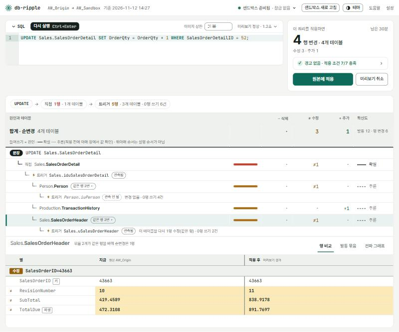

# db-ripple 웹 화면

Vue 3 + Vite + TypeScript + Pinia. 설계: [docs/architecture.md](../docs/architecture.md) §4 C1~C4, §6.3, D6. API 모양: [docs/week3-plan.md](../docs/week3-plan.md) §5. 화면 배치는 목업 [docs/mockups/r2/3-compare.html](../docs/mockups/r2/3-compare.html)을 바탕으로, 가운데 목록은 테이블 단위 원인 트리로 정했다(2026-11-18. 실제 사용자 테스트가 아니라 사용자 유형 3가지를 가정한 추정 평가와 반박 라운드로 골랐다).

## 설치와 실행

API 서버(`src/DbRipple.Host`, `http://127.0.0.1:5080`)를 먼저 켠다([루트 README](../README.md) 실행 방법). 그다음:

```powershell
cd web
npm install
npm run typecheck         # 타입 검사
npm run build             # 타입 검사 + 빌드(dist/)
npm run dev               # 개발 서버 http://localhost:5273
```

- 브라우저는 같은 출처의 `/api`만 부른다. Vite 개발 서버가 `/api`를 `http://127.0.0.1:5080`으로 넘기므로 CORS 설정이 없다(`vite.config.ts`).
- `/sp9`는 개발 서버에서만 열린다(운영 빌드에서 열려면 `VITE_ENABLE_SP9=true`).
- `package.json`의 버전은 모두 고정이다. 설치 때 존재하지 않는 버전이라는 오류가 나면 `npm view <패키지> versions`로 확인해 가까운 패치로 바꾼다.
- 글꼴은 npm 패키지로 함께 묶는다(실행 파일의 CSP `font-src 'self'`): 본문 Pretendard Variable(`pretendard`, OFL 1.1, 글자 범위별 조각만 받음), 코드 JetBrains Mono(`@fontsource/jetbrains-mono`).
- 색·움직임은 리디자인 시안([docs/mockups/r3/](../docs/mockups/r3/db-ripple-redesign.html))을 따른다: 빨강 = 삭제·파괴적 동작, 파랑 = FK 연쇄, 황색 = 트리거·추론, 초록 = 정상·통과. 토큰은 `src/styles/main.css` 한 곳에 있고, 움직임 줄이기(`prefers-reduced-motion`) 설정이면 움직임을 모두 끈다.
- 개발 서버에서 주소에 `?fixture=dm2`처럼 붙이면 서버 없이 실측 시험 데이터로 화면을 연다(`src/dev/`, 운영 빌드에서는 빠진다).

## 화면 구성(`/`)



| 영역 | 컴포넌트 | 내용 |
|---|---|---|
| 메뉴 줄 | `App.vue`, `SandboxBar` | 로고, 원본 → 샌드박스 DB, 기준 시각, 샌드박스 상태 한 줄(색 점 + 글씨, 정상이면 "· 잠금 없음". 지문 불일치·기준선 오래됨·원본 연결 안 됨·잠금·인스턴스 경고는 옆에 짧게 표시. 좁으면 DB 이름·기준 시각부터 말줄임), [샌드박스 새로 고침](오래됨·오염·오류면 주 단추), [테마]. 상태 글씨를 누르면 새로 고침 실패 이유(error일 때)·모드·기준 시각·환경 지문(차단·경고)·수집 범위·원본 연결·잠금. `SandboxBar`는 메뉴 줄의 `#menu-slot`으로 Teleport 한다(홈에서만) |
| C1 SQL 띠 | `SqlEditor`, `compare/PreviewInfo` | CodeMirror 6 MSSQL 방언(엔진이 PostgreSQL이면 PostgreSQL 방언, 기본 스키마 public). `/api/catalog/schema`로 스키마·열 자동완성(기준선 `baselineAt`별 캐시). 입력을 멈추면 `/api/analyze`로 분석해 거부·경고 위치를 줄 표시로 보인다. Ctrl+Enter = 미리보기. 오른쪽 "미리보기 정상 · n초 ▾"를 누르면 문장별 결과·수집 범위·미리보기 id·환경 지문·단계별 소요·결과 JSON 내보내기 |
| C4 적용 상자 | `ApplyPanel` | 오른쪽 위. "이 쿼리를 적용하면" 큰 합계 숫자(순변경, 새 미리보기마다 0부터 올라감, 섞이면 아래에 "수정 3 · 추가 1")와 남은 시간, 접이식 "경고 없음 · 적용 조건 n/n 충족"(status ok · 환경 지문 일치 · 30분 안 · SQL 불변 등, 꺼지면 이유를 모두 보인다. PostgreSQL에서는 [적용]을 지원하지 않는다는 한 줄로 꺼진다), [원본에 적용] [미리보기 취소] 한 줄. 누르면 네이티브 `<dialog>` 모달로 한 번 더 확인한다: 첫 줄 빨강 "원본에서 n행이 삭제됩니다.", 테이블별 건수, 원본 DB 이름 입력, 필요하면 약한 검증(KEYSET_HASH) 동의, 빨강 확정 단추. 적용 뒤에는 결과 한 줄과 [새 미리보기](새 기준선이 생긴 뒤 켜짐)·[샌드박스 새로 고침] |
| 전파 단계 칩 | `compare/FlowSteps` | 결과 맨 위. "DELETE → 직접 1행 → FK 연쇄 3행 → 트리거 쓰기 0행 변경 · 2건"처럼 원인 종류별 칩(빨강 직접 · 파랑 FK · 황색 트리거). 숫자는 발동 기준(묶음 rowCount 합)이라 같은 행을 여러 번 바꾸면 겹쳐 센다. 순변경 합계는 원인 트리 합계 줄 |
| 원인 트리 | `compare/TableTree`, `compare/PathLine`, `lib/compare.ts` | 테이블당 한 줄, 숫자는 순변경(열 합 = 맨 위 합계). 들여쓰기 = 원인(문장 → 직접·FK 연쇄·프로시저 쓰기 → 트리거 → 테이블). 테이블은 행을 바꾼 묶음 가운데 가장 얕은 깊이 자리에 두고(관측 순서에 기대지 않음), 같은 층은 이름순. 같은 행을 여러 묶음이 바꾸면 [같은 행 n번 ▸]으로 모든 경로를 펼친다. 선 모양 = 확신도, 관측 안 된 트리거는 흐린 줄, 0행 쓰기는 그 트리거 줄의 개수(E23). 이름 옆 행 수 막대(가장 큰 테이블 = 100%, 색은 첫 원인). 위아래 화살표·Enter로 고른다 |
| 행 비교 | `compare/RowCompare` | 고른 테이블의 최종 차이(net) 행을 서버 페이지로 읽어 "지금(원본) \| 적용 후"로 맞댄다. 수정 행은 키·바뀐 열부터, 추가·삭제 행은 없는 쪽을 빗금으로. "예상값"·"파생" 표시, 이미지에 없는 열은 "수집 안 됨"(NULL과 구분) |
| C3 발동 묶음 · C2 전파 그래프 | `DiffGrid`, `PropagationGraph`, `FlowNode`, `RippleEdge`, `GraphDrawer` | 아래 창 보조 탭. 발동 묶음: AG Grid, 발동 보기(event)·최종 차이 보기(net) 전환(E24), 묶음 선택 목록, 키 없는 테이블은 "제거된 행 n개, 추가된 행 m개"(E6). 전파 그래프: 노드 6종·간선 7종, dagre 왼쪽 → 오른쪽 배치, 선 모양 = 확신도, `observed:false`는 흐린 점선, 0행 묶음은 기본 숨김. 새 그래프는 문장 → 직접 → FK → 트리거 순으로 노드와 선이 나타나고, 추론 점선은 흐른다. 도구 막대는 줌 묶음 [맞춤 − n% ＋] · 0행 보기 · [표로 보기] · "읽는 법 ?" 팝오버(범례). 노드를 누르면 서랍 |
| 결과 자리 | `ApplyResultView` | 원본에서 실행을 시도한 적용(커밋·드리프트·불일치 롤백)은 트리 자리를 "미리보기 → 실제" 대조표로 바꾼다(IDENTITY 짝·비교 제외 열·KEYSET 한계·잔여 확인 실패). 선행 조건 실패·오류는 알림 칸에 두고 트리는 그대로 |

같은 사실은 한 곳에서만 말한다. 422 거부는 결과 자리의 거부 칸 하나(규칙 ID·위치·문장별 통과/거부, [n행으로 이동]), 409 BUILDING은 빈 결과 칸 하나다. 그 밖의 오류는 ProblemDetails를 `ProblemBanner`로 보인다: 409는 `reason` 5종(LOCKED·BUILDING·NO_BASELINE·FINGERPRINT_MISMATCH·DIRTY)별 문장과 [새로 고침] 단추를, 503은 연결 끊김 문장을. 결과 잘림·잔여 확인 실패·롤백 뒤 남은 변경·경고는 트리 위 알림 칸에 있을 때만 나온다.

## SP9 측정 화면(`/sp9`)

서버 없이 합성 데이터로 잰다. 그래프 노드 50·200·500개(배치+렌더), 그리드 1만·5만 행(첫 렌더, 끝까지 스크롤, 정렬). 값은 m5.csv의 브라우저 열에 수동으로 옮긴다(Q42). 같은 크기를 3회 이상 재서 중앙값을 쓴다.

## 구조

```
src/
  api/types.ts         week3-plan.md §5를 손으로 옮긴 타입(유일한 기준은 §5)
  api/client.ts        fetch 래퍼, ApiError, 오류 문장
  stores/              Pinia: sandbox(상태·스키마 캐시), preview(편집·분석·미리보기·적용, 고른 테이블·아래 창 보기)
  composables/         useRowPage(서버 페이지), useNow, useSplitter
  lib/                 순수 함수: compare(테이블별 집계·원인 트리·경로), summary, applyGate, graphModel·graphLayout·graphStyle, gridRows, editorSupport, format, sp9Data
  components/          위 표의 화면 조각. compare/ = 원인 트리·경로·행 비교·미리보기 상세
  views/               HomeView(/), SettingsView(/settings), Sp9View(/sp9)
  dev/                 개발 서버 전용 시험 데이터(?fixture=)
```
